# PROJECTE 2: Gestió de memòria d'un SO
«S'ha sintetitzat el contingut del document original per tal de centrar-se en els aspectes clau, havent depurat i omès qualsevol informació de caràcter personal.»

**Actualització important**

La nit del 28 al 29 de setembre em vaig deixar el disc a classe i l'endemà havia desaparegut. Es van perdre les captures de pantalla dels exercicis ja fets (de l'1 al 7). Per aquesta raó s'han generat de noves tot i que els números remarcats no coincideixin; s'especificaran novament per evitar començar el treball des de zero.

## Activitat 1. Fotografia inicial del sistema

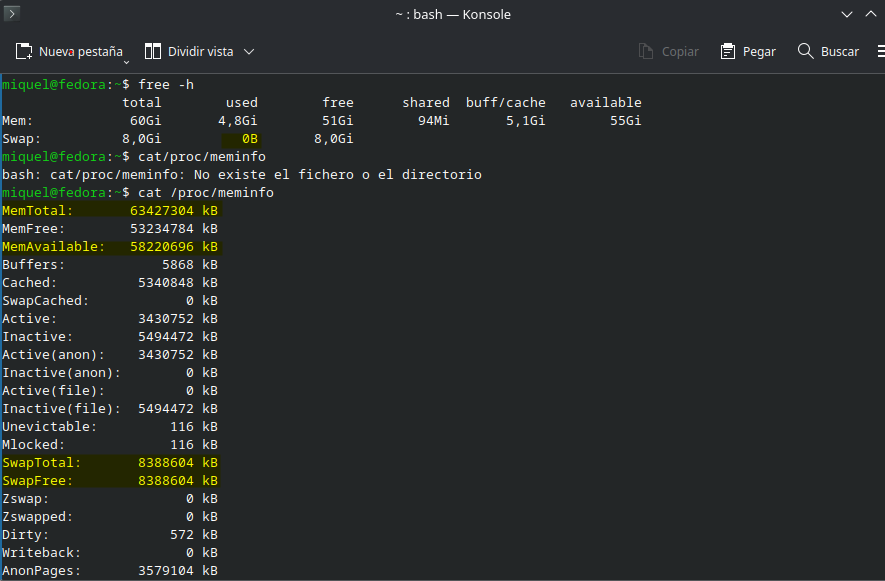

**A) Quanta RAM té el teu ordinador?**

Té 64.427.304 KB, aproximadament uns 64GB.

**B) Quanta memòria està disponible?**

Té 58.442.940 KB, aproximadament uns 58GB.

**C) El teu ordinador utilitza swap?**

No necessita utilitzar swap, ja que encara presenta molta memòria disponible. No hi ha diferència entre _SwapTotal_ i _SwapFree_, per tant, no n'està utilitzant.

**D) Quina diferència hi ha entre RAM i swap?**

La memòria RAM és la memòria física principal de l'ordinador. La memòria SWAP és la memòria virtual del disc que queda reservada per utilitzar temporalment en cas que la memòria RAM estigui plena. D'aquesta manera s'evitarien tancaments forçats de programes i processos.

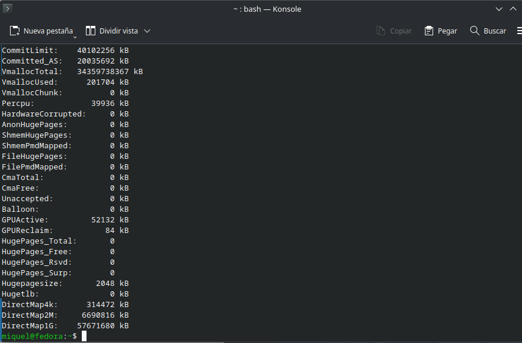

## Activitat 2. Quins programes utilitzen la memòria?

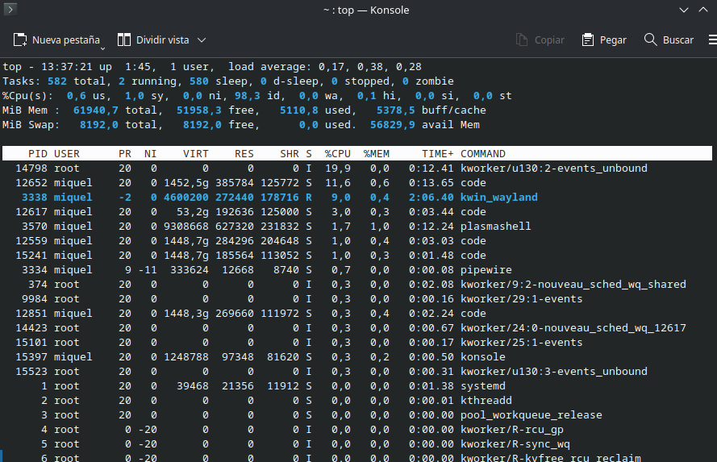

He esperat, ja que anaven alternant, que aparegués el navegador Firefox perquè era el que més consumia, tot i tenir només la pestanya del moodle oberta. S'ha afegit un procés més a la llista perquè els últims tres coincidien en espai de memòria utilitzada. Les variables de la taula són²:
* %MEM - És la memòria RES dividida per la memòria física total.
* RES  - Qualsevol cosa que estigui ocupant memòria física.
* VIRT - Tot el que s'està utilitzant i/o reservat.

| **Procés** | **PID** | **%MEM** | **RES** | **VIRT** |
| :---: | :---: | :---: | :---: | :---: |
| 1 | 4734 | 1'0 | 634.740KB (0'63GB) | 4.047.980KB (4'05GB) |
| 2 | 3699 | 0'9 | 598.816KB (0'59GB) | 6.631.348KB (6'63GB) |
| 3 | 9867 | 0'6 | 402.724KB (0'40GB) | 2.108.988KB (2'11GB) |
| 4 | 3490 | 0'4 | 259.388KB (0'26GB) | 4.226.448KB (4'23GB) |
| 5 | 7638 | 0'4 | 259.540KB (0'26GB) | 3.088.616KB (3'09GB) |
| 6 | 4904 | 0'4 | 264.032KB (0'26GB) | 3.037.384KB (3'08GB) |

* Procés 1: **firefox** - Pertany al navegador web Mozilla Firefox. És el procés principal que s'encarrega de gestionar i coordinar el propi navegador i derivats.
* Procés 2: **plasmashell** - És la interfície de l'escriptori de l'usuari. És el procés que s'encarrega d'executar la interfície gràfica principal com la barra de tasques, menú...
* Procés 3: **soffice.bin** - S'encarrega d'executar qualsevol arxiu obert per l'aplicació _LibreOffice_.
* Procés 4: **kwin_wayland** - S'executa també a través de la interfície de l'escriptori però aquest s'encarrega de la gestió i composició de les finestres, l'E/S (Entrades/Sortides) de ratolí i teclat,...
* Procés 5: **Isolated Web Co** - Procés fill de Firefox que s'encarrega de separar les pàgines web que es van obrint per evitar que si una es bloqueja, també ho faci tot el navegador.
* Procés 6: **Privileged Cont** - Procés fill de Firefox que s'encarrega de la seguretat; executar amb privilegis components intern del navegador.

## Activitat 3. Què passa quan obrim programes?

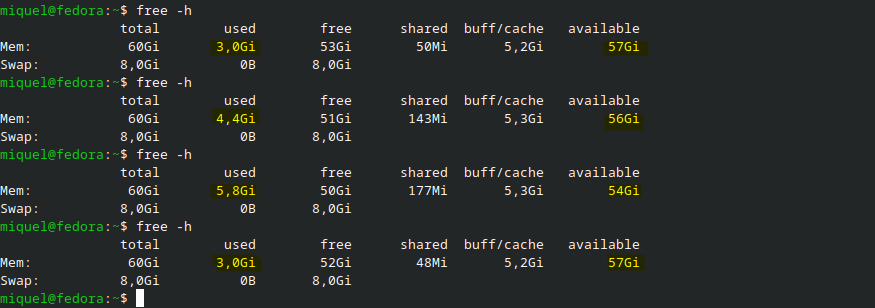

| **Situació** | **Memòria disponible** | **Memòria utilitzada** |
| :---: | :---: | :---: |
| Abans d'obrir programes | 57GB | 2'8GB |
| Navegador obert | 56GB | 4'4GB |
| Navegador + Writer | 53GB | 7GB |
| Programes tancats | 57GB | 2'9GB |

1. Només s'ha obert la terminal.
2. S'han obert tres pestanyes del navegador Firefox.
3. S'han obert el programa LibreOffice Writer i Visual Studio Code.
4. S'ha tancat tot menys la terminal.

**A) Què ha canviat?**

Tant la memòria disponible com la utilitzada han canviat a mesura que s'obrien i es tancaven programes. Si la memòria utilitzada augmentava, la disponible disminuïa i al revés (relació inversament proporcional).

**B) La memòria ha tornat exactament al mateix valor?**

La memòria disponible sí; la memòria utilitzada no, ha variat en 0'1GB.

**C) Per què creus que passa?**

Això passa perquè la memòria disponible és exactament igual al començar aquesta part de l'activitat. En canvi, la utilitzada s'ha vist alterada per la generació de nova informació a la _caché_ temporal, memòria cau, (en aquests 0'1GB) preparada per si s'haguessin de tornar a obrir aviat.

## Activitat 4. Investiguem un procés

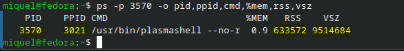

**A) Quin procés has escollit?**

He escollit el procés _plasmashell_ pel seu nom. Abans de continuar s'ha fet la comanda _top_ per veure el PID (ha canviat al tornar a utilitzar la terminal).

**B) Quin PID té?** 

Té el PID número 3302.

**C) Quin PPID té?**

Té el número 2763 com a PPID.

**D) Quanta memòria resident utilitza?**

RSS³ = memòria del conjunt resident. És la memòria física no intercanviada que ha utilitzat una tasca.

És la referenciada amb 597.344KB, uns 0'60GB.

**E) Quina memòria virtual té?**

VSZ³ = memòria virtual del procés. Els mapatges estan actualment exclosos (2025-03-13).

És la referenciada amb 8.486.928KB, uns 8'49GB.

**F) Quina informació proporciona pmap?**

Proporciona informació sobre el mapa de memòria d'un procés; és a dir, detalla l'assignació d'adreces de memòria⁴.

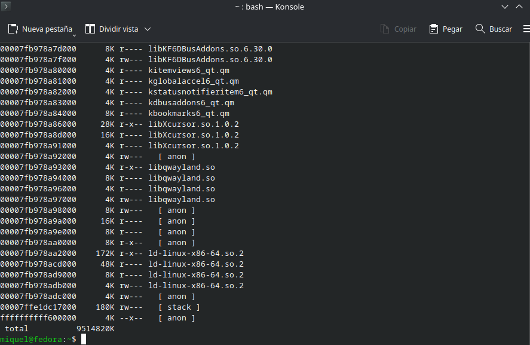

## Activitat 5. Paginació

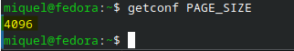

**A) Quina mida té una pàgina de memòria en el teu sistema?**

Presenta una mida de 4.096 bytes.

**B) Què és una pàgina?**

És l'unitat de mesura més petita (bloc de mida fixa) que utilitza la memòria virtual per intercambiar informació.

**C) Per què els sistemes operatius divideixen la memòria en pàgines?**

Perquè d'aquesta manera es pot evitar la fragmentació externa i poder emmagatzemar la informació de manera saltejada (barrejada).

**D) Quina relació hi ha entre les pàgines i la memòria virtual?**

La memòria virtual _dividida en pàgines_ es posa en contacte amb la memòria física _dividida en marcs de pàgina_ per tal de traduir les adreces virtuals a físiques.

**E) Calcula aproximadament quantes pàgines necessita el programa utilitzant la mida de pàgina del teu sistema (suposa que un programa necessita **1MB de memòria**. Mostra els càlculs.**

1MB = 1.000.000 B

1.000.000 B / 4096 = 244'14 pàgines

Per tant, necessita de 245 pàgines tot i que la última no l'utilitzi sencera.

## Activitat 6. Memòria virtual

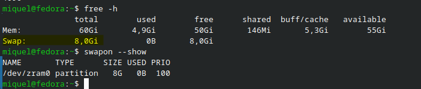

**A) El teu sistema disposa de swap?**

Sí.

**B) Quina capacitat té?**

Té una capacitat de 8GB.

**C) Quina diferència hi ha entre RAM i swap?**

A l'activitat 1.D s'ha fet la mateixa pregunta: La memòria RAM és la memòria física principal de l'ordinador. La memòria SWAP és la memòria virtual del disc que queda reservada per utilitzar temporalment en cas que la memòria RAM estigui plena. D'aquesta manera s'evitarien tancaments forçats de programes i processos.

**D) Per què un sistema operatiu pot utilitzar la memòria virtual?**
Per poder utilitzar programes que necessiten més memòria de la que té la RAM física. D'aquesta manera s'eviten tancaments forçats i proporcionen protecció entre els processos⁶.

## Activitat 7. Abans i després

El programa escollit ha sigut _Visual Studio Code_, per ser el més utilitzat des de que va començar el curs. Seqüència:
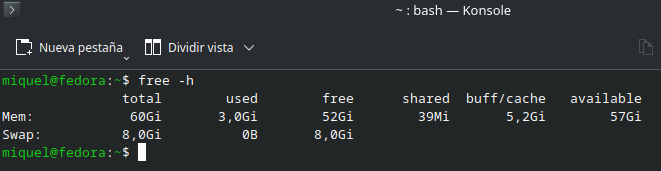
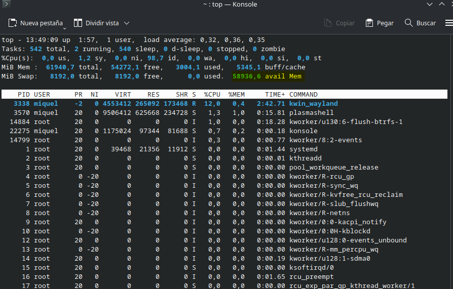
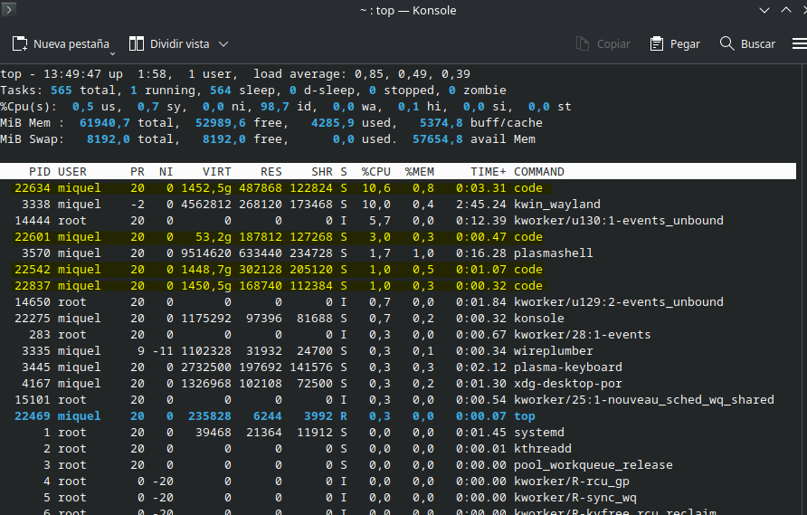
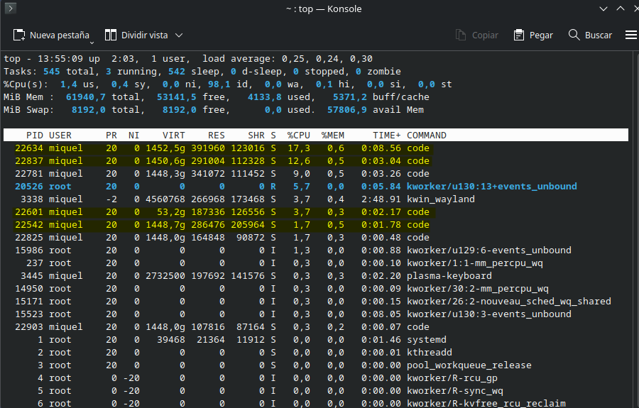
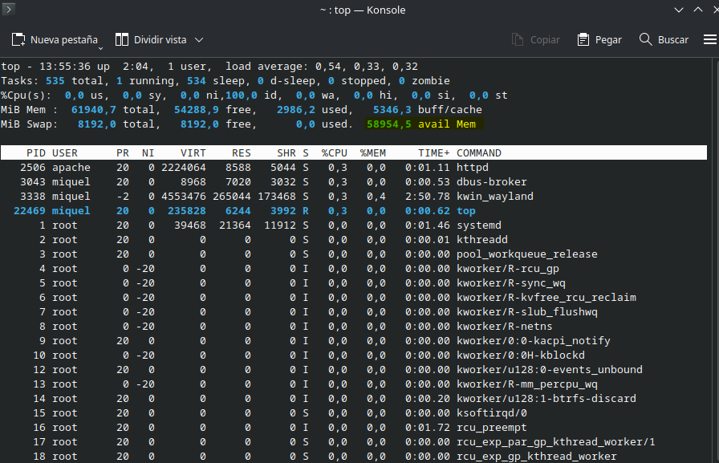

**Omple la següent taula:**
| **Moment** | **Memòria disponible** | **Memòria del programa** |
| :---: | :---: | :---: |
| Abans d'obrir-lo (13:33:33) | 58.710'8MB | 0MB |
| Just després d'obrir-lo (13:34:18) | 56.826'9MB | 72.263KB |
| Després de 5 minuts (13:39:19) | 57.135'2MB | 457.792KB |
| Després de tancar-lo (13:39:43)| 58.589MB | 0MB |

**Explica:**

**A) Què ha passat amb la memòria durant l'experiment?**

Durant l'experiment s'ha pogut comprovar el funcionament de la memòria amb el programa Visual Studio Code. En les imatges es pot comprovar tots els processos que apareixen abans i després dels cinc minuts. Tot i això s'ha utilitzat només el primer, amb el **PID 29406**, ja que apareix en primera posició en les dues imatges. Abans d'obrir el programa no ocupava cap classe de memòria perquè no era necessari. Tan bon punt s'ha obert el programa, la memòria disponible ha disminuït per poder-li assignar memòria RAM als processos necessaris. Després d'utilitzar-lo durant cinc minuts, la memòria RES ha anat disminuint per tal d'assignar els nous valors introduïts. S'ha d'especificar que aquests han anat variant segons l'ús intensiu o no de la utilització del mateix programa. En tancar el programa, els processos finalitzen i la memòria torna a estar disponible (allibera espai) pel següent procés necessari. No tota perquè hi ha una petita secció, com hem vist en l'activitat 3.C, que va directa a la memòria cau (_caché_).

## Activitat 8. Particions, segmentació i paginació

**A) Particions: Què significa dividir la memòria en particions?**

La partició divideix en blocs per poder ocupar tot un procés en el mateix lloc i no haver-lo de dividir (es guarden de manera contigua).

**B) Segmentació: Què significa dividir l'espai d'adreces en segments?**

La segmentació divideix en fragments de diferents mides per adaptar-se amb molta precisió a la informació que necessita ser emmagatzemada.

**C) Paginació: Què significa dividir la memòria en pàgines?**

La paginació divideix tot l'espai disponible en una mateixa mida (la més petita) per anar-li assignant la informació pertinent encara que l'hagi de dividir.

**D) Comparació: completa la següent taula** (no copiïs una taula d'internet).
| **Tècnica** | **Com divideix la memòria?** | **Avantatge** | **Inconvenient** |
| :---: | :---: | :---: | :---: |
| Particions | En blocs (mateix tamany o diferent) | Ràpida gestió de la informació | Espai lliure entre processos (interna quan és fixa o externa quan és variable) |
| Segmentació | Fragments de diferents tamanys | S'adapta a la informació del programa/procés | Espai lliure entre processos (externa) |
| Paginació | Mateix tamany (més petit) | Evita l'espai lliure extern | Espai lliure entre processos (interna) |

## Activitat 9. Investigació final

**Nom del procés:**

El nom escollit a l'atzar és Wireplumer.

**PID:**

El PID és 2708.

**PPID:**

El PPID és 2398.

| **Dada** | **Valor** | **Què significa?** |
| :---: | :---: | :---: |
| Particions | N'hi ha de fixes i de variades | La comanda _cat /proc/PID/status_ mostra l'estat d'un procés en concret, així que no es pot visualitzar cap partició |
| Segmentació | VmExe = 8KB; VmStk = 132KB; VmData = 113.796KB; VmLib = 24.628KB | Fan referència a la memòria resident, a les dades, les piles i les llibreries; formats que utilitzen la segmentació per adaptar la informació a la memòria |
| Paginació | VmRSS = 31.584KB | En canvi, la virtual fa servir la paginació (format més petit) |

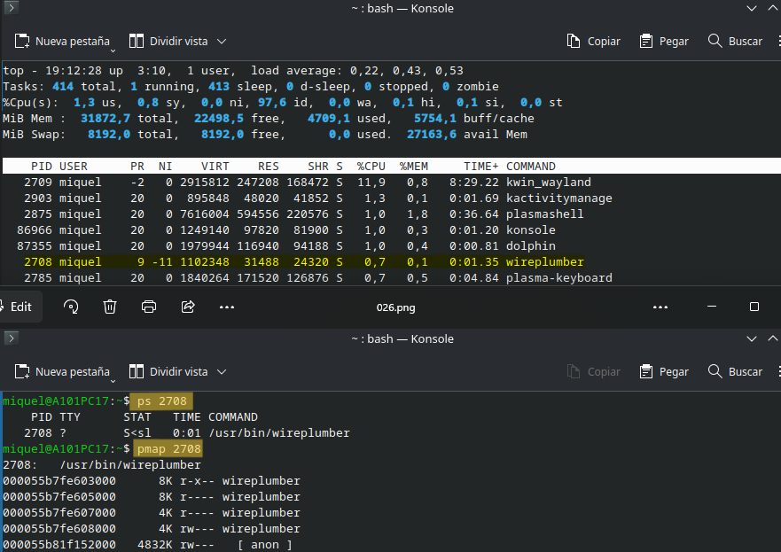
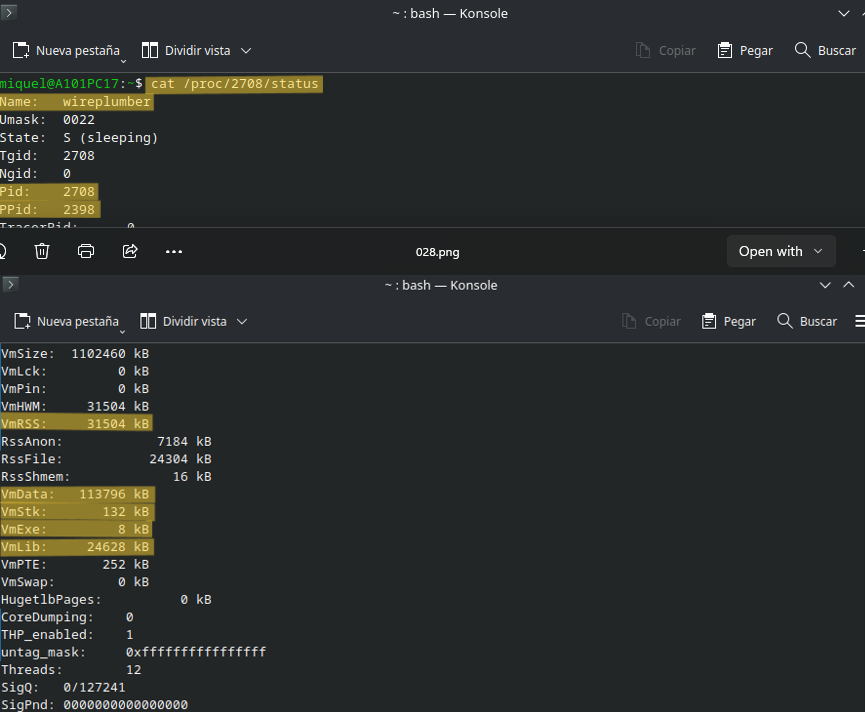

## Activitat 10. Conclusions
S'ha utilitzat l'ordinador personal de casa (es va comprar fa poc) per pura curiositat a l'hora de fer les proves; d'aquesta manera les activitats m'ajudarien a entendre millor una eina que faig servir diàriament. L'únic inconvenient va ser perdre el disc dur. Independentment d'un o altre, el sistema Linux gestiona la memòria amb la següent classificació (Linux memory types):

* "Abstracte: llibre d'adreces i límits de la memòria física". Fa referència a la memòria virtual, on cada procés té la seva pròpia referència individual.
* "Aïllada: cada procés en un espai de direccions independent". Fa referència al fet que cada procés no pot sobreescriure informació en una pàgina/bloc/segment (depenent de com estiguin distribuïts).
* "Compartició: una única assignació pot satisfer múltiples necessitats". Tinc dubtes amb aquesta, però crec que fa referència a les assignacions diferents que presenten la memòria virtual i la física a una mateixa informació.
* "Flexible: assignació d'una adreça virtual a un arxiu". Fa referència al _pmap_ on cada procés mostra la seva base (mapa) d'adreces.

Tenint present la diferència principal entre "kibi" i "kilo", els programes que més consumeixen de la memòria en aquest projecte han sigut el Visual Studio Code i el Firefox, ja que són els dos que més utilitzo des que va començar el grau superior; els dos que més memòria han anat acumulant i que cada un gestiona internament altres processos necessaris per a la seva utilització fiable i segura. Obrir aquestes aplicacions assigna memòria a la RAM, on es veu un increment en la memòria feta servir, per executar les dades necessàries. I passa exactament el mateix quan les tanques, recuperant gairebé tota la memòria inicial, recordant que una petita part queda en la memòria cau per si en un futur immediat es volgués tornar a fer servir aquell programa/procés.

La memòria virtual fa la funció de "caixa" extra per si en algun moment la memòria física es quedés sense espai. Els processos creuen que tenen més memòria de la que hi ha, i si en algun moment aquesta acabés plena entraria en funcionament el _swap_, memòria física però del disc dur (no de la RAM). Aquesta memòria virtual es divideix en pàgines, la mesura més petita possible, de 4096B, per a un control de la informació més precisa i organitzada (tot i que no contigua). A part de la pàgina, les dades també es poden dividir en segments o particions. El primer adapta l'espai a la informació que es vol emmagatzemar. El segon crea una unitat independent en la mateixa memòria. Tres formes diferents d'emmagatzemar la informació; a risc cada un de la fragmentació interna o externa (deixar espai dins o entre processos).

Curiosament, la que m'ha resultat més interessant han sigut les dues últimes on havies d'entendre bé la diferència entre les diferents divisions de la informació. Són conceptes que sempre havia sentit o llegit més d'una vegada, però fins ara no m'havia parat mai a buscar informació sobre com gestionen realment les dades.