# PROJECTE 1: Gestió de processos d’un sistema operatiu
«S'ha sintetitzat el contingut del document original per tal de centrar-se en els aspectes clau, havent depurat i omès qualsevol informació de caràcter personal.»

## Activitat 1. Quins processos s'estan executant?
**A) Què és un procés?**

Un procès es un programa que fa una determinada tasca dins el sistema operatiu (i aquets solen carregar-se per prioritat).

**B) Quina informació apareix sobre cada procés?**

Depenent de les opciones utilitzades, sol aparèixer la següent informació [extreta d'aquí](https://docs.oracle.com/cd/E19504-01/802-5750/6i9g464so/index.html):

    * Current status of the process (estat actual del procés)
    * Process ID (identificador del procés - PID)
    * Parent process ID (identificador del procés pare - PPID)
    * User ID (identificar de l'usuari - UID)
    * Scheduling class (classe de planificació)
    * Priority (prioritat)
    * Address of the process (Adreça de memòria del procés)
    * Memory used (memòria utilitzada)
    * CPU time used (temps de CPU utilitzada)

**C) Què és el PID?**

És un identificador únic (_Process ID_) que el nucli li assigna a cada procés per distingir-lo de la resta.

**D) Escull dos processos de la llista i indica el seu PID i el programa que executen.**

Escollim dos processos a l'atzar (s'ha buscat al navegador què eran cada un):

* **Nº7: kworker/R-slub_flushwq** - Aquest procés s'encarrega de gestionar en segon pla el sistema de memòria.
* **Nº21- idle:inject/0** - Aquest procés s'encarrega de forzar un estat d'inactivitat en el primer nucli de la CPU per evitar el sobrecalantament.

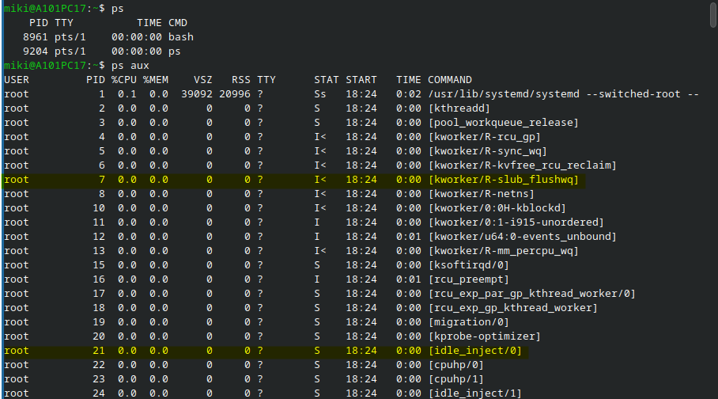

## Activitat 2. Crear un procés

**0. Problemes inicials**

Em donava error la segona comanda, al no adonar-me que estava executant les paraules separades per un espai (_error: improper list_) així que he buscat informació a través del _ps -- help_.
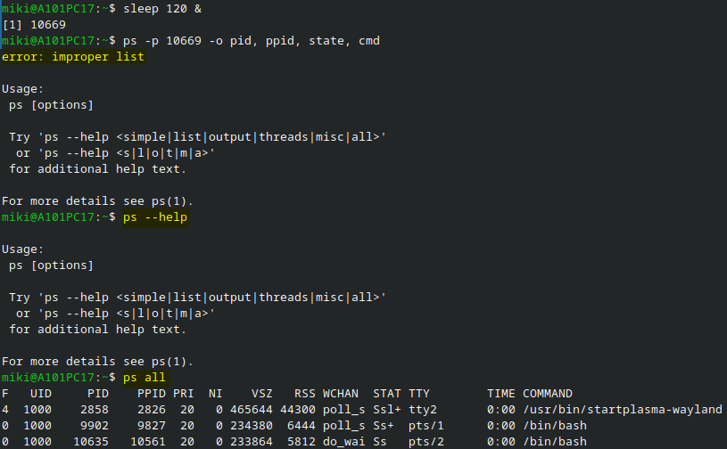 Així he descobert que podies obtenir la llista sencera de tots els elements del procés. I s'ha fet una prova amb PID de la mateixa llista. 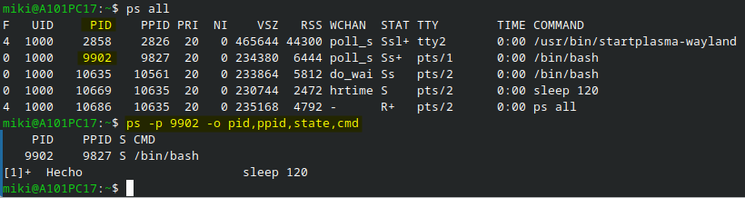

Al descobrir els errors d'espais, s'ha seguit el guió inicial (veure imatge "a1-bloc2-projecte1-004").

**A) Quin PID té el procés?**
Retorna el procés número 11.322.

**B) Quin PPID té?**
El seu PID pare és el número 10.635.

**C) Quin estat presenta?**
S, que significa que està en pausa o esperant a que el sistema digui lo contrari.

**D) Quin programa està executant?**
Sleep

**E) Per què el procés continua apareixent si nosaltres no estem fent res?**
Per la comanda 120 de l'sleep. 

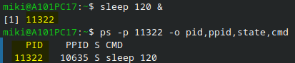 

## Activitat 3. Observar un procés

>[Note] Degut a un error de tancament de la terminal, s'ha fet directament al obrir una altre la comanda _sleep 120 &_, després el _top_ i m'ha sortit el següent ___PID:11789___.

**A) El procés està utilitzant molta CPU?**

No n'està utilitzant cap "_0'0_".

**B) Quanta memòria utilitza aproximadament?**

Tampoc n'està utilitzant cap "_0'0_".

**C) Quin estat apareix?**

Apareix l'estat _S_ (Sleep; en pausa).

**D) Què creus que està fent el procés en aquest moment?**

No està fent res a l'espera de que acabi la primera comanda de 120 segons per finalitzar automàticament.

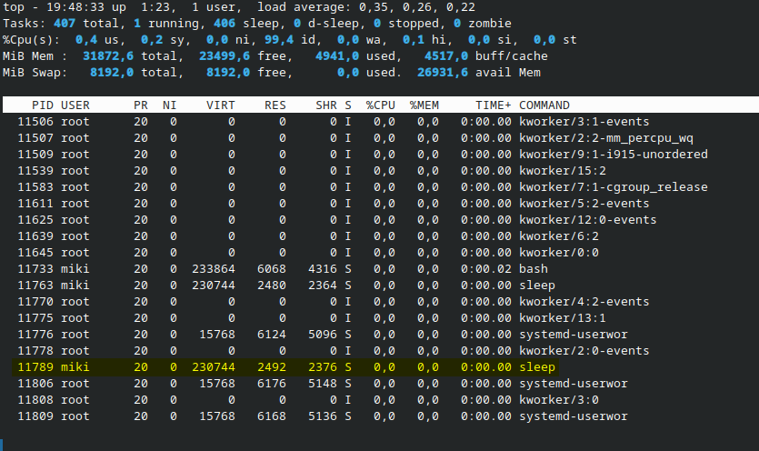

## Activitat 4. Procés que utilitza la CPU

**A) Què ha passat amb el consum de CPU?**

S'ha disparat al _"99'8_".

**B) Per què aquest procés consumeix CPU?**

La càrrega de la CPU es possa a treballar al 100% perquè la paraula _yes_ imprimeix una cadena repetidament fins que se li fa un "kill" al procés en qüestió. Informació [extreta d'aquí.](https://h4ckseed.wordpress.com/2021/08/12/como-hacer-una-prueba-de-stress-en-gnu-linux/)

**C) Compara'l amb el procés _sleep_.**

El primer procés, _yes > /dev/null &_, utilitza un bucle infinit per fer una prova d'estrés a la CPU, arribant aquesta pràcticament al 100%. El segon, _sleep_, està en repòs sense malgastar cap tipus de recurs, sense superar el 0%.

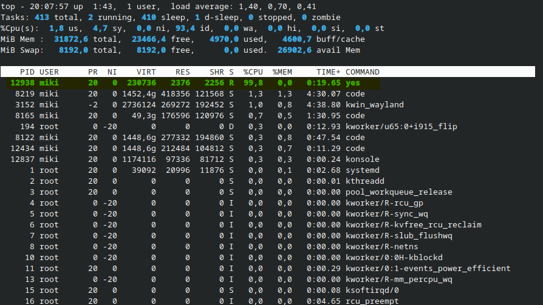

## Activitat 5. Crear i finalitzar un procés

**A) Què ha passat després d'executar "kill"?**
Has obligat al procés a finalitzar-se.

**B) Per què el procés ja no apareix?**
Perquè al finalitzar, deixa lliure la part de la memòria que estava utilitzant.

**C) Què significa que un procés estigui finalitzat?**
Que ja no es consumeixen ni recursos ni espais per a ell ja que ha complert (en principi) la seva finalitat.

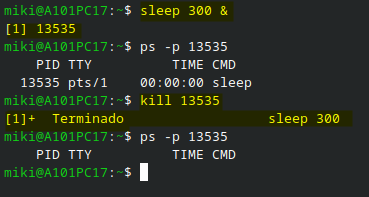

## Activitat 6. Procés pare i procés fill

**A) Quin és el PID del bash?**

El seu PID és el número 7401.

**B) Quin és el PID del sleep?**

El seu PID és el número 7402.

**C) Quin és el PPID del sleep?**

El PPID del sleep és el 7401.

**D) Quin procés és el pare?**

El procés pare és el primer comandament que hem fet, el Bash.

**E) Quin procés és el fill?**

El procés fill és el segon comandament que hem realitzat, el sleep.

**F) Fes un petit esquema utilitzant els PID reals que has obtingut**

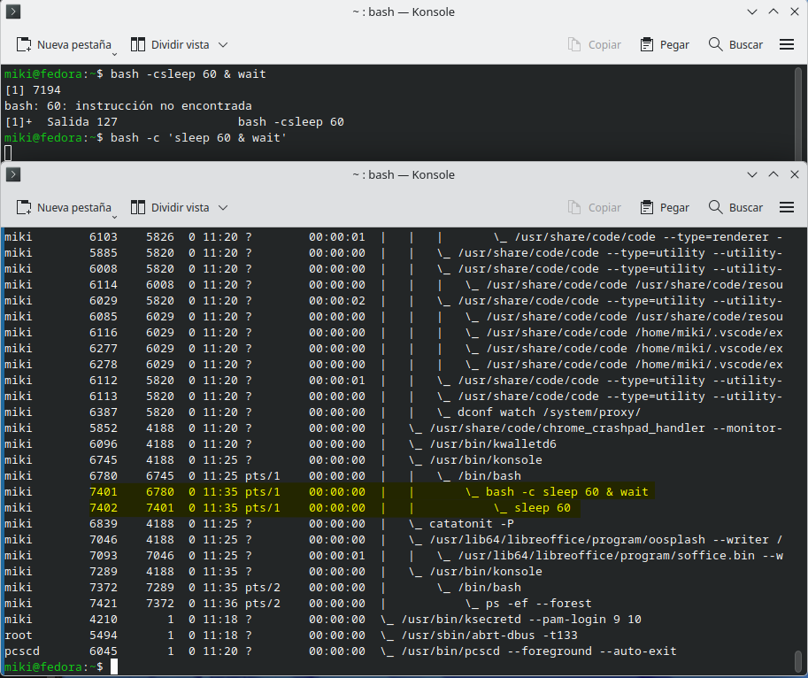

## Activitat 7. Execució concurrent

**A) Quants processos sleep hi ha?**

Apareixen els tres processos que hem creat de sleep.

**B) S'estan executant al mateix temps?**

Sí

**C) Què significa que els processos s'executin de manera continuada?**

Tal com la paraula indica, s'executen sense pauses ni interrupcions fins que aquest finalitza o és interrumput manualment.

**D) Els tres processos tenen el mateix PID?**

No tenen el mateix PID ja que són tres processos independents.

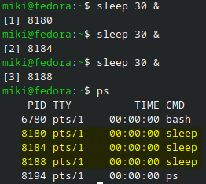

## Activitat 8. Planificació
Els tres PID's assignats per _yes > /dev/null &_ han sigut 5272, 5276 i 5280.

**A) Els tres processos reben temps de CPU?**

Sí que reben temps els tres processos.

**B) Tots consumeixen exactament el mateix percentatge de CPU?**

No. Cada un porta al límit la CPU que té designada.

**C) Per què el sistema operatiu ha de decidir quin procés utilitza la CPU?**

Perquè aquesta s'encarrega de planificar quins processos s'executen i en quina prioritat.

**D) Què és la planificació de processos?**

És la capacitat que té la CPU per determinar per prioritat quins són els processos que ha d'executar, pausar o finaltizar.

**E) Quin procés és el fill?**

Cap dels tres és fill dels altres dos, ja que estan executats des del mateix nivell independent.

**F) Fes un petit esquema utilitzant els PID reals que has obtingut**
```
Comanda yes > /dev/null &
    \_ 5272
    \_ 5276
    \_ 5280
```

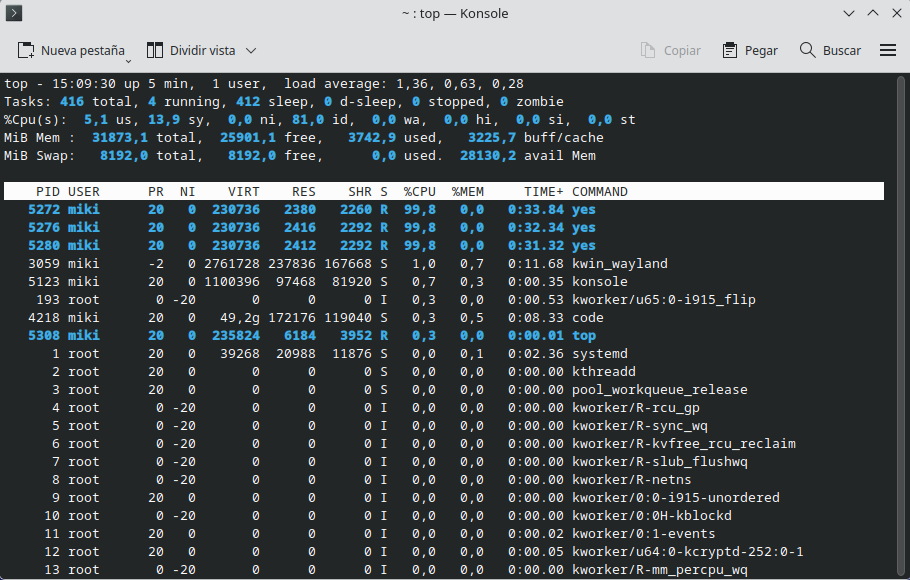

## Activitat 9. Sincronització

**A) Quantes línies esperaves trobar?**

Dos-centes línies.

**B) Quantes línies hi ha realment?**

Apareixen les dos-centes línies.

**C) Apareixen les A i les B agrupades o barrejades?**

Barrejades.

**D) Per què dos processos poden interferir quan treballen sobre un mateix recurs?**

Perquè no estan treballant a la vegada. Primer ho fa un, després l'altre; per això les lletres apareixen intercalades.

**E) Què és la sincronització de processos?**

És la manera de que poder executar diferents processos de manera que no es creuin entre elles. Per exemple, que el procés pare no continuï si s'està executant el procés fill.

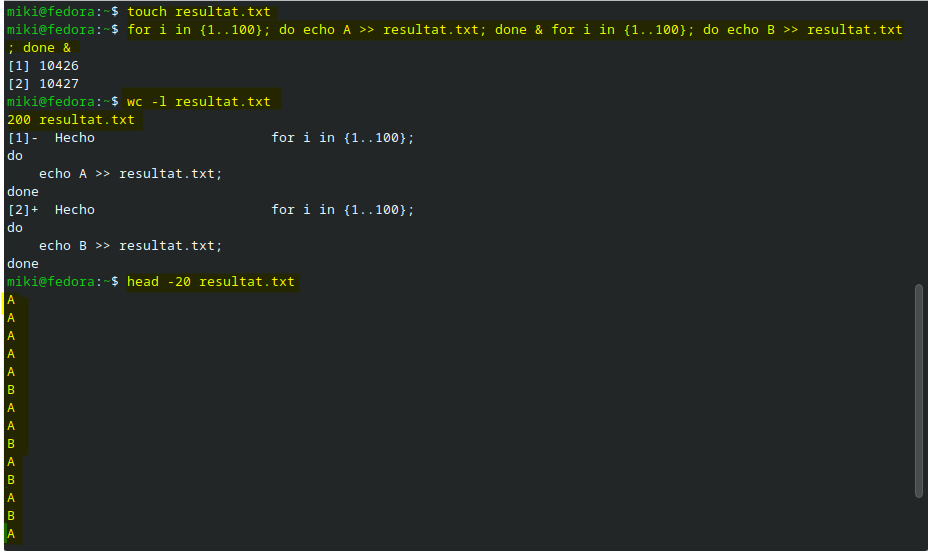

## Activitat 10. Diagrama final
S'ha utilitzat el mermaid per crear la taula per fer el diagrama.

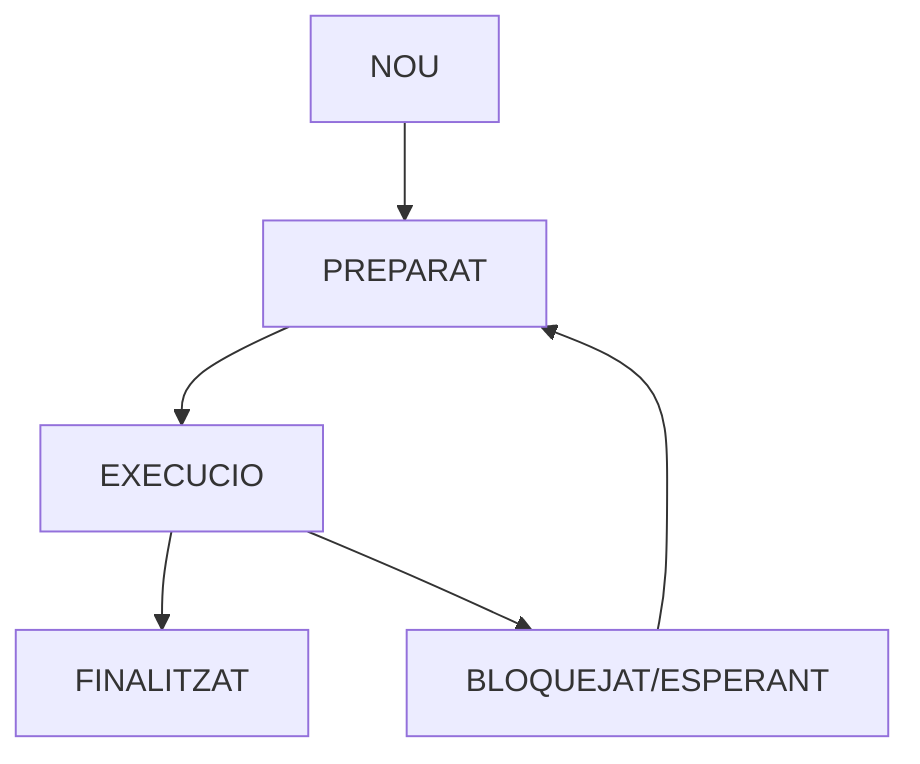
1. NOU: es crea un nou procés a la memòria; creació d'una nova comanda com _yes > /dev/null &_ o _sleep 30 &_
2. PREPARAT: li assigna un temps per a la seva execució; en aquest cas és indefinit perquè se li ha assignat amb un _&_ en els dos casos.
3. EXECUCIÓ: el procés es posa en marxa. El primer cas, es troba en execució fins que se li digui lo contrari; en el segon, passa está el procés en bloquejat/esperant. Si hi hagués un procés para/fill, el pare quedaria bloquejat fins que el fill hagués fet tot el seu procés i finalitzat, i només llavors continuaria.
4. BLOQUEJAT/ESPERANT: El segon procés queda en pausa fins que passin els 30 segons. Es llavors quan torna a preparat per determinar què fer a continuació. El procés pare tornaria a preparat quan el fill hagués finalitzat.
5. FINALITZAT: El primer procés queda finalitzat de manera normal, quan se li indica expressament o ha sigut forçada per un un error. El segon, finalitza per si sol després de tornar a preparat ja que no ha rebut cap nova ordre i la seva ja s'ha establit.

## Conclusions
Un procès es un programa que fa una determinada tasca dins el sistema operatiu, ocupant memòria i temps (només quan s'estigui executant) fins que aquest ha finalitzat. Cada un d'ells executa la seva propia funció, queda a l'espera d'altres processos necessaris per a la seva continuïtat o finalitza alliberant memòria si aquest ja ha complert la seva funció. Cada procés presenta diferents paràmatres, un dels quals es el PID, número identificador (_Process ID_) que li assigna la CPU per fer el seguiment del mateix. Un procès es pot trobar en diferents estats des del moment que ha sigut creat fins que aquest finalitza de manera normal o forzadament. El primer d'ells es la creació (NOU) del propi procès a la memòria, amb la seva propia assignació numèrica. Se li assigna un temps d'execució (PREPARAT) i quan li toca el torn treballa en la feina que se li hagi assignat (EXECUCIÓ). Si aquest ja no té res més a fer en el temps que se li ha assignat (FINALITZAT) desapareix alliberant espai. En canvi si no ha acabat (BLOQUEJAT/ESPERANT) o necessàriament necesita una resposta (com E/S) es queda pausat fins que la resposta arriba o ha "preparat" se li torna a assigna un nou temps.

El SO necessita planificar es processos perquè hi ha una quantitat de milions de procesos diferents i la capacitat del format físic que les executa és limitada; depenent de la generació que s'utilitzi menys o més. Tot i així aquesta limitació és la que obliga a la CPU a treballar els diferents processos de manera concurrentment. L'usuari final no nota la diferència perque la majoria de processos duren milisegons o menys, pero es aquesta manera de treballar la que dona la percepció de que els processos treballen tots de manera contianuada, quan són interrumputs entre ells per guanyar temps d'execució. Es imprescindible que hi hagi una sincronització entre tots els processos que s'estan executant o estan a la cua perquè no hi hagi errors en el funcionament del SO; ja que molts (procés pare) necessiten esperar obligatòriament que altres (procés fill) li entregui les dades que necessita per continuar.