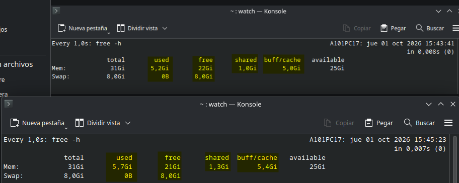
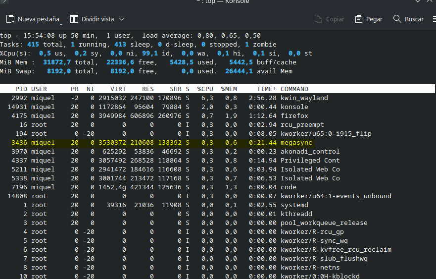
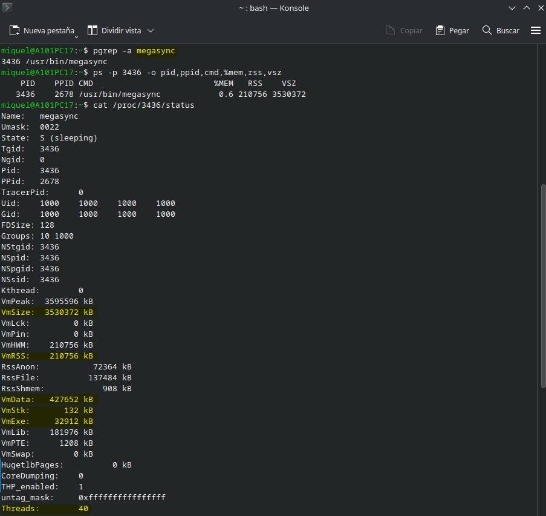
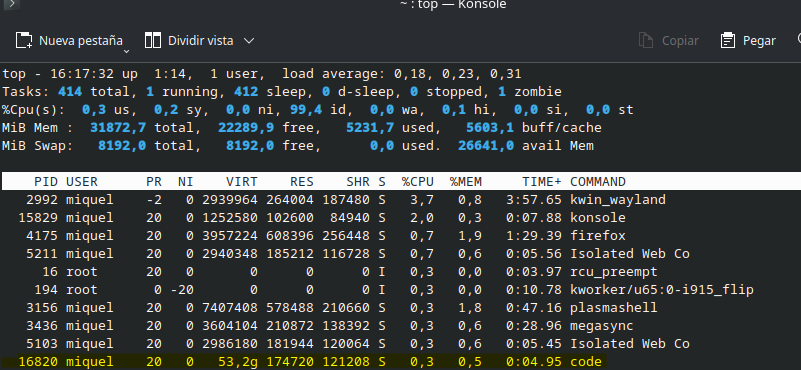
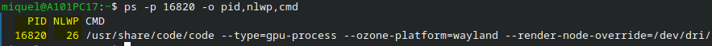
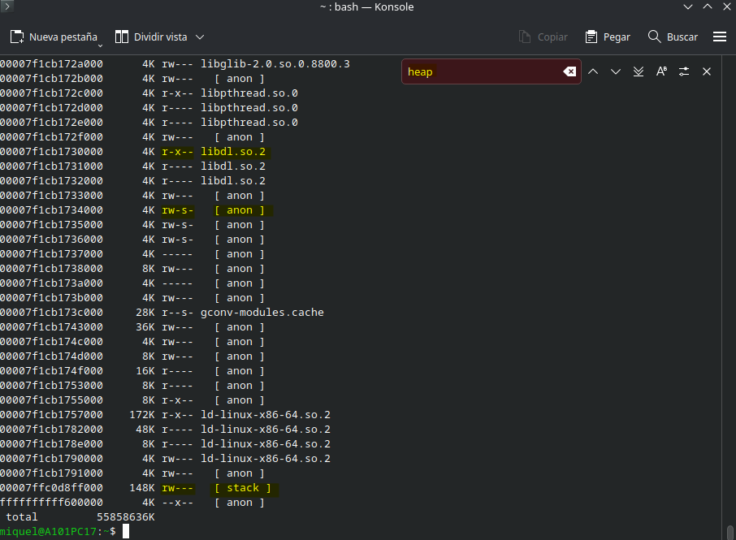

# Activitat d'ampliació - Memòria sota pressió
«S'ha sintetitzat el contingut del document original per tal de centrar-se en els aspectes clau, havent depurat i omès qualsevol informació de caràcter personal.»

## Activitat 1. Observem la memòria en temps real

**A) Què passa amb la memòria disponible?**

La memòria disponible va disminuint a mesura que els diferents programes van ocupant l'espai. Tot i que en la imatge no s'aprecia (no varia), ja que s'han obert pocs programes.

**B) Què passa amb la memòria utilitzada?**

La memòria feta servir va augmentant a mesura que es fa servir l'espai disponible pels diferents programes; passant de 5'26G a 5'7G.

**C) La variació és immediata?**

La variació és immediata perquè en el moment en què s'obren els diferents programes, aquests processos són assignats als espais corresponents pel SO a la memòria principal.

**D) Què passa quan tanques les aplicacions?**

La memòria utilitzada deixa d'estar ocupada (recordem, menys la memòria cau) i allibera aquest espai a l'acabar els processos pertinents.

**E) La memòria disponible torna exactament al valor inicial?**

No torna exactament al mateix valor perquè una petita part es dirigeix directament a la memòria cau, per si en un futur immediat es volgués tornar a obrir algun programa anterior.

## Activitat 2. Investiguem la memòria d'un procés

**Completa la taula**

| **Dada** | **Valor** | **Què significa** |
| :--: | :--: | :--: |
| VmSize | 3.530.372KB | És la mida total que presenta la memòria virtual  |
| VmRSS | 210.756KB | És la memòria resident; la que s'utilitza en aquests instants de la física |
| VmData | 427.652KB | És la mida de les dades que s'utilitzen |
| VmStk | 132KB | És la mida que es fa servir per a les piles (stack) |
| VmExe | 32.912KB | És la memòria reservada pels processos executables |
| Threads | 40 | És el nombre de fils que s'utilitzen en aquests instants |

## Activitat 3. RSS i VSZ: són el mateix?

**RSS (Resident Set Size)** i **VSZ (Virtual Size)**

La memòria resident és la que et diu exactament quanta memòria física hi ha (que el procés utilitza). En canvi, la memòria virtual és l'espai que se li ha assignat a un procés.

**Si un procés té un VSZ molt superior al seu RSS, què ens indica això?**

Ens indica que la memòria virtual ha reservat una capacitat superior al procés que la física. Això és habitual en tots els processos perquè aquests puguin executar-se amb fluïdesa; i si en algun moment necessiten realment aquesta capacitat física extra entraria en funcionament la memòria swap (petita part de la memòria secundària).

## Activitat 4. Investiguem els fils d'un procés

**A) Quants fils té el procés?**

Les sigles **NLWP** signifiquen _Number of Light Weight Processes_. El procés escollit és el "Code". Aquest procés té 26 fils.

**B) Quina diferència hi ha entre un procés i un fil?**

Un procés és una execució d'un programa, mentre que els fils són unitats independents que serveixen per fer vàries execucions en paral·lel. D'aquesta manera el programa pare pot estar pendent de la part important, mentre que els nlwp es poden encarregar de processos secundaris.

**C) Per què un programa pot necessitar diversos fils?**

Per evitar tenir culs d'ampolla per evitar bloquejar el que estigui fent l'usuari i poder gestionar les E/S.

**D) Creus que tots els fils necessiten una còpia completa de la memòria del procés? Explica-ho**

Crec que no, ja que té més sentit que tots ells es dirigeixin a un mateix lloc per a veure la informació mentre treballen de manera independent i coordinada.

## Activitat 5. Investiguem el mapa de memòria

Apareixen tots menys el HEAP. Cada un té assignats diferents adreces (la llista és extensa i només s'ha fet captura de l'últim apartat on apareixien quatre dels cinc demanats). Les llibreries estan visualitzades amb _lib_, els _heap, stack i regions anònimes_ dintre dels [] amb els seus respectius noms. El mapejat de memòria és l'assignació d'accés a cad aun d'ells, per exemple, _rw-s-_ on cada lletra equival a:

* r = read
* w = write
* x = execute
* s = shared
* p = private (copy on write)

**A) Per què un procés necessita diferents regions de memòria en lloc d'utilitzar un únic espai continu?**

Entenc jo que la raó és la mateixa que he dit en les conclusions del projecte 2: s'utilitza la part _abstracte, aïllada, compartida i flexible_ per poder assegurar un treball fliud i segur.

## Activitat 6. Experiment: un programa consumeix memòria

**A) Com evoluciona el RSS?**

El RSS augmenta progressivament a mesura que vas afegint dades a la llista `a`. Això és degut a que Python ha d'assignar nous blocs de memòria RAM real per emmagatzemar els nous elements.

**B) Com evoluciona el VSZ?**

El VSZ també augmenta, de vegades a salts (en blocs més grans). El SO reserva un espai d'adrçament virtual més graan per al procés a mesura que aquest sol·licita més memòria per a la llista.

**C) El creixement és constant?**

No exactament. Tot i que l'entrada de dades sigui lineal, el creixement de la memòria a nivell de sistema operatiu sol fer-se a salts (en blocs). Python utilitza un mecanisme de reassignació de memòria (over-allocation) per a les llistes: quan la llista s'omple, reserva espai extra per a múltiples elements de cop per evitar haver de demanar memòria al sistema cada `append()`.

**D) Què passa quan elimines la variable?**

En fer `del a`, s'elimina la referència a la llista i el "recol·lector de brossa" de Python allibera els objectes de la memòria interna de Python. Tanmateix, el valor de RSS/VSZ del procés vist des de fora (amb `top` o `watch`) no sol reduir-se immediatament a zero o al nivell inicial, ja que l'intèrpret de Python sovint manté la memòria reservada per reutilitzar-la en futurs objectes en lloc de retornar-la immediatament al sistema operatiu.

## Activitat 7. Repte final: explica què està passant

Posem per cas que un usuari vol entrar a Netflix per veure una pel·lícula. Aquest obre el navegador; comença el **procés** inicial (el procés pare). Aquest procés utilitza de manera immediata espai de la memòria principal per establir-se. Ho fa a través de la **memòria virtual**, que enllaça la informació entre elles mitjançant **pàgines**, la unitat més petiteta indivisible que està conformada per 4096 bytes. És la manera més eficient per treballar amb la informació (tot i que no estigui ordenada) perquè guanyen agilitat i fiabilitat a l'hora d'organitzar les dades dins el mateix sistema. L'usuari obre la web de Netflix i si està un temps buscant una opció per visualitzar-la. Durant aquesta estona la memòria continua guardant tota aquesta informació. Llavors, la **memòria RAM**, la memòria principal, continua omplint-se d'informació. Resulta que l'usuari ha decidit obrir tres pel·lícules diferents per determinar quina veure, i això fa que la memòria principal que té quedi completament ocupada. El SO determina una certa quantitat de memòria (processos que s'executen en segon pla o fa temps que no es fan servir) per destinar-la a la memòria **swap**; aquella que quan la física està completament ocupada es pugui guardar mentrestant la informació al disc dur, per evitar així tancaments de programes imprevistos o errors. Llavors, quan l'usuari ha determinat quedar-se amb una pel·lícula i tancar tota la resta, la memòria principal que utilitzava aquella informació queda completament alliberada; deixant una petita part a la memòria cau per si en algun moment l'usuari volgués reprendre la visualització que estava fent abans.

## Activitat 8. Pregunta de reflexió

**A) Significa això que el procés està utilitzant físicament 12GB de RAM?**

Fa servir virtualment 12GB de memòria virtual; això significa que no és física; és l'espai que se li ha assignat a la virtual per si en algun moment la necessités.

**B) Quina informació ens proporciona el RSS?**

La RSS ens indica la informació pertinent a la memòria del conjunt resident; això significa que és la que utilitza en aquests instant el procés en qüestió.

**C) Per què el VSZ pot ser molt superior al RSS?**

El VSZ pot ser molt superior a la RSS perquè no fa servir la memòria física disponible, sinó que fa servir la part virtual que amplia la física per prevenir futurs necessitats d'espai.

**D) La presència de swap significa necessàriament que la RAM està plena?**

La presència de la swap no significa directament que la memòria física hagi d'estar plena. És un espai reservat en cas de necessitat, però no té per què necessitar-la. 

**E) Quina informació adicional voldries consultar per saber millor com està gestionant el sistema la memòria?**

Utilitzaria les comandes _free -h i cat /proc/meminfo_ per veure els diferents valors reals de la memòria i obtenir detalls específics.