# PROJECTE 3.1: Missió: administrador Linux
«S'ha sintetitzat el contingut del document original per tal de centrar-se en els aspectes clau, havent depurat i omès qualsevol informació de caràcter personal.»

## Activitat 1. Preparar l'entorn

1. **Quina comanda has utilitzat per crea la carpeta?**

Per crear els diferents directoris (el principal i els seus "fills") s'ha utilitzat la comanda "mkdir" que fa aquesta funció. D'aquesta manera _missio_linux_ seria el "pare" i _personal, projecte, copia_seguretat i temporal_ els fills (estructura jeràrquica). Es podien haver creat els "fills" en una única comanda, però per falta de costum no m'hi he adonat fins després.

2. **Quina comanda has d'utilitzar per entrar-hi?**

Has de fer servir la comanda "cd" seguida del nom en qüestió. En el nostre cas "cd missio_linux" per poder entrar dins el directori.

3. **Com has comprovat que eres dins de "missio_linux"??**

Per comprovar que estàs posicionat en el lloc correcte pots utilitzar dues maneres: La primera és "pwd" perquè t'indiqui la localització exacta en la qual estàs o "ls" per veure el domini. El primer cas és més fiable que el segon, però com que el directori missiolinux_ està molt a prop de l'arrel, també ens serveix per complir la funció d'on som i aprofitar per veure si els altres directoris s'han creat correctament.

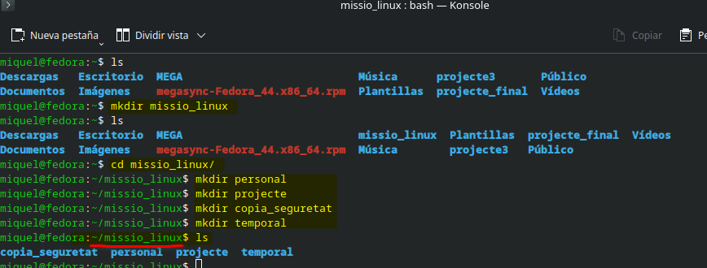

## Activitat 2. Crear la informació

1. **Quina comanda has utilitzat per crear els fitxers?**

S'ha fet servir la comanda "touch" per crear els diferents fitxers en format ".txt".

2. **Quina comanda has utilitzat per escriure informació?**

S'ha fet servir la comanda "echo" per escriure informació en tots els fitxers. La primera línia amb un > mentre que les següents amb un >> per evitar esborrar la informació prèvia.

3. **Quina comanda has utilitzat per consultar el contingut?**

S'ha fet servir la comanda "cat" per consultar o demanar un retorn de la informació que hi havia en els arxius i així poder veure que no hi ha hagut cap error.

4. **Fes una captura que permeti comprovar els continguts dels quatre fitxers.**

Al fer l'activitat 6, m'he adonat de que el hostname canvia depenent de en quin ordinador estiguis. Resulta que m'han aparegut dos noms diferents, per això en un captura apareixerà "fedora" en el nom d'ordinador i més endavant apareixeran els dos: "fedora" i "A101PC16".

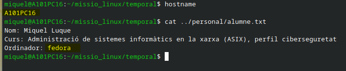

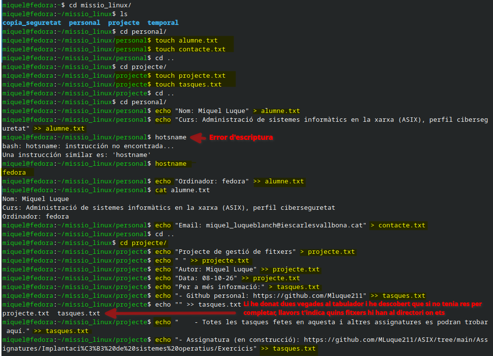

Com es pot veure en la primera captura, m'he confós i he premut dues vegades seguides el tabulador, descobrint que si no té res per completar et mostra els arxius disponibles per tal d'ajudar-te a buscar opcions. A mi m'han sortit tots, els dos, perquè estava "completant" un espai en blanc.

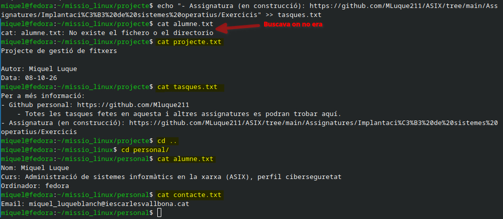

## Activitat 3. Un error intencionat

**Respon abans de continuar**
1. **Què creus que passaria si utilitzessis > en lloc de >>?**

El que passaria seria que en comptes de col·locar a continuació la informació que es volgués afegir, es col·locaria a la part superior de tot, esborrant sense voler tota la informació prèvia que hi hagués emmagatzemada. Un error que s'ha de vigilar no cometre.

**Respon després de continuar**
1. **Què ha passat?**

El què temíem. La informació prèvia ha desaparegut per deixar pas a la nova.

2. **Quina diferència hi ha entre > i >>?**

Col·locar només un ">" et permet sobreescriure informació (tota l'antiga desapareix). En canvi, col·locar dues ">>" et permet escriure informació a continuació del ja existent (independentment de si és la primera, la tercera o la sisena línia).

3. **Quina de les dues utilitzaries per afegir informació al final d'un fitxer? Per què?**

Després de l'experiment clarament la de ">>" per evitar perdre informació.

**Fes una captura que permeti comprovar el resultat.**

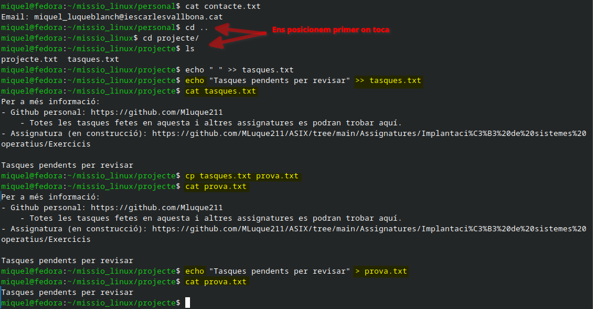

## Activitat 4. Organitzar un desastre

**Respon abans d'executar la comanda**
1. **Quina comanda utilitzaràs?**

La ruta que jo ja conec a l'hora de fer els treballs i buscar les imatges (en format markdown) és "../" per triar un directori superior per moure el fitxer llavors es fa servir: "mv prova.txt ../temporal".

2. **Per què?**

Perquè és la forma més eficient si saps que t'has de desplaçar poc. Et permet canviar la ubicació sense duplicar-ho, ja que es troba un nivell superior. Tot i això, aprofitaré primer per investigar si recordo bé com utilitzar el símbol "~" per buscar la ruta directa.

3. **Què creus que passarà amb "prova.txt" a la seva ubicació actual?**

Com que estàs movent un arxiu, el fitxer en qüestió es desplaçarà a la seva nova ubicació i en l'antiga ja no existirà.

**Després**
1. **Executa l'operació**

S'ha fet la prova del perquè no es pot moure directament al directori especificat, ja que aquest no es troba al "mateix nivell" que en el qual estàs posicionat. Llavors s'ha utilitzat la ruta personal "~" per moure'l directament.

2. **Comprova que "prova.txt" ja no es troba a la ubicació anterior.**

En comprovar que s'ha mogut correctament amb la comanda "ls", s'ha fet la prova de fer servir "../" per moure el mateix fitxer a la ubicació antiga, per comprovar si realment funcionava el mateix format que en markdown. En fer-ho, s'ha tornat altre cop a la posició de destí dintre del directori anomenat temporal.

3. **Comproba que es troba dins de "temporal".**

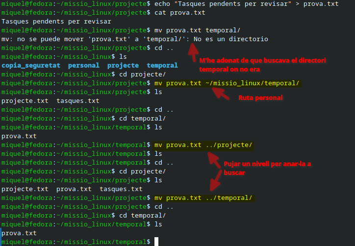

## Activitat 5. Crear una còpia de seguretat

1. **Quina comanda has utilitzat per crear les còpies?**

S'ha fet servir la comanda "cp", primer va el nom que es vol copiar i després l'adreça i el nou nom on es vol deixar la còpia. Per exemple: "cp projecte.txt ../copia_seguretat/projecte_backup.txt".

2. **Per què no has utilitz "mv"?**

Perquè la comanda "mv" trasllada l'arxiu i el que es pretén en aquesta activitat és fer una còpia de seguretat.

3. **Quina diferència hi ha entre copiar i moure les còpies?**

Crear una còpia serveix per duplicar la informació existent en un nou directori, mentre que moure les còpies serveix per traslladar l'arxiu original al lloc de destí.

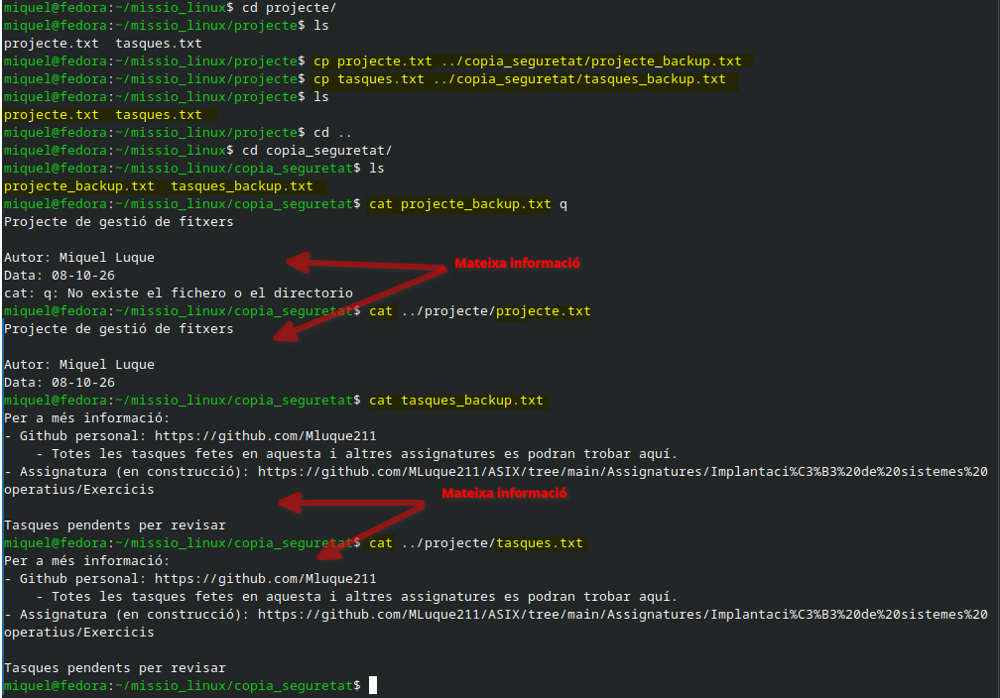

## Activitat 6. Eliminar un fitxer

1. **Quina comanda has utilitzat per eliminar-lo?**

S'ha fet servir la comanda "rm" seguit del nom del fitxer per eliminar-lo.

2. **Què ha passat amb el fitxer?**

El fitxer s'ha eliminat definitivament sense possibilitat de recuperació.

3. **Per què cal utilitzar aquesta comanda amb precaució?**

S'ha de fer servir amb precaució perquè l'ésser humà és despistat. El cansament o les presses poden fer-te escriure un fitxer semblant i eliminar informació important.

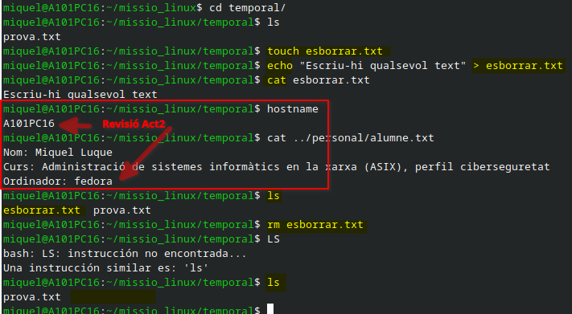

## Activitat 7. Auditoria

A) **On ets.** Utilitza una comanda que permeti demostrar la ubicació actual.

Es fa servir la comanda "pwd" per mostrar la ubicació actual: amb el resultat de "/home/miquel/missio_linux".

B) **Contingut de "missio_linux".** Mostra els elements que hi ha dins.

Es fa servir la comanda "ls" per veure tots els directoris que hi han a dins de _missio_linux_.

C) **Contingut de "personal".** Mostra els elements que hi ha dins.

Es fa servir la comanda "ls personal" per veure tots els elements que hi ha dins el directori "personal".

D) **Contingut de "projecte".** Mostra els elements que hi ha dins.

Es fa servir la comanda "ls projecte" per veure tots els elements que hi ha dins el directori "projecte".

E) **Contingut de "copia_seguretat".** Mostra els elements que hi ha dins.

Es fa servir la comanda "ls copia_seguretat" per veure tots els elements que hi ha dins el directori "copia_seguretat".

F) **Contingut de "temporal".** Mostra els elements que hi ha dins.

Es fa servir la comanda "ls temporal" per veure tots els elements que hi ha dins el directori "temporal".

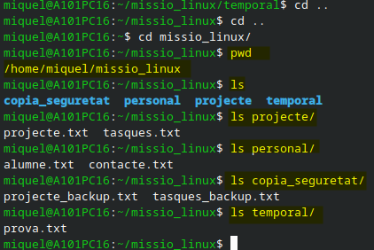

## Activitat 8. Investiga els permisos

1. **Quines lletres apareixen al principi de la línia?**

Apareixen les lletres "r" i la "w". La primera significa que l'administrador té els permissos per llegir aquell arxiu. La segona que té els permisos d'escriptura per l'arxiu.

2. **Què significa "r"?**

Significa que l'arxiu és de lectura.

3. **Què significa "w"?**

Significa que l'arxiu és d'escriptura.

4. **Què significa "x"?**

Significa que l'arxiu és d'execució.

5. **Quines lletres apareixen als permisos de "projecte.txt"?**

Apareixen les lletres "r" i "w". Que són de lectura i d'escriptura, en aquest ordre "-rw-r--r--".

6. **Quines lletres apareixen als permisos de "tasques.txt"?**

Apareixen les lletres "r" i "w". Que són de lectura i d'escriptura, en aquest ordre "-rw-r--r--". Els dos arxius apareixen exactament iguals.

7. **Quin usuari apareix com a propietari?**

Apareix l'usuari de nom "miquel" com a propietari.

8. **Quin grup apareix?**

Apareix al grup anomenat "miquel" (el segon miquel)

9. **Quina informació proporciona aquesta comanda que no proporciona ls?**

La comanda ls proporciona només els noms dels directoris i/o arxius que hi pugui haver. En canvi, la comanda "ls -l" et proporciona molta més informació addicional com, en ordre: els permisos, els enllaços, el propietari, el grup, la mida que ocupa, la data i hora de l'última modificació i el nom del fitxer.

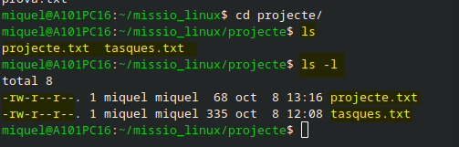

## Activitat 9. Repte de resolució

En l'activitat anterior número 7 s'ha pogut veure la disposició final dels directoris i arxius que hi ha dintre del directori "pare" anomenat "missio_linux". Es pot comprovar en la imatge de l'activitat número 8. En les següents imatges es pot comprovar tota la informació que els fitxers contenent, per assegurar que totes les activitats s'han fet correctament.

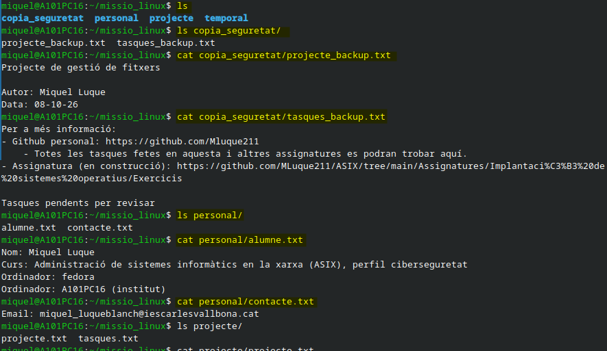

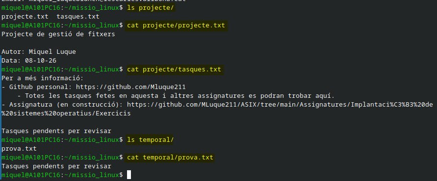

## Activitat 10. Explica les teves decisions

| **Situació** | **Comanda** | **per què serveix?** |
| :---: | :---: | :---: |
| Saber on sóc | pwd | Per determinar amb exactitud la localització exacta d'en quin directori ets |
| Veure els fitxers | ls | Per veure tots els fitxers i/o directoris que hi hagi allà on se li demana |
| Entrar en un directori | cd (nom) | Per accedir dintre del directori anomenat |
| Crear un directori | mkdir | Per crear un directori (una carpeta) amb el nom seleccionat |
| Crear un fitxer | touch | Per crear un fitxer amb l'extensió exacte que vulguis segons el resultat que es busqui (com .md; .adoc;...) |
| Veure el contingut d'un fitxer | cat | Per reflectir en pantalla el text que conté aquell fitxer |
| Copiar un fitxer | cp | Per duplicar la informació d'un fitxer |
| Moure un fitxer | mv | Serveix per traslladar un fitxer a un altre directori (el d'origen desapareix i apareix en el destí) |
| Canviar el nom d'un fitxer | mv (nom_antic nom_futur) | Per modificar el nom d'un fitxer |
| Eliminar un fitxer | rm | Per eliminar de forma permanent un fitxer o directori (s'ha de fer servir amb molta cura) |
| Consultar els permisos | ls -l | Per consultar els tipus de permisos que un fitxer o directori presenten de cara a l'administrador |

## Activitat 11. Reflexió final

1. **Quina ha estat la part més difícil de l'activitat?**

Per mi, la part més difícil ha estat la de crear informació dintre de diferents fitxers. Ja que s'ha d'estar atent no només per crear-la on toca sinó també per no equivocar-te amb el "> o >>" i haver de tornar a començar la feina feta. Igual que la comanda "rm" s'ha de revisar amb cura abans de prémer l'enter.

2. **Quina comanda has utilitzat més?**

Diria que les comandes que més he fet servir han estat "ls" i "cat", el primer per comprovar el llistat del directori (i saber si estava en el lloc correcte) i el segon per comprovar si la comanda "echo" s'havia emprat correctament.

3. **Quina comanda t'ha resultat més útil?**

La comanda "ls" sens dubte. Et dona la informació amb quins arxius estàs treballant. I perquè més endavant coneixerem les dreceres ("atajos") que li pots donar a la terminal perquè amb un únic "ls" et pugui mostrar tota la informació necessària que li hagis demanat prèviament per no haver de fer diferents comandes i així estalviar temps.

4. **Quina operació podries fer de més d'una manera?**

L'operació de copiar i moure és la que es pot fer de diverses maneres. Es pot copiar directament al lloc de destí; la pots copiar i després moure; la pots moure i més tard copiar per canviar-li el nom,... Segons l'administrador necessiti es pot fer de diferents maneres. Uns, òbviament, més rendibles que d'altres.

5. **Què podria passar si executessis una comanda sense comprovar abans sobre quin fitxer o directori estàs treballant?**

Podries convertir un error molt absurd ("despiste") en un problema molt greu per l'empresa que estiguis treballant. Per exemple: esborrar una informació d'un company que aquest encara no havia guardat.

6. **Quina diferència hi ha entre saber una comanda i saber utilitzar-la?**

La diferència és abismal. El primer executa la comanda i li retorna una informació. El segon saps no només on fer-la servir sinó que tampoc necessita moure's gaire per la terminal per trobar la informació necessària. Es pot estalviar passos i temps.
