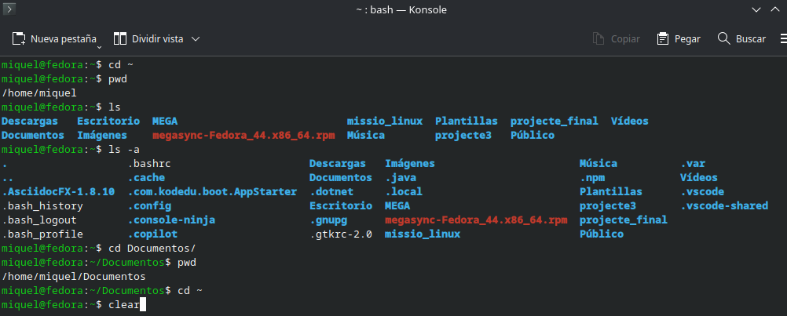
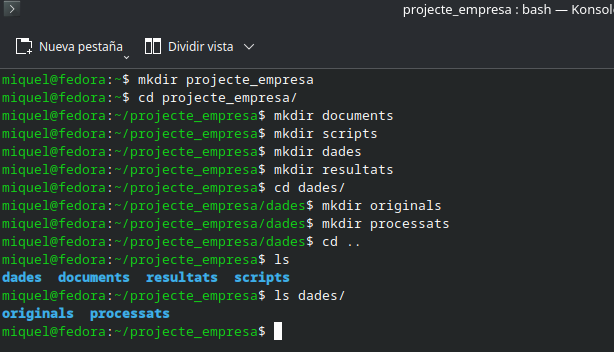
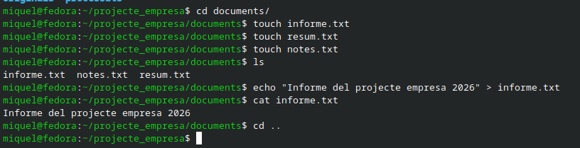
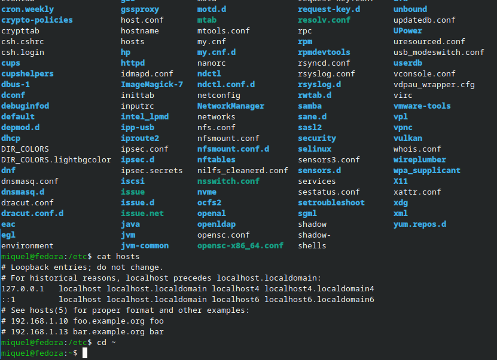
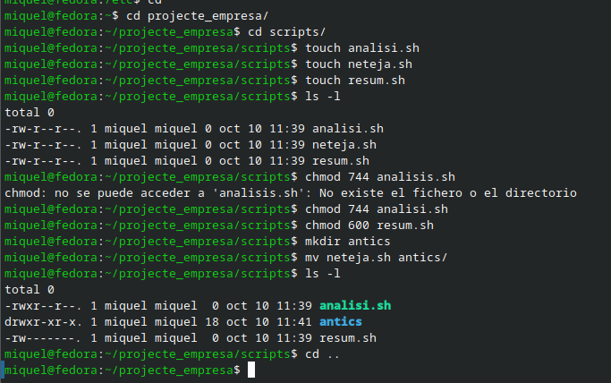
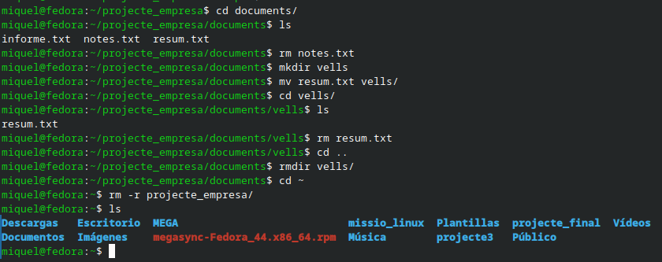
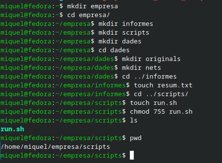

# Projecte 3.3: Pràctica guiada - Navegant pel sistema de fitxers de Linux (nivell inicial)

## Activitat 1. Explorant el teu entorn



## Activitat 2. Creació del projecte



## Activitat 3. Fitxers dins de "documents"



## Activitat 4. Explorant el sistema



## Activitat 5. Fitxers i permisos



## Activitat 6. Eliminació i reorganització



## Activitat 7. Repte final



## Activitat 8. Autoavaluació final
1. Quina ordre serveix per veure el directori actual?

La comanda "pwd" serveix per conèixer l'ubicació actual.

2. Què fa `cd ..`_?

Torna "enrere" un diretori.

3. Quina diferència hi ha entre `rm` i `rmdir`_?

El primer "rm" esborra qualsevol arxiu mentre que el segon "rmdir" esborra qualsevol directori.

4. Quina ordre serveix per crear fitxers buits?

La comanda touch.

5. Com expresses els permisos d'un fitxer amb valors numèrics?

Amb la comanda "chmod més_tres_números": El primer indica el permis per l'usuari, el segon pel grup i el tercer per tothom. Informació extreta d'aquest [enllaç](https://linuxize.com/post/what-does-chmod-777-mean/):

```
Each digit of the permissions number may be a sum of 4, 2, 1, and 0:

0 (0+0+0) – No permission.
1 (0+0+1) – Only execute permission.
2 (0+2+0) – Only write permission.
3 (0+2+1) – Write and execute permissions.
4 (4+0+0) – Only read permission.
5 (4+0+1) – Read and execute permission.
6 (4+2+0) – Read and write permissions.
7 (4+2+1) – Read, write, and execute permission.
```