# PROJECTE 3: Gestió d'arxius i E/S en un SO
«S'ha sintetitzat el contingut del document original per tal de centrar-se en els aspectes clau, havent depurat i omès qualsevol informació de caràcter personal.»

## Activitat 1. On sóc?
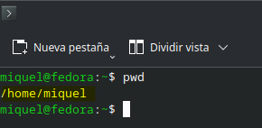

* **El resultat de pwd indica que estic al directori:**

Em trobo en la carpeta principal del meu propi usuari, a la ruta anomenada: _/home/miquel_.

## Activitat 2. Què hi ha al directori?

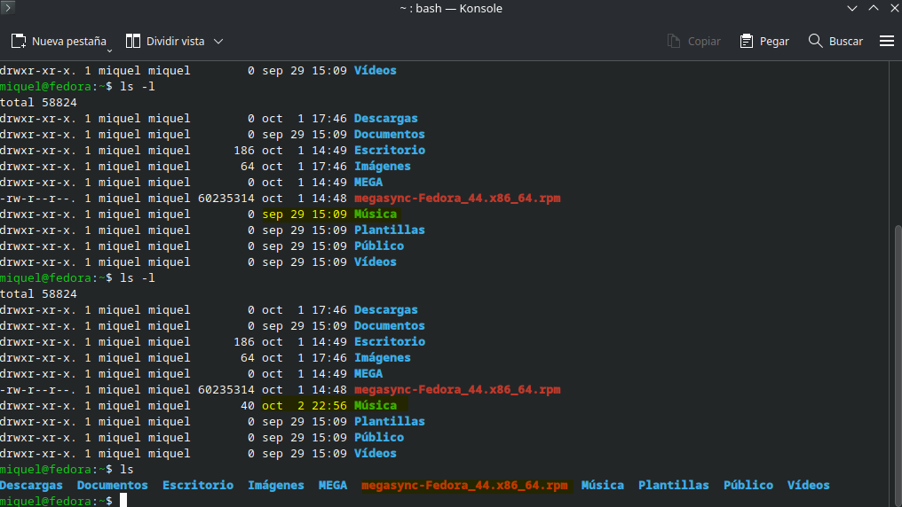

1. **Quina diferència observes entre ls i ls -l?**

La comanda ls t'indica els noms dels directoris que hi ha a la ruta actual, en aquest cas a la carpeta personal de l'usuari. En canvi, la comanda ls -l ens aporta més informació que no només els noms. Ens indica els permisos que representa cada un dels directoris (vist en el projecte 2). La data de l'última vegada que s'ha tocat, l'hora i el nom corresponent. He fet la següent prova: en la captura es pot distingir com en el directori "Música" canvien les dates perquè he entrat en ella i li he creat un arxiu buit per comprovar, efectivament, com canviava.

2. **Quants elements apareixen amb ls?**

Apareixen 10 elements. Tots ells són carpetes (directoris de color blau), rutes cap a altres directoris directes menys un. Aquest últim és la sincronització al núvol de megasync (no és un directori, per això no surt en blau, és un executable ".rpm") per evitar perdre els treballs fets, com em va passar amb l'últim projecte:
- Directoris: _Descargas, Documentos, Escritorio, Imágenes MEGA, Música, Plantillas, Público i Vídeos_.
- Altres: _megasync-Fedora_44.x86_64.rpm_

## Activitat 3. Crear un directori

1. **Què fa mkdir?**

La comanda _mkdir_ crea un nou directori allà on estiguis posicionat amb el nom que li indiquis. A la imatge es pot comprovar com s'ha fet dues vegades la comanda _ls_ i només en el segon apareix el nou directori.

2. **Què fa cd?**

La comanda _cd_ et trasllada dintre el directori (o carpeta), si aquest existeix, que li hagis indicat a continuació.

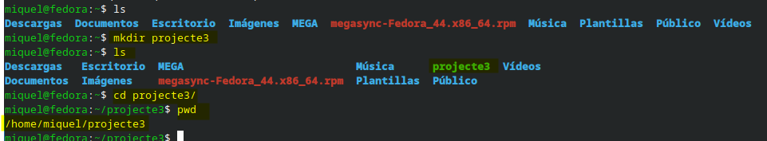

## Activitat 4. Crear un fitxer

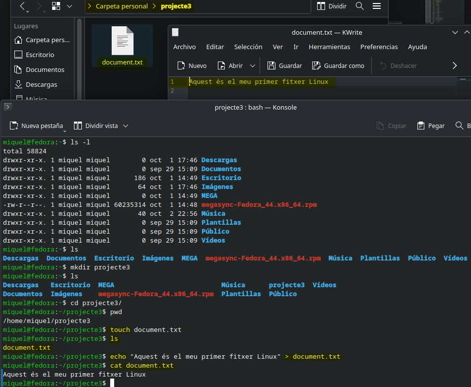

En la captura es pot distingir les tres operacions: el document físic creat, la primera línia dintre del document i el retorn a la terminal.

1. **Quin nom té el fitxer?**

El nom del fitxer que s'ha creat es diu document.txt.

2. **Quin text conté?**

Conté el text introduït per la comanda _echo i >_ dintre del fitxer anomenat document.txt. Aquest és: _Aquest és el meu primer fitxer Linux_.

3. **Per a què serveix cat?**

La comanda _cat_ ja l'hem vist en el projecte anterior i serveix per veure per la terminal allò que li demanis posteriorment (text pla).

## Activitat 5. Afegir informació

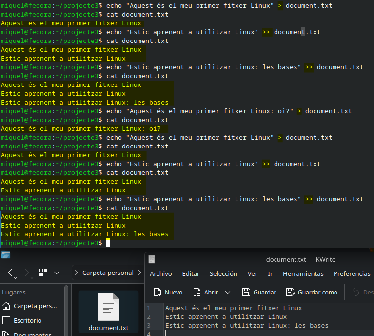

1. **Quina diferència observes?**
Com es pot observar en la successió de comandes a la terminal, s'ha descobert que la >> afegeix a continuació allò que li indiques i la >, tingui o no informació prèvia, l'esborra i li afegeix com a primera línia el que s'ha indicat.

## Activitat 6. Copiar un fitxer

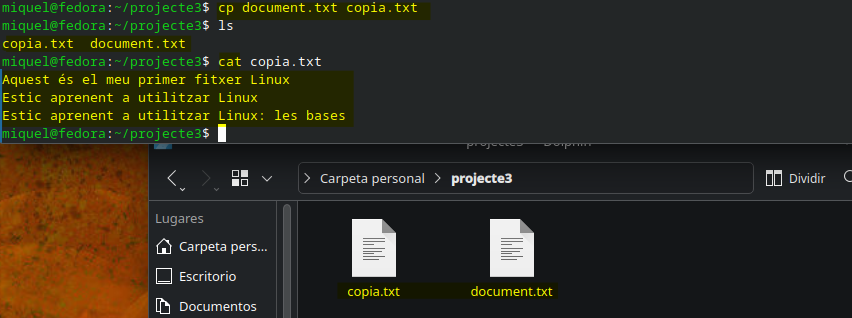

1. **Quins dos fitxers tens ara?**

En crear l'arxiu copia.txt el directori de "projecte3" presenta dos arxius idèntics en contingut, però no en nom: document.txt i copia.txt.

2. **Tenen el mateix contingut?**

Com es pot veure en la imatge tots dos arxius presenten el mateix contingut, confirmant que la comanda _cp_ ha funcionat correctament.

3. **Què fa la comanda cp?**

La comanda cp copia el contingut d'un arxiu a un altre (del primer de la comanda al segon), però en el cas que no existeixi l'arxiu demanat el crea en aquell moment per poder copiar el contingut.

## Activitat 7. Crear una carpeta i moure un fitxer

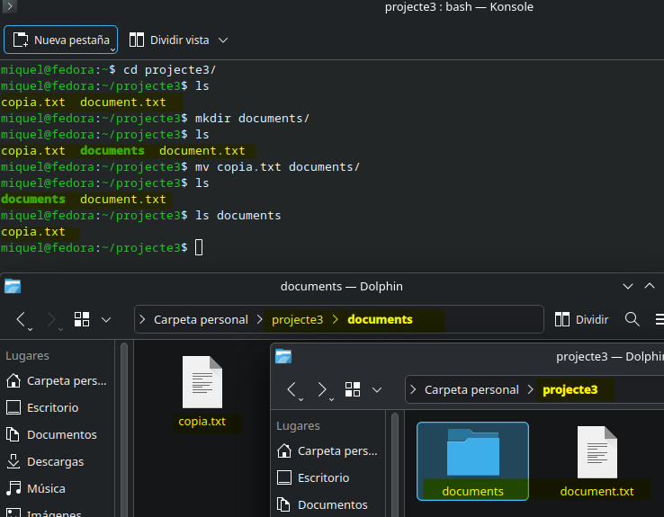

1. **On es troba ara _copia.txt_?**

El fitxer "copia.txt" s'ha mogut dintre del directori documents/ amb la comanda "mv".

2. **Quina funció té _mv_?**

La funció de la comanda "mv" és la de traslladar l'arxiu demanat al lloc especificat, en aquest ordre.

**Representa l'estructura**

```
Projecte3
|
|____ Documents
|      |
|      |____ copia.txt
|
|____ document.txt

```

## Activitat 8. Canviar el nom d'un fitxer

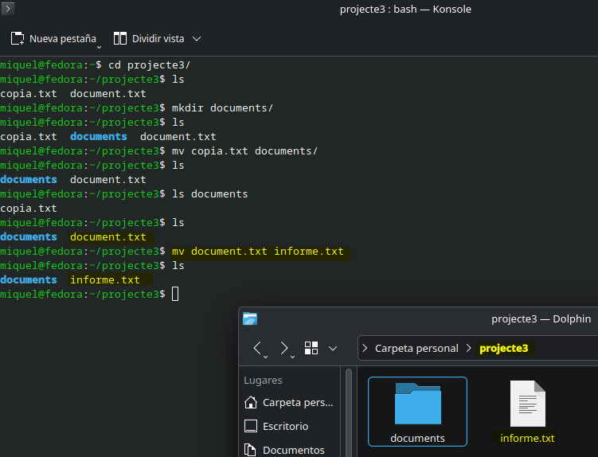

1. **Quin era el nom original?**

El nom original de l'arxiu era "document.txt".

2. **Quin és el nom actual?**

El nom actual és "informe.txt".

3. **S'ha creat una còpia del fitxer?**

Aquesta vegada no s'ha creat una còpia del fitxer ni s'ha mogut a un nou directori; ja que si s'utilitza la comanda "mv" dintre un mateix directori el primer arxiu demanat canviarà de nom al segon indicat.

4. **Què podem utilitzar _mv_ per fer?**

La comanda mv serveix per moure un arxiu de directori o canviar-li el nom si es manté dintre del mateix directori. He fet la prova com es pot veure amb la següent imatge i també es pot moure i canviar de nom al mateix temps. 

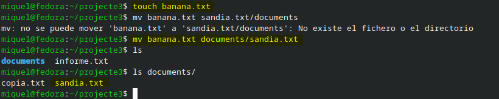

## Activitat 9. Eliminar un fitxer

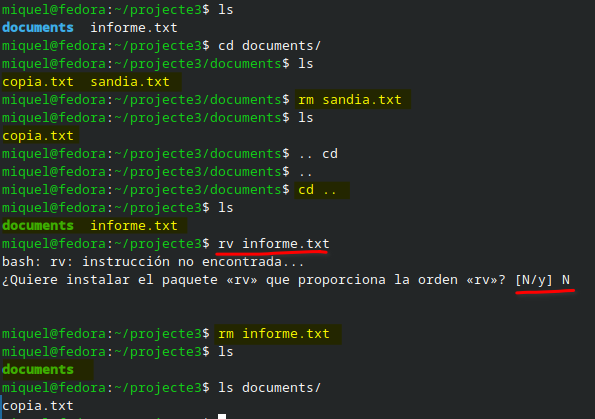

1. **Què ha passat amb _informe.txt_?**

Aprofitant la comanda rm també he esborrat l'arxiu de prova anterior anomenat sandia.txt dintre el directori "documents/". Llavors he tornat enrere i esborrat l'arxiu amb el nom "informe.txt". S'ha de tenir molta cura, moltíssima, en escriure exactament el que vols fer, ja que m'he equivocat amb una lletra i gairebé instal·lo un paquet d'una comanda que no sé què fa. Els dos arxius s'han eliminat permanentment del sistema. 

## Activitat 10. La jerarquia de directoris

1. **Què és _/_?**

La barra "/" indica que ens trobem en el directori "mare"; no podem anar més enllà. I a partir d'allà penjaran tots els altres directoris. Aquesta barra també serveix per indicar un separador entre directoris si ens el trobem enmig de dos noms.

2. **Què és _/home_?**

És el directori personal de l'usuari, per això a dintre hi ha el nou directori amb el seu nom. Si hi hagués més usuaris en un mateix sistema operatiu hi hauria més carpetes.

3. **Quina diferència observes entre _/home_ i _/tmp_?**

Al directori "/home" apareix només el directori personal de l'usuari (actualment només n'hi ha un), mentre que en el directori "/tmp" apareixen els arxius temporals que el mateix usuari ha anat fent servir i que esborraran en tancar sessió.

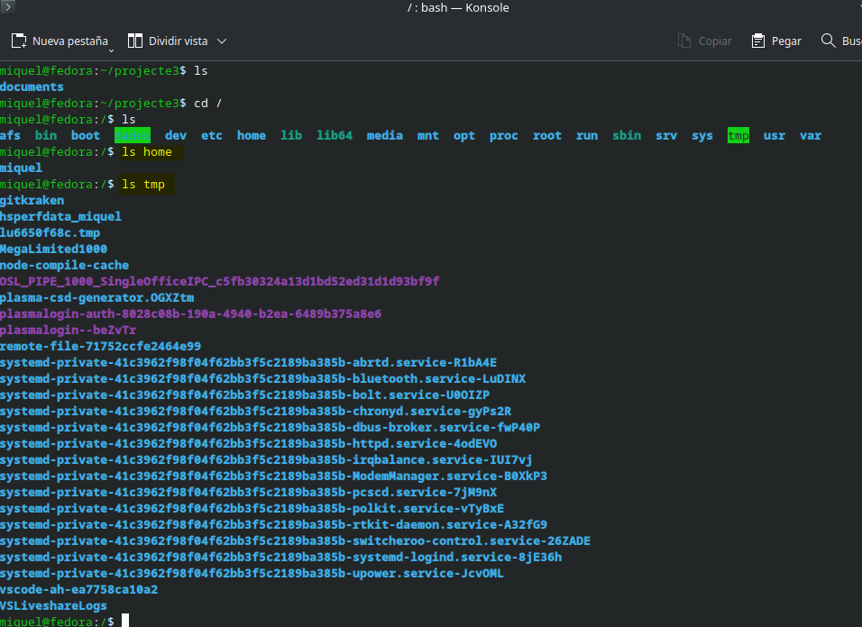

## Activitat 11. Tornem al nostre directori

1. **Quina diferència hi ha entre _cd_ i _cd ~_?**

S'ha entès millor en fer l'exercici següent, canviant la resposta d'aquest a:

Com es pot veure en la imatge, a primera vista no hi ha cap diferència entre la comanda "cd" i la "cd ~". Des de diferents directoris s'ha utilitzat i s'ha tornat al mateix punt inicial. S'entén que el símbol "~" és una espècia de "atajo" per anar o portar documents directament allà on l'especifiquis del directori de l'usuari.

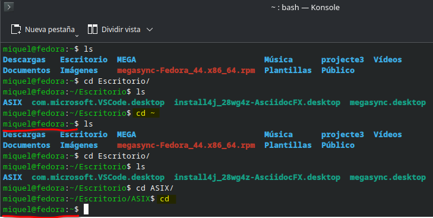

## Activitat 12. Els permisos

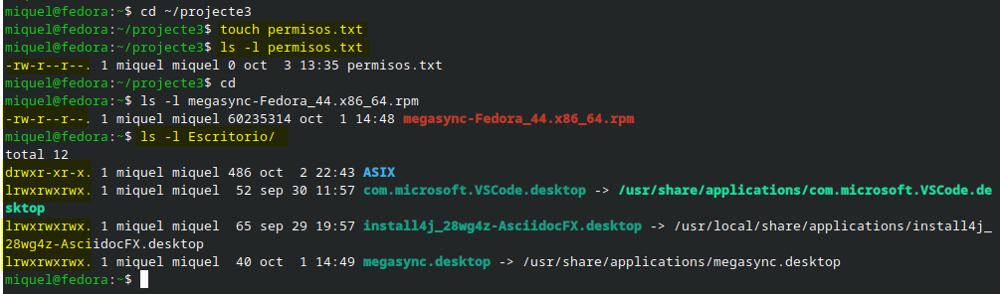

1. **Quina lletra representa la lectura?**

La lectura és representada amb la lletra "r" (read).

2. **Quina lletra representa l'escriptura?**

L'escriptura és representada amb la lletra "w" (write).

3. **Quina lletra representa l'execució?**

L'execució és representada amb la lletra "x" (execute).

4. **Quines lletres apareixen als permisos del teu fitxer?**

Apareixen les lletres "r" i "w", de lectura i escriptura. He fet la prova d'anar a buscar un altre directori, l'escriptori; i en aquest apareixen els tres esmentats en aquesta activitat gairebé en totes les posicions.

## Activitat 13. Els dispositius

1. **Quins dispositius USB detecta el teu ordinador?**

En detecta més dels que jo esperava, ja que inclou les diferents peces del propi hardware (que té sentit quan hi penses...). Amb la informació adquirida fins ara a ASIX en reconec la majoria.
* Per una banda, entenc que estan els controladors del sistema.
* Per l'altre, les E/S (Entrades/Sortides) com el ratolí, teclat, el disc dur extern que utilitzem, adaptador bluetooth...

2. **Per què creus que és necessari que el sistema operatiu gestioni aquests dispositius?**

Trobo que és absolutament necessari que el sistema operatiu gestioni els diferents dispositius perquè hi hagi un funcionament eficient i eficaç entre els diferents components per un correcte funcionament segur, fluït i fiable.

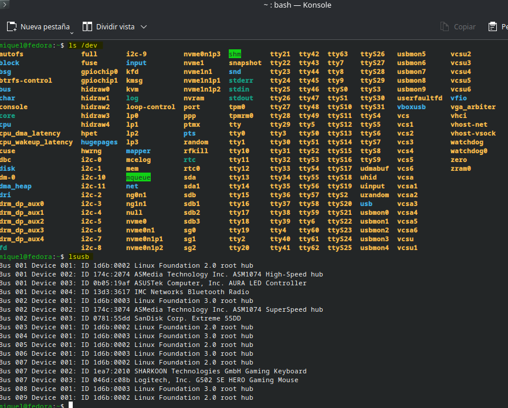

## Activitat 14. Què és l'E/S?

| **Dispositiu**  | **Entrada** | **Sortida** |
|:--:|:--:|:--:|
| Teclat | [x] | [ ] |
| Ratolí | [x] | [ ] |
| Pantalla | [ ] | [x] |
| Impressora | [ ] | [x] |
| Micròfon | [x] | [ ] |
| Altaveus | [ ] | [x] |
| Disc| [x] | [x] |


## Activitat 15. Un exemple d'E/S

DISC

$\downarrow$

DISPOSITIU D'ENTRADA

$\downarrow$

SISTEMA OPERATIU

$\downarrow$

DISPOSITIU DE SORTIDA

$\downarrow$

PANTALLA


El _disc dur_ és el que té la informació guardada que l'usuari vol veure. Quan aquest fa "click" (el SO envia el senyal de lectura) el mateix disc transfereix les dades com a _dispositiu d'entrada_ fins a la RAM on s'emmagatzemaran. És llavors quan el _sistema operatiu_, en tenir totes les dades, gestiona la petició de l'usuari interpretant aquelles dades per enviar-les cap a la pantalla. Crec que en aquest cas és la targeta gràfica la que fa de _dispositiu de sortida_ en forma de diferents llums LED perquè la _pantalla_ rebi la informació traduïda i l'usuari pugui comprendre la informació sol·licitada en el primer pas. L'acció és tan ràpida que sembla una única acció.

## Activitat 16. Com gestiona l'ordinador les E/S?

Són els tres mecanismes que ens permeten comunicar-nos amb les diferents E/S (Entrades/Sortides).
1. **E/S programada:** La CPU s'encarrega directament de preguntar-li a l'E/S (intervals de temps molt petits) si està preparada. Només quan està s'envien o reben les dades. El principal problema és que la CPU perd molt de temps preguntant-li fins que aquest diu que sí. Aquest sistema s'anomena _polling_.
    - CPU: Estàs preparat? $\rightarrow$ Dispositiu: No.
    - CPU: Estàs preparat? $\rightarrow$ Dispositiu: No.
    - CPU: Estàs preparat? $\rightarrow$ Dispositiu: No.
    - CPU: Estàs preparat? $\rightarrow$ Dispositiu: Sí (enviament de dades).

2. **E/S per interrupcions:** És el mètode més habitual. La CPU executa els seus propis processos i en rebre una senyal d'E/S genera una interrupció (el flux d'execució de la CPU determinarà quin procés aturar per donar pas al senyal d'E/S). Quan aquestes dades ja hagin sigut retornades (li envia un "IRQ OK" assegurant que ja ha acabat), la CPU agafa el fil anterior que tenia guardat i continua amb ell (això s'anomena _canvi de context_).
    - CPU treballa $\rightarrow$ Dispositiu envia senyal
    - CPU genera interrupció (i guarda dades) $\rightarrow$ Dispositiu crida al sistema
    - CPU executa E/S i envia dades $\rightarrow$ Dispositiu rep les dades
    - CPU restaura el procés

3. **DMA:** És un xip que es pot trobar dintre o fora de la CPU. Aquest, quan detecta un perifèric d'E/S rep una ordre de la CPU amb certes instruccions. El DMA funciona de manera independent després de rebre les instruccions. Quan ja les ha gestionat avisa a la CPU i aquesta envia les dades on pertoqui. Aquestes instruccions serien:
    - Longitud: Quantitat de dades. Ex: _10.000bytes_
    - @ Memòria: A quina enviar-la. Ex: _FA32_
    - R/W: Si vol escriure o llegir. Ex: _R (lectura)_
    - @ Dispositiu: On retornar les dades. Ex: _3FFF_

    Pd. Si és de lectura (R) serà de l'adreça 3FFF al FA32. En canvi, si fos d'escriptura (W) seria de l'adreça FA32 al 3FFF.

4. **ESQUEMA**

| Mecanisme | CPU | US TÍPIC |
| :---: | :---: |  :---: | 
| Polling | Treballa constantment (perd molt de temps | Dispositius molt senzills |
| Interrupcions | Només treballa quan el dispositiu envia la senyal fins que es produeix el _canvi de context_ | Perifèrics d'ús habitual com ratolí o teclat |
| DMA | Només treballa al configurar les instruccions i al rebre la senyal per enviar les dades | Transferència de un gran volum de dades |

Com a extra: Hi ha un una tècnica intermitja anomenada _buffer_ on es guarden les dades transferides per evitar errors mentre treballen en les diferents velocitats entre la CPU (molt alta) i el perifèric d'E/S (més baixa). Una altre tècnica és la _Cua d'E/S_ on s'estructuren les diferents peticions pendents en ordre per evitar perdre informació.

## Activitat 17. Repàs de comandes

|**Comanda**|**Per a què serveix?**|
|:--:|:--:|
| pwd | T'indica en quin directori et trobes actualment |
| ls | Et mostra la llista del directori en el qual et trobes actualment |
| cd | Serveix per tornar al directori de l'usuari (i si l'acompanyes amb un directori que tingui dintre hi podràs entrar) |
| mkdir | Serveix per crear un nou directori |
| touch | Serveix per crear un arxiu de qualsevol mena que li indiquis després del "." |
| cat | Serveix per mostrar en pantalla de la terminal la informació d'un arxiu (de text pla) |
| cp | Serveix per copiar fitxers |
| mv | Serveix per traslladar un arxiu d'un directori a un altre o, si et trobes al mateix, canviar-li el nom |
| rm | Serveix per eliminar definitivament qualsevol arxiu |
| ls -l | Et mostra informació detallada no només dels arxius o directoris que hi pugui haver sinó també els permisos, dates... |

## Activitat final. La meva carpeta Linux

M'he equivocat/despistat en dues ocasions. La primera, he començat a crear els dos primers arxius fora de _projecte final__, així que els he mogut i després he continuat. La segona, he col·locat un espai buit al _fitxer1.txt_ quan el volia col·locar al _fitxer2.txt_. La resta ha anat de manera fluida al anar afegint informació a cada fitxer nou que s'anava creant. Per curiositat he copiat de les dues maneres possibles: copiant a un arxiu i creant-lo a la vegada; i creant primer l'arxiu i després copiar el contingut. Pd. Més tard he caigut que segurament es pugui afegir varies frases en una unica comanda _echo_ amb el símbol _&&_ (sempre i quan el primer no dongui errors).

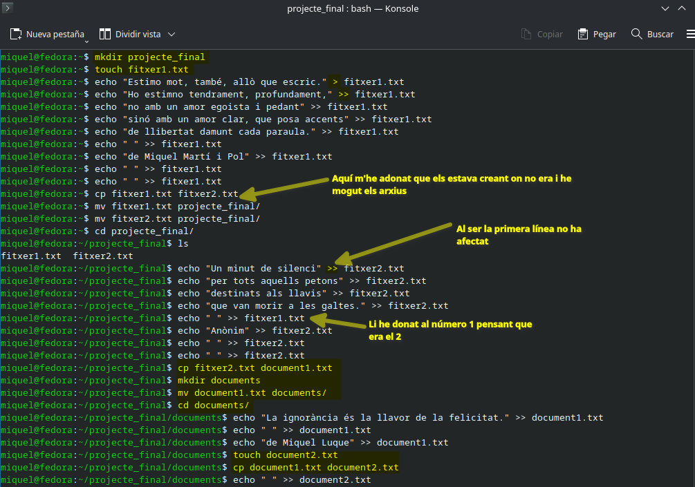

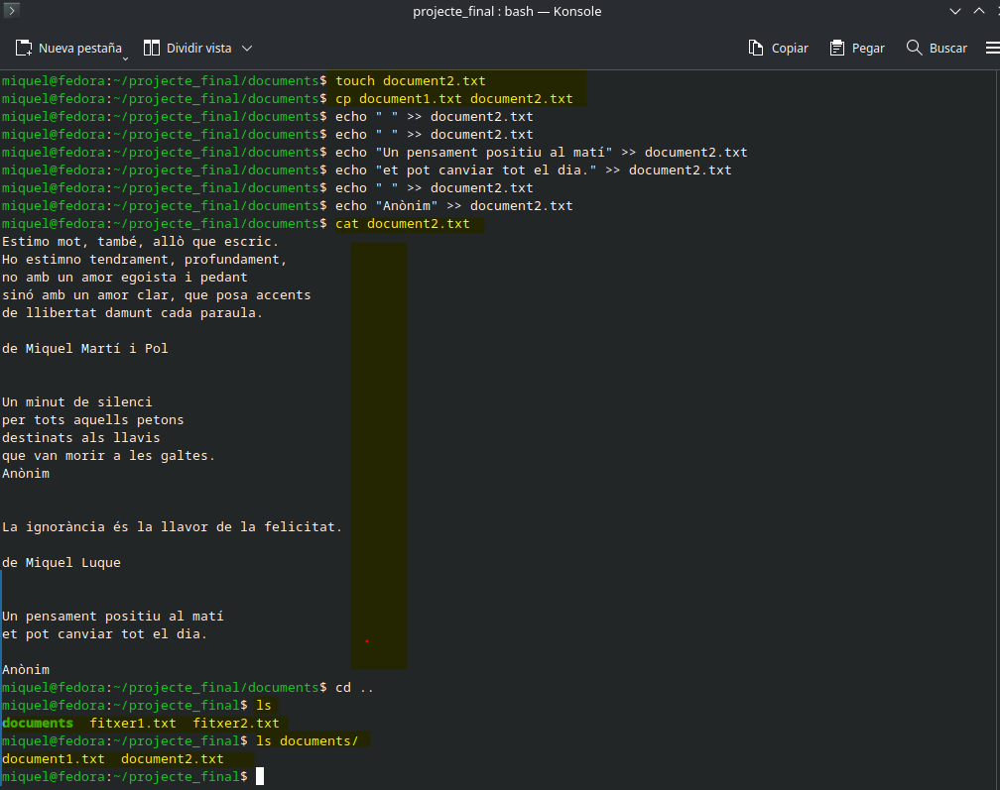

## Conclusions

1. **Què és un fitxer?**

Un fitxer és un document que, depenent amb quin format estigui escrit, et permet veure informació d'una manera o d'una altra.

2. **Què és un directori?**

Un directori és un espai, una _carpeta_, en la qual et permet organitzar informació de manera jeràrquica (guardar fitxers i altres directoris).

3. **Quina diferència hi ha entre copiar i moure un fitxer?**

Moure un fitxer et serveix per moure tota la informació en un sol moviment a una altra localització. En canvi, copiar un fitxer et serveix per copiar tota (entenc que també podria ser en part amb altres mecanismes) la informació d'un fitxer a un altre.

4. **Per a què serveixen els permisos?**

Serveixen per determinar què es pot fer amb aquell arxiu o directori en concret: que sigui només de lectura ("r"), d'escriptura ("w"), d'execució ("x") o varies a la vegada.

5. **Què significa E/S?**

Són dispositius externs d'entrada i sortida que serveixen per enviar o rebre informació.

6. **Escriu tres comandes que ara saps utilitzar i explica per a què serveixen.**

- A) Comanda _cd ~_: És la comanda que més interès ha despertat en mi. Serveix per tornar, independentment d'on estiguis, al directori arrel de l'usuari. Pots inclús anar directament a una subcarpeta o enviar un arxiu directament allà.

- B) Comanda _touch_: Aquesta comanda serveix per crear fitxers de tota mena. És una de les sorpreses; el fet de poder crear tant un pdf, un .adoc, un .md... amb una sola línia.

- C) Comanda _ls_: Aquesta comanda serveix per llistar tot el que hi hagi dintre d'un directori en concret. El que em sorprèn, és el fet que tu pots crear una drecera i poder especificar cada vegada que vulguis llistar, per exemple, amb _ls_ que et mostri tantes coses com tu li hagis configurat prèviament, amb la mateixa comanda.

7. **Quina comanda t'ha resultat més fàcil?** 

La comanda pwd perquè et diu la posició exacte on ets. Sé que té versions, però aquesta sola és senzilla i fonamental.

8. **Quina t'ha costat més?**

Són comandes senzilles i ja tenia certs coneixements sobre elles. Així que no n'hi ha hagut cap que m'hagi costat entendre. Quan aprofondim més apareixerà alguna.