# Projecte 4: Virtualització
«S'ha sintetitzat el contingut del document original per tal de centrar-se en els aspectes clau, havent depurat i omès qualsevol informació de caràcter personal.»

## Apartat A. Preparació de l'entorn
**VirtualBox**
El sistema ja tenia instal·lat l'Oracle VirtualBox; no ha sigut necessari fer la instal·lació en si.

**Extension Pack**
Per fer-ho s'ha anat a la [web oficial](https://www.virtualbox.org/wiki/Downloads) i s'ha descarregat el paquet "VirtualBox 7.2.20 Extension Pack". Així doncs, s'ha instal·lat a través del programari d'extensions tal com es veu a la imatge.

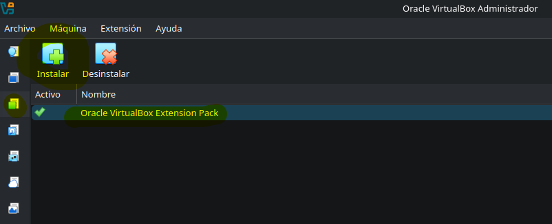

S'ha creat un directori dintre de l'arrel del sistema, per tant, són necessaris els permisos d'administrador a través del "sudo". Un cop fet això  he recordat que es va dir que en crear un directori a l'arrel del sistema, necessitava canviar els permisos del mateix per no tenir futurs problemes. A través de la comanda `chmod -R permisos nomdirectori`. S'ha esborrat l'ISO de Windows que no funcionava (està explicat més endavant). Un cop fetes servir les ISO, s'han guardat totes juntes dintre el directori de les màquines virtuals anomenada "~/VirtualMachinesM1/iso/".

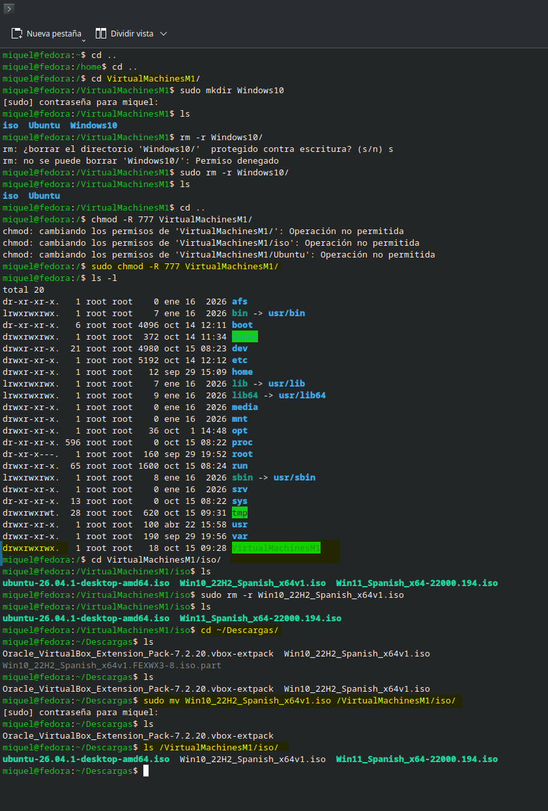

**Coneixement de VirtualBox**
En tenir problemes per fer la instal·lació des del PC de l'institut (se'm congelava constantment), s'ha fet la instal·lació, de les dues ISO, des de casa. El problema de fer-ho així és que m'he trobat amb un parell d'inconvenients:
1. Els drivers necessitaven actualitzar-se, ja que en l'ordinador personal no s'havia fet.
2. La configuració de la BIOS necessitava ser canviada perquè deixes obrir qualsevol màquina virtual.

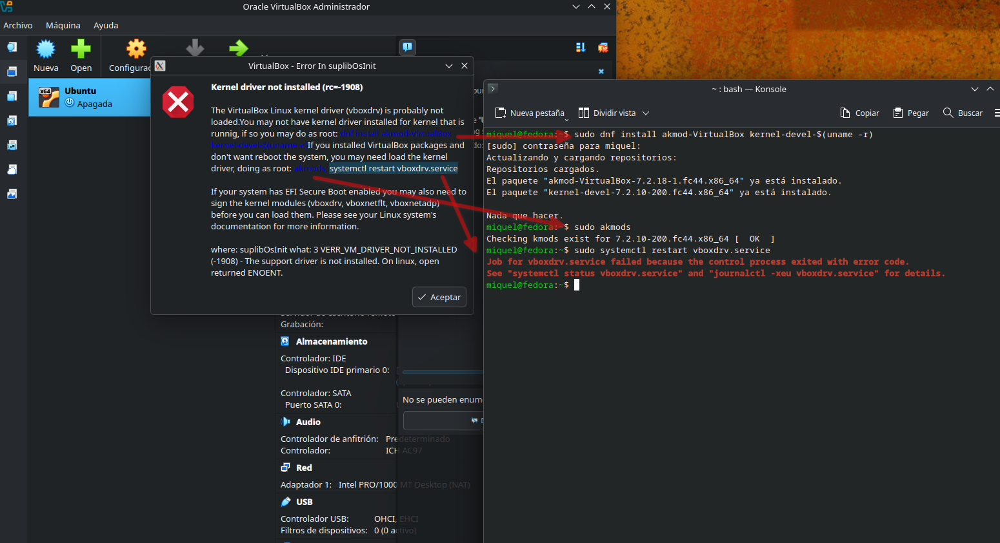

**Adquirir una llicència d’Ubuntu Desktop 18 o superior**
La ISO s'ha extret de la [pàgina oficial](https://ubuntu.com/download/desktop), i l'actual i la que s'ha fet servir és l'Ubuntu 26.04.1 LTS.

**Adquirir una llicència de Windows 10 o superior**
La ISO s'ha extret de la [pàgina oficial](https://www.microsoft.com/es-es/software-download/windows10ISO), i s'ha decidit fer servir la versió de Windows 10 per ser més versàtil (coneguda) alhora de trastejar amb ella. 

## Apartat B. Teoria de virtualització
1. **Què és virtualitzar un sistema?**

És crear un espai aïllat independent del sistema operatiu principal per tal de crear un entorn segur en el qual treballar. D'aquesta manera pots fer proves de tota mena assegurant l'espai principal. Aquest espai és conegut com a "màquina virtual (MV) i utilitza els recursos del sistema principal que li hagis permès en configurar-la.

2. **Quins són els beneficis de la virtualització?**

Alguns dels beneficis de la virtualització són els següents:
- Seguretat: Es poden fer proves amb tranquil·litat de programaris perillosos sense comprometre l'estabilitat del sistema principal.
- Aïllament: Cada màquina virtual (si tens l'espai i els recursos es poden fer servir diverses màquines alhora) és independent de la resta de màquines o del sistema principal.
- Còpies: Es pot copiar tota una màquina virtual per tal de transportar-la a un altre sistema físic. D'aquesta manera, si els canvis realitzats superen les proves de seguretat, es poden implementar allà on siguin necessaris.
- Optimització: En poder utilitzar els recursos d'un únic hardware, es poden estalviar temps i recursos.

3. **Quins són els inconvenients de la virtualització?**

Alguns dels inconvenients són:
- Si el sistema principal cau per qualsevol raó, les màquines virtuals (que serien com els convidats) també cauen. Presenten una jerarquia immediata.
- Les màquines virtuals depenen directament de la capacitat física del sistema principal. Aquest ha de tenir la suficient potència i capacitat per albergar totes les necessàries. Si no hi haurà una sobrecàrrega i cap dels dos funcionaran de manera eficient.
- És necessari tenir un cert coneixement del qual es fa per tal de poder-ho fer eficientment. En el nostre cas tenim la guia del mateix exercici. Un exemple claríssim són les "Guest Addition" (explicat en el seu propi apartat).

4. **Quin programari existeix per virtualitzar?**

Tenia el coneixement de què existien els anomenats "Oracle VirtualBox", el que fem servir per a les pràctiques, i del "VMware Workstation". Però existeixen més, molts més. En aquesta [pàgina web](http://www.xtec.cat/~rcalatay/eXe/maquinesvirtuals/mquines_virtuals.html) es pot veure al final una llista llarga de noms i funcions diferents.

## Apartat C. Instal·lació d'un sistema operatiu propietari (Windows 10)

La pàgina oficial no em deixava descarregar la ISO directament, així que he utilitzat un pendrive (d'un company) per poder tenir la ISO i començar a treballar. El problema inicial ha estat que aquesta ISO estava corrompuda (no funcionava), així que s'ha descarregat, com ja s'ha explicat, les dues ISO des de casa i s'han instal·lat des d'allà per no tenir més problemes; més enllà dels ja esmentats.  

Un cop solucionat els permisos del directori mare s'ha instal·lat sense cap problema. Per no ocupar tant d'espai amb les imatges, ho especifico a continuació a través d'una enumeració, la qual pertanyen cada una a una pàgina d'instal·lació manual. Aquesta instal·lació ha estat de la següent manera:

- _Escoger idioma_: Triar idioma.
- _Instalar ahora_: Començar la instal·lació.
- _Activar Windows_: _No hi ha clau_, així que es tria aquesta opció i posteriorment Windows 10 Pro.
- _Aceptar terminos_: Acceptar termes.
- _Personalizada_: Només Windows.
- _Assignar espai_: En els 50 GB que hem triat de la màquina virtual.
- _Instalando_: Començar la instal·lació.
- _Conceptos básicos_: Es trien idiomes dels components d'E/S.
- _¿Cómo quiere realizar la configuración?_: Es configura per ús personal.
- _Agregar compte_: Segueix la _Cuenta sin conexión_ i _Experiencia limitada_. Llavors es crea un usuari (s'han inventat les respostes a les preguntes de seguretat perquè no tenen rellevància en tractar-se d'un entorn per practicar).
- _Ajustes finales_: No importar explorador, no utilitzar ubicació, etc.

1. Resposta

S'ha fet servir la [pàgina oficial](https://support.microsoft.com/es-es/windows/requisitos-del-sistema-de-windows-10-6d4e9a79-66bf-7950-467c-795cf0386715) per extreure els requisits de Windows. Aquests s'han representat en la següent taula:

| Component | Requisits mínims | Requisits recomanables |
| :---: | :---: | :---: |
| Processador | 1 GHz (Gigahertz) | Qualsevol actual |
| RAM | 1 GB per 32 bits o 2 GB per 64 bits | Qualsevol actual |
| Disc dur | Espai de 32GB | Qualsevol actual a excepció de si es vol treballar amb IA, ja que llavors si és necessari ampliar a 64GB com a mínim |
| Targeta gràfica |  DirectX 9 o posterior con controlador WDDM 1.0 | Qualsevol actual |
| Pantalla | 800x600 | Qualsevol actual |

2. Resposta

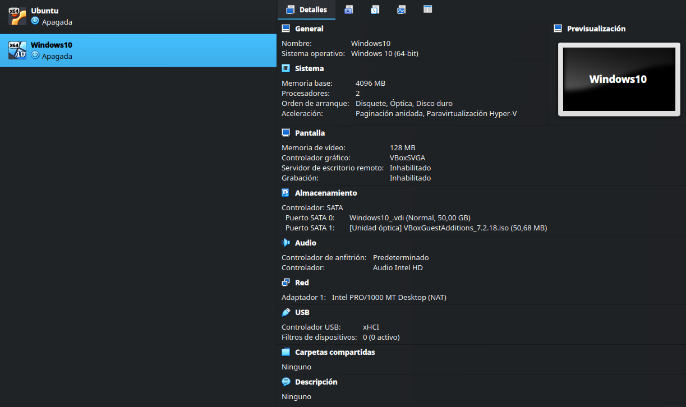
Se li ha donat el doble d'espai a Windows que Ubuntu, segons les mateixes recomanacions del propi assistent de VirtualBox. Per tal de tenir un rendiment òptim se li ha assignat 4GB de memòria RAM i 2 fils del processador.

3. Resposta

Els passos a seguir s'han extret d'un pdf de la classe però s'adjunta per tenir-ho tot endreçat en un únic punt.

- Es descarrega la ISO de les GuestAdditions (proporcionat pel professor en el moodle).
- Inicia la màquina virtual amb el sistema operatiu Windows. 
- A la barra de menú superior de la finestra de VirtualBox, fes clic a "Devices" (dispositius).
- Selecciona l'opció "Insert Guest Additions CD image" (Insereix la imatge de CD de les Guest Additions).
- Obre l'explorador de fitxers de Windows i entra a "This equip" (Aquest equip). Obre la unitat de CD virtual de les Guest Additions.
- Executa el fitxer "VBoxWindowsAdditions.exe" fent-hi doble clic. Si cal, fes clic amb el botó dret i selecciona "Executa com a administrador".
- Segueix les instruccions de l'assistent d'instal·lació, prem "Next", has de mantenir les opcions per defecte i fer clic a "Install".
- Si Windows demana autorització per instal·lar controladors o programari, accepta-la.
- Quan acabi la instal·lació, fes clic a "Finish" i reinicia la màquina virtual si t'ho demana. 
- La ISO es trasllada amb les altres per tenir-les totes agrupades. I s'aprofita per traslladar també, ja que no s'havia fet, el "Pack Extension".

>**Important:** si no apareix la unitat de CD, torna al menú "Devices" i selecciona l'opció d'inserir la imatge de les Guest Additions.

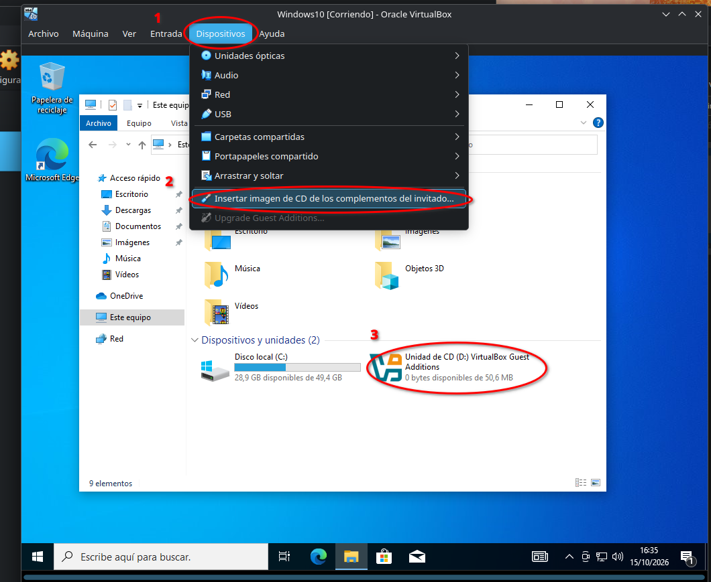

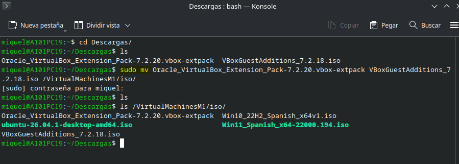

Els principals avantatges que aporten les "Guest Addition" són:
- Resolució de pantalla adaptable: ajusta la resolució automàticament i permet utilitzar el mode de pantalla completa.
- Integració del ratolí: permet moure el ratolí entre el sistema amfitrió i la màquina virtual amb més fluïdesa.
- Portapapers compartit: permet copiar i enganxar text entre els dos sistemes, si aquesta funció està activada.
- Carpetes compartides: permet accedir a carpetes del sistema amfitrió des de Windows, si s'han configurat a VirtualBox.

Tots aquests problemes els vaig patir la primera vegada que vaig instal·lar Ubuntu fa uns anys i desconeixia que es podia solucionar amb les "Guest Additions". 

4. Resposta

S'han d'utilitzar les tecles "Windows+R" i escriure "services.msc". En el llistat que apareix s'ha de buscar (avall de tot) el procés "Windows Update" i donar-li doble click. En el desplegable a l'apartat on apareix "Manual" s'ha de canviar a "Deshabilitat". 

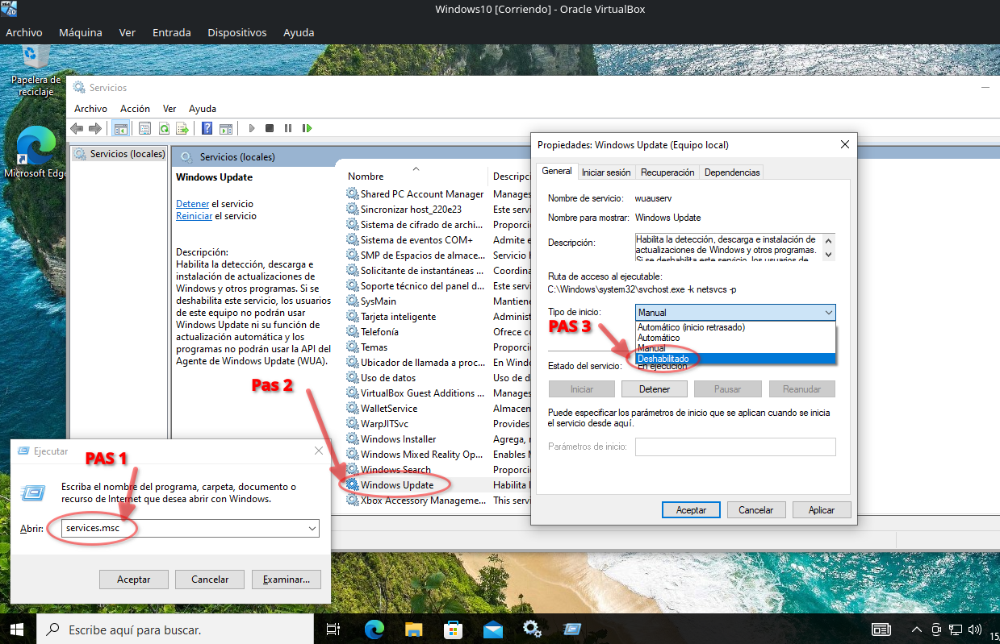

5. Resposta

S'ha de fer de la següent manera:
- Exportar a OCI...
- OVA 2.0
- Seleccionar carpeta de destí
- No incloure imatge ISO

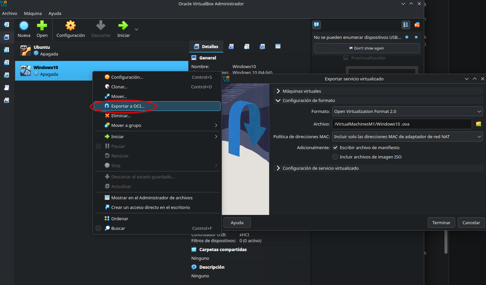

## Apartat D. Instal·lació d'un sistema operatiu lliure (Ubuntu)
Igual que en Windows, un cop solucionat els permisos del directori mare s'ha instal·lat sense cap problema. Per no ocupar tant d'espai amb les imatges, ho especifico a continuació a través d'una enumeració, la qual pertany cada una a una pàgina d'instal·lació manual. Aquesta ha estat de la següent manera:

La instal·lació d'Ubuntu s'ha especificat manualment:
- _Escoger idioma_: Triar idioma.
- _Accesibilidad en Ubuntu_: No s'ha tocat res.
- _ Disposición del teclado_: No s'ha tocat res; en l'idioma triat.
- _Internet_: No s'ha tocat res; Utilitzar connexió per cable.
- _¿Qué quiere hacer?_: Instal·lar d'Ubuntu.
- _¿Cómo le gustaría instalar Ubuntu?_: No s'ha tocat res; instal·lació interactiva (desconec les altres dues).
- _Aplicaciones_: Només esencial (d'aquesta manera aprendrem a fer-ho per nosaltres mateixos en les futures pràctiques).
- _Programas privativos recomendados_: S'ha donat que sí a les dues opcions.
- _¿Cómo instalar?_: Esborrar disc i instal·lar Ubuntu.
- _Cifrado_: No es xifra el disc entenent que és per practicar i que ja està dintre un disc dur extern xifrat. Per tant no necessita tanta seguretat.
- _Cree su cuenta_: Omplir tots els camps.
- _Seleccione huso horario_: Triar el teu.
- _Revisar_: Si tot està bé, llavors instal·lar (triga una estona).

1. Resposta

S'ha fet servir la [pàgina oficial](https://ubuntu.com/download/desktop) per extreure els requisits d'Ubuntu Dsektop. Aquests s'han representat en la següent taula:

| Component | Requisits mínims | Requisits recomanable |
| :---: | :---: | :---: |
| Processador | 2 GHz (Gigahertz) dual-core | Qualsevol actual |
| RAM | 6 GB | Qualsevol actual |
| Disc dur | Espai de 25GB | 30GB o superior |
| Targeta gràfica | No especifica | Qualsevol actual |
| Pantalla | No especifica | Qualsevol actual |

2. Resposta

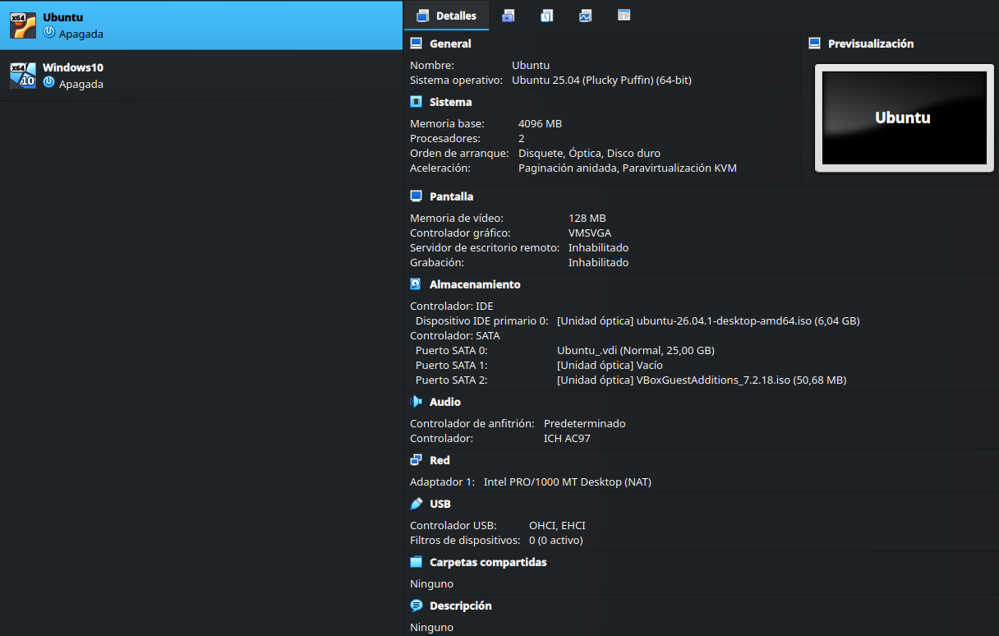

Per tal de tenir un rendiment òptim se li ha assignat 4GB de memòria RAM i 2 fils del processador. Però amb la meitat de memòria RAM que a Windows, ja que no necessita tant d'espai.

3. Resposta

S'han explicat a l'inici de l'apartat D per estar en consonància amb l'apartat C de Windows.

4. Resposta

En Ubuntu es fa des de la configuració de la mateixa màquina virtual tal com es pot veure en la imatge.

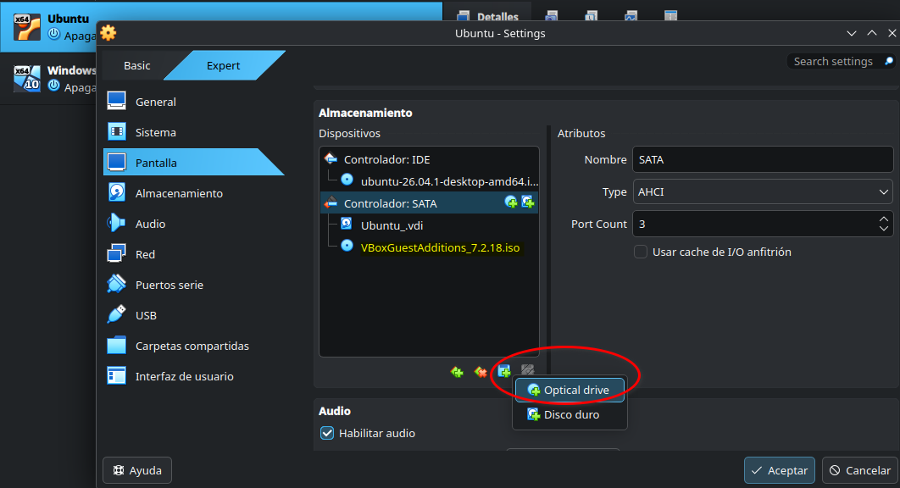

5. Resposta

S'ha de fer de la següent manera, igual que amb Windows:
- Exportar a OCI...
- OVA 2.0
- Seleccionar carpeta de destí
- No incloure imatge ISO

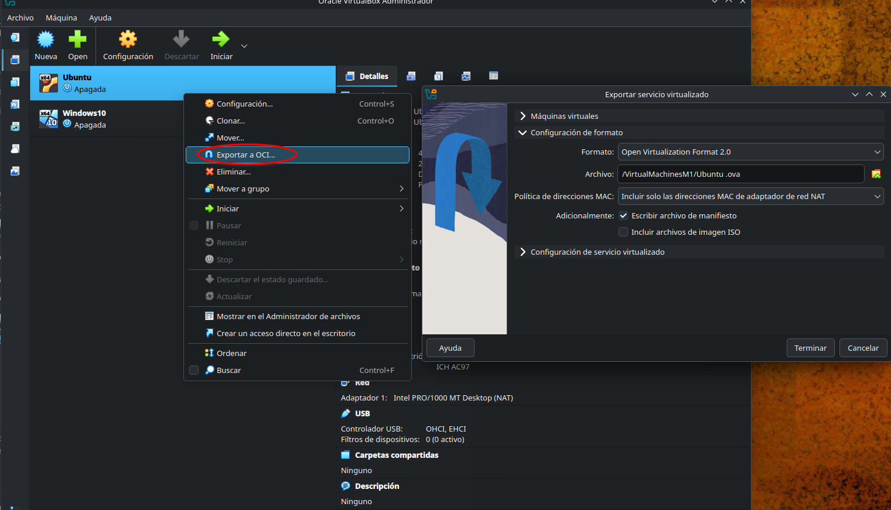

Es va acabar l'hora de la classe quan s'estava exportant la màquina de Windows 10. Aquí es mostra que s'havia creat una carpeta específica per mantenir les màquines virtuals (base). En no recordar que s'havia creat aquest directori posteriorment, s'han traslladat dintre un cop han sigut obtingudes.

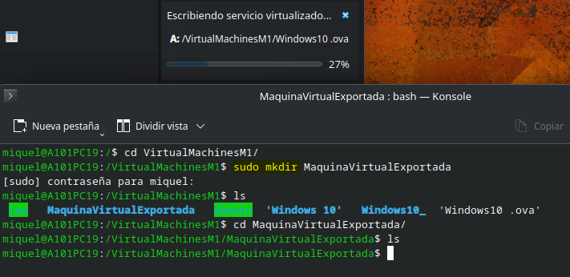

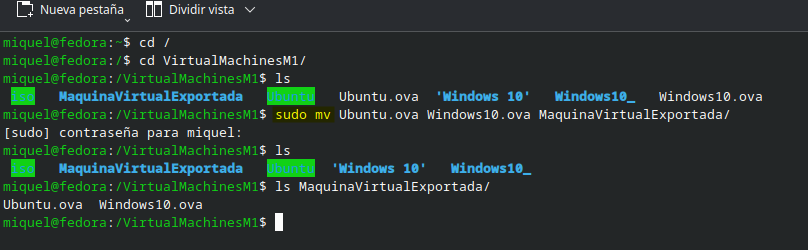

En fer un repàs de l'activitat, m'he adonat de què no havia canviat els noms de les màquines virtuals exportades, així que s'ha fet.

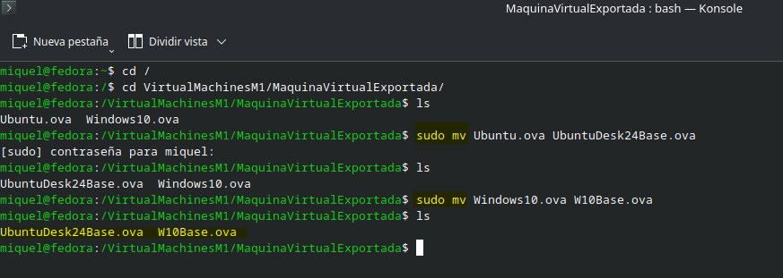

## Apartat E. Arrencada DUAL

1. Resposta

Se segueixen tots els passos ja coneguts de l'apartat C per tornar a instal·lar Windows amb una excepció. Quan es tria l'espai assignat, en comptes d'utilitzar tots els GB per a Windows, se li ha de fer una partició per tal de deixar un espai sense assignar per a quan s'instal·li Ubuntu. S'ha fet una separació de 30-20GB tal com es veu en la imatge.

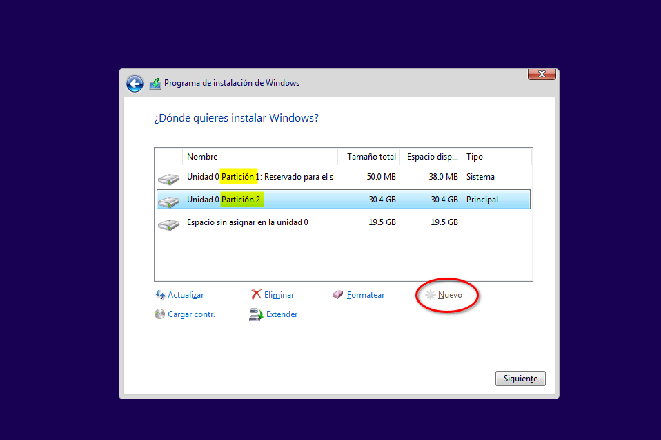

2. Resposta

Per a fer ara la instal·lació d'Ubuntu, primer s'ha d'afegir un nou "optical dirve" per tal de dir-li a la màquina d'on extreure l'instal·lador.

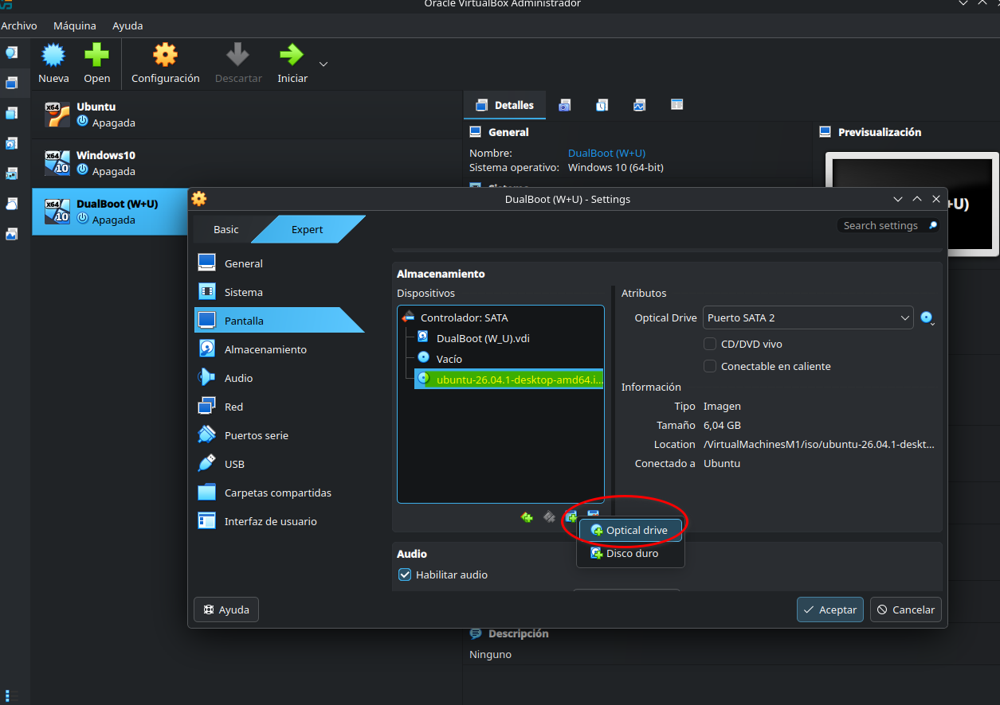

S'inicia la màquina virtual DualBoot, però en comptes d'obrir l'instal·lador em torna a engegar Windows. Es comprova, efectivament, que l'instal·lador està preparat. Es tanca sessió i s'investiga un cop més les opcions de la màquina virtual DualBoot. En l'apartat de "Sistema" canviem la prioritat de _óptica_ i la col·loquem en primera posició. Pensant que ja s'havia solucionat l'error tornem a iniciar la màquina virtual i es torna a engegar Windows directament. Tanco un altre cop i decideixo desactivar temporalment el _disc dur_ del mateix llistat, per forçar la instal·lació.

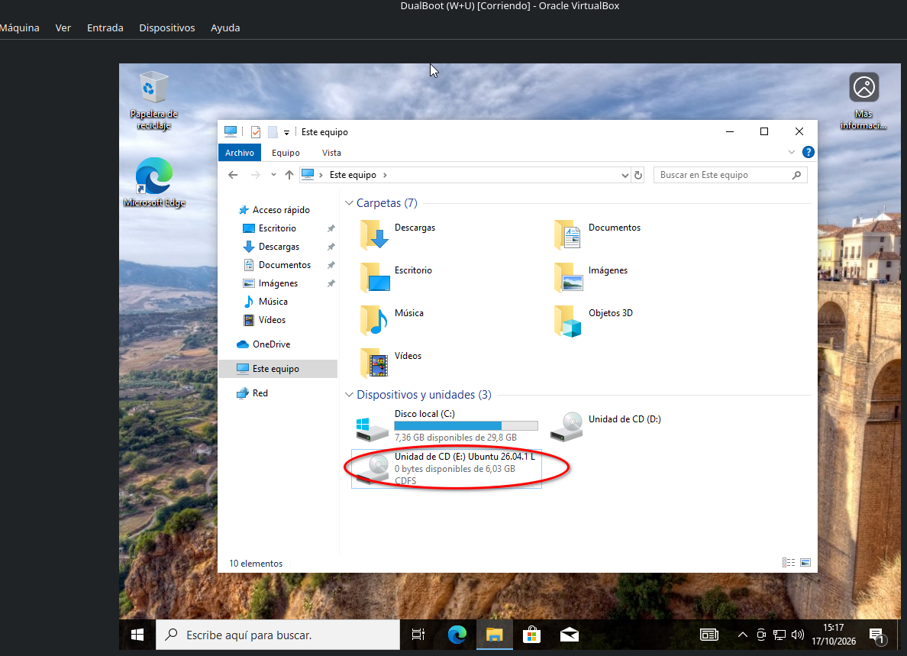

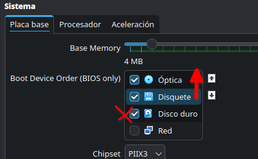

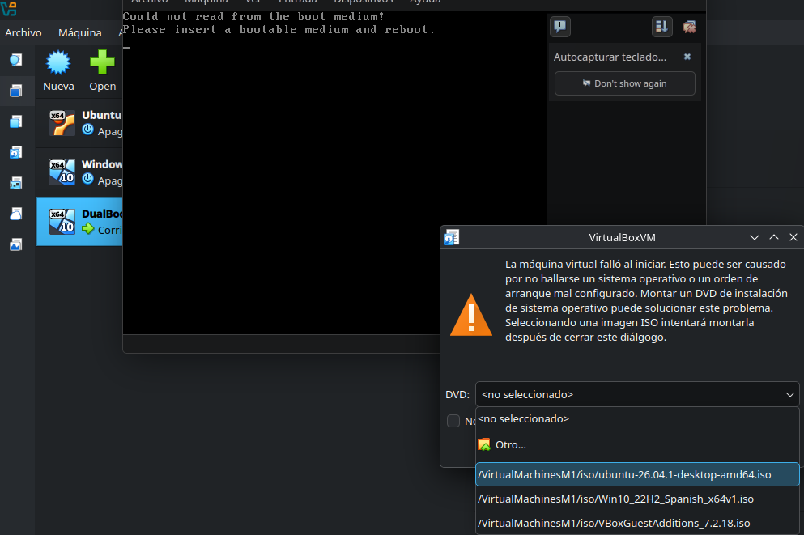

D'aquesta manera sí que arrenca l'instal·lador d'Ubuntu. Un cop dins, es segueixen els passos ja coneguts en l'apartat D fins que aquest et demana _¿Cómo quieres instalar Ubuntu?_, assignant-li la primera opció anomenada _Instalar Ubuntu junto a Windows 10_. Automàticament li assignarà l'espai lliure que ja s'havia creat anteriorment. 

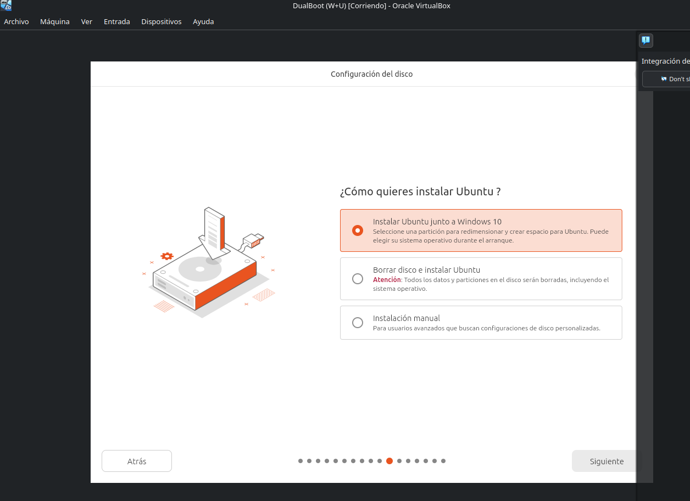

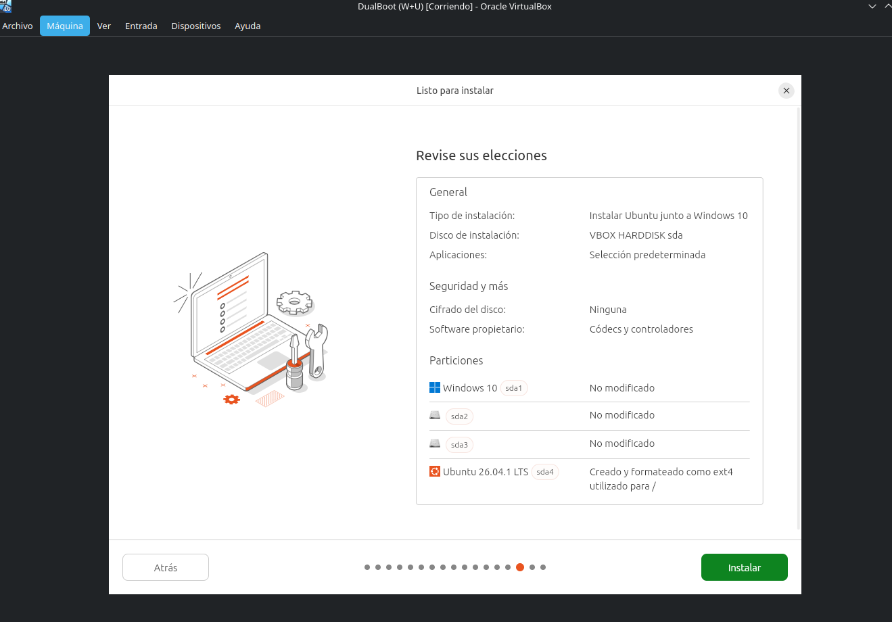

És important saber que un cop finalitzada la instal·lació i reiniciat Ubuntu, s'han de treure de la configuració la imatge ISO d'Ubuntu i tornar a activar l'opció del sistema del disc dur, per tal d'evitar tenir problemes futurs.

3. Resposta

En iniciar un cop fet els passos anteriors m'ho ha fet directament en Ubuntu. Per tal de saber el perquè he començat buscant informació sobre el _menú del Grub_, ja que no sabia què era exactament més enllà d'una pàgina inicial on et deixa triar amb quin sistema es vol començar. És llavors quan m'he trobat amb aquesta [pàgina web](https://somebooks.es/obtener-el-menu-de-grub-en-ubuntu-24-04-lts/) on no només ho explica sinó també et diu com canviar la configuració per tal de no haver d'estar constantment, en iniciar, amb la tecla shift premuda. 

S'han seguit els passos indicats, que aquests són:
- Obrir Ubuntu.
- Obrir la terminal amb _Ctrl+Alt+T_.
- Escriure: _sudo gnome-text-editor /etc/default/grub_ per obrir el fitxer.
- Escriure: la contrasenya, per tant, es necessiten permisos d'administrador.
- Canviar: _GRUB_TIMEOUT_STYLE=hidden_ per _#GRUB_TIMEOUT_STYLE=hidden_.
- Canviar: _GRUB_TIMEOUT=0_ per _GRUB_TIMEOUT=10_.
- Guardar: els canvis.
- Escriure: _sudo update-grub_ per actualitzar.
- Reiniciar.

A partir d'aquí s'han fet les proves i efectivament cada vegada que s'obre la màquina virtual DualBoot apareix el menú de grub i pots triar quin sistema operatiu vols iniciar.

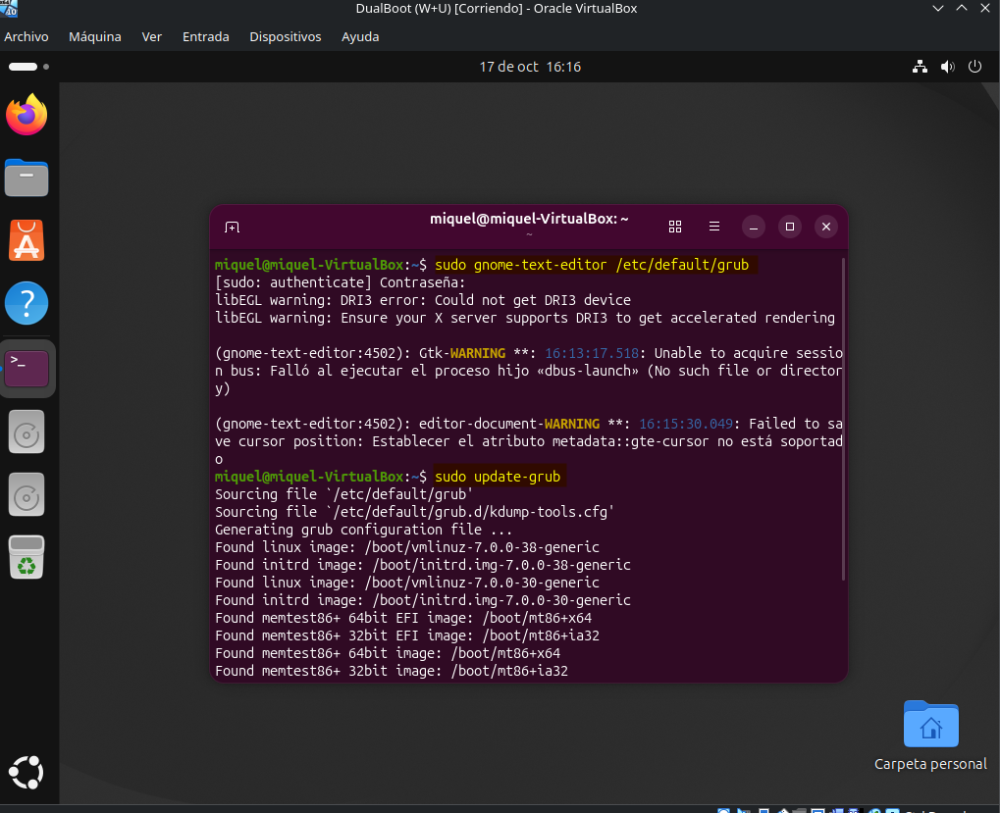

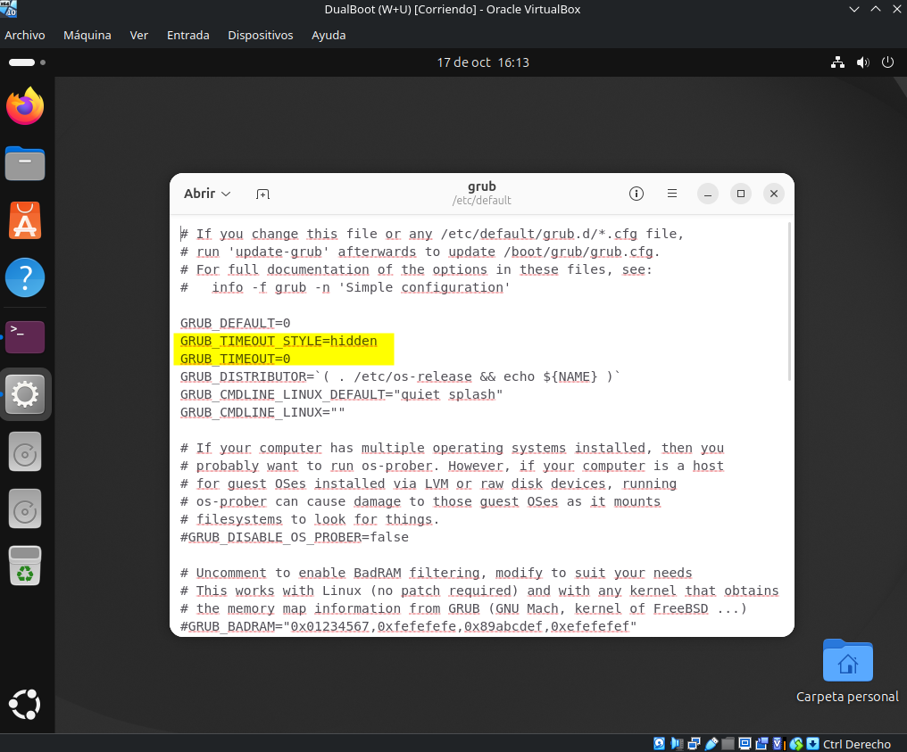

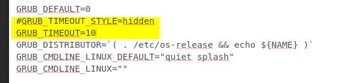

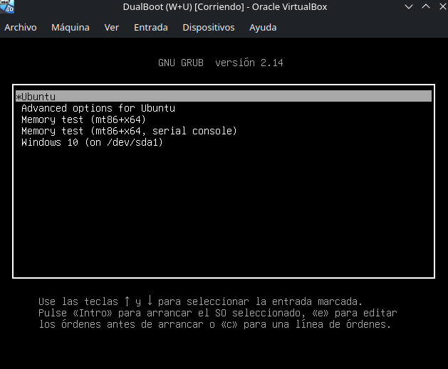

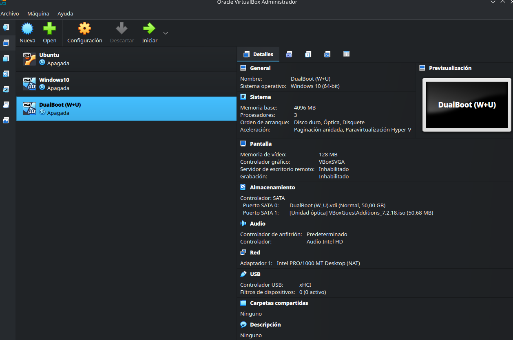