# Projecte 5: Instal·lació i administració de programari base
«S'ha sintetitzat el contingut del document original per tal de centrar-se en els aspectes clau, havent depurat i omès qualsevol informació de caràcter personal.»

**Preparació**

Per clonar una màquina virtual, s'ha de preparar de la següent manera:

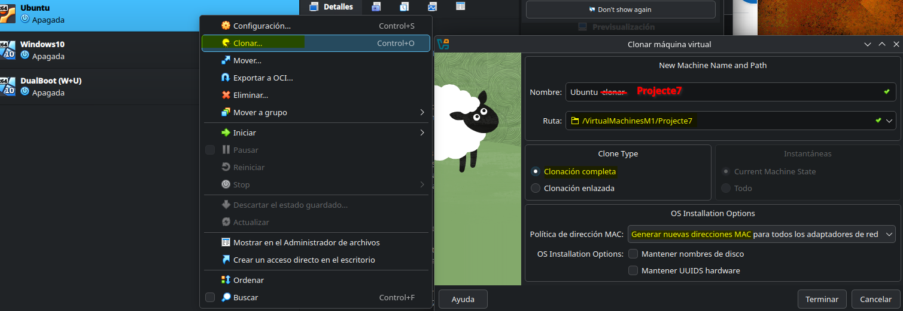

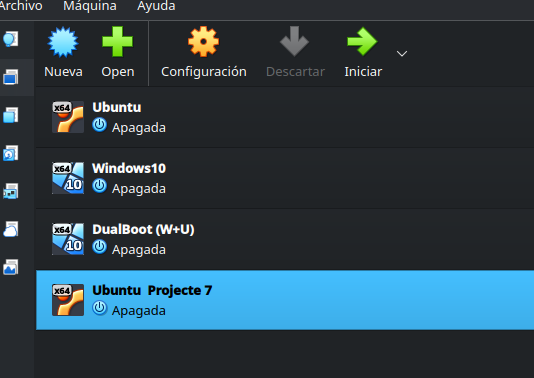

## Apartat A. Comandes bàsiques sobre arxius i carpetes
1. **Resposta**

S'ha creat dintre del directori home, el directori anomenat "Activitat_7" seguint el mateix ordre de directoris que en l'esquema.

Hi ha hagut un petit "desliz" i s'han creat els tres últims directoris del directori "Primer" fora d'ell. Per tant, s'han traslladat dintre. L'ordre es pot veure en la imatge.

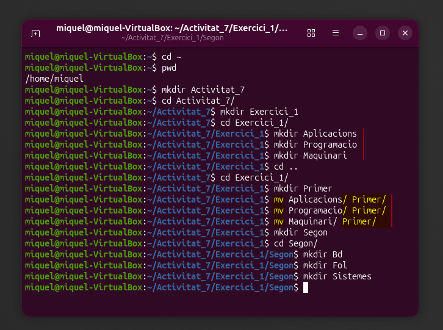

2. **Resposta**

S'ha fet un primer intent i no ha sortit del tot bé. S'han creat tots els directoris en el mateix espai. S'han esborrat amb "rm -r" seguit de tots els noms. I s'ha començat de zero. Ha sigut llavors quan m'he adonat de l'error. Havia deixat espais entre els noms per inèrcia d'escriptura.

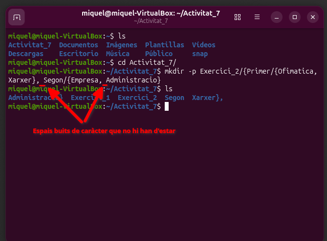

Ens hem desplaçat un altra vegada dins del directori **Activitat_7** i llavors hem escrit la comanda sense espais. La comanda "-p" serveix per indicar que crearàs a continuació directoris, pares i fills. Perquè sigui més comprensible s'ha representat d'aquesta manera:

`mkdir -p Exercici_2/{Primer/{Ofimatica,Xarxes},Segon/{Empresa,Administracio}}`

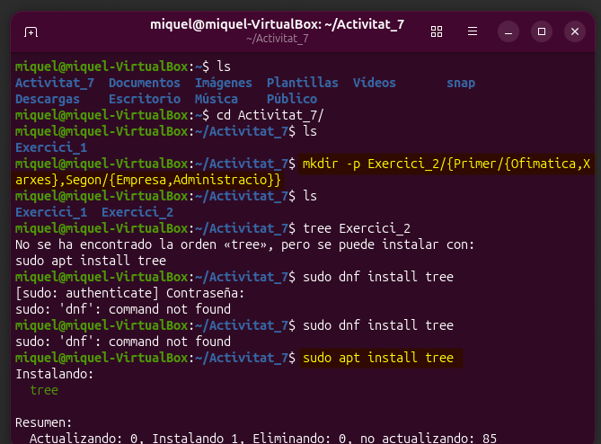

Tal com es pot veure en les imatges, la comanda "tree" t'ajuda a posar de manera visual el directori demanat (pare i fills). Així amb un cop d'ull es pot saber si s'ha creat tal com es tenia pensat. És per això, com en el meu cas, que s'ha hagut de descarregar prèviament perquè encara no el tenia. I el resultat ha estat:

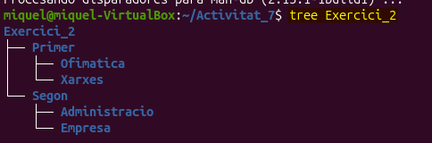

3. **Resposta**.

S'ha creat tal com s'ha indicat en l'enunciat.
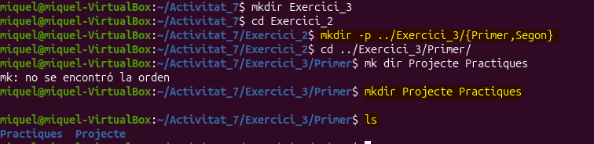

4. **Resposta**

Per anar al teu directori personal es fa servir la comanda "cd ~" i allà s'han fet les altres dues.

5. **Resposta**

Es pot veure com s'han creat correctament. Ressalten precisament perquè són arxius envoltats de directoris.
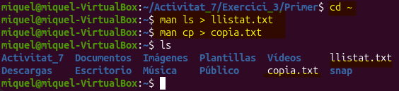

6. **Resposta**

Es crea una còpia amb la comanda "cp llistat.txt llistat2.txt".

7. **Resposta**

Es crea un fitxer amb la comanda "touch notes.txt"

8. **Resposta**

I llavors es mou l'arxiu dintre del directori:
```
Activitat_7
  |__ Exercici_3
        |__ Primer
              |__ notes.txt
```
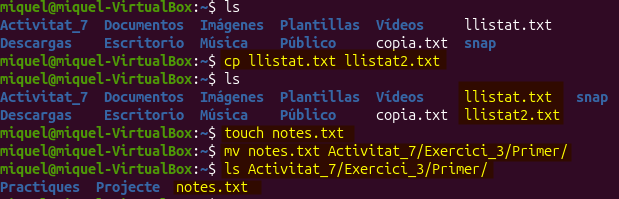

9. **Resposta**

S'ha canviat de nom l'arxiu des del directori personal.
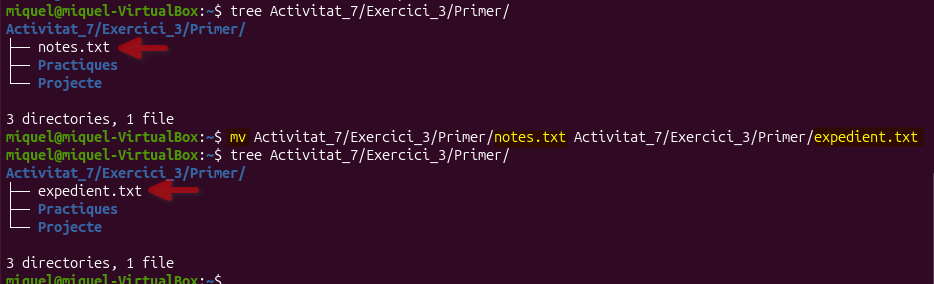

10. **Resposta**

S'ha esborrat amb la comanda "rm"

11. **Resposta**

Per esborrar des de la ruta absoluta s'ha d'esborrar amb "rm -r /noms_directoris".

12. **Resposta**

En canvi, per fer-ho des de la ruta relativa s'ha de fer des de la posició en la que et trobes en aquell moment, amb "rm -r"

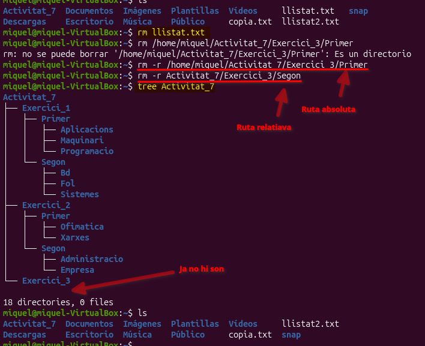

13. **Resposta**

Per tal de veure com s'esborren els següents directoris aquí deixem representada l'arbre actual de la "Activitat_7".

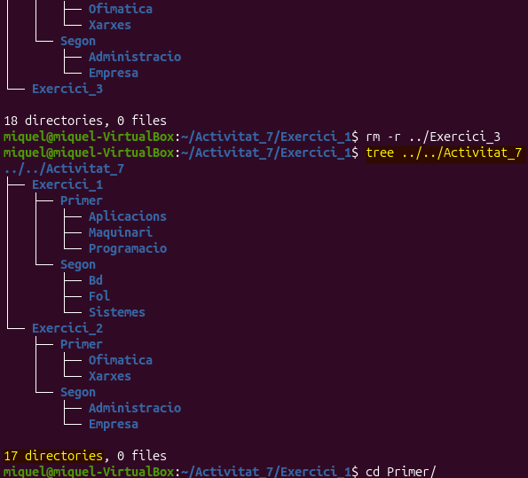

14. **Resposta**

S'esborra el directori des de l'indicat i es passa al següent.

15. **Resposta**

S'esborra el directori indicat.

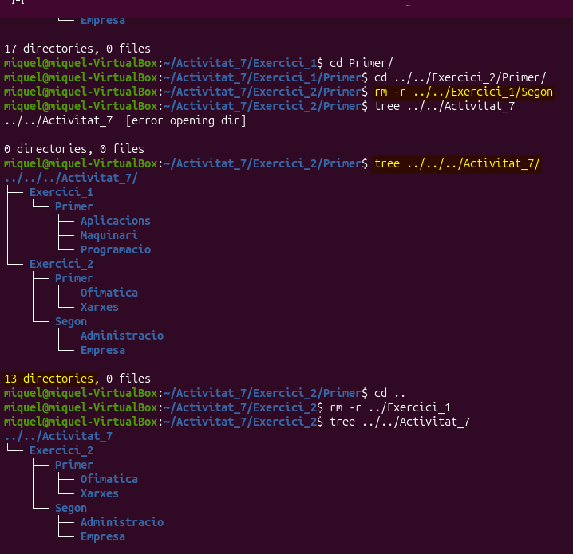

16. **Resposta**

S'esborra tota l'estructura d'"activitat_7" en una única comanda.

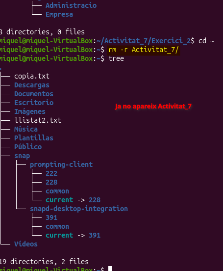


## Apartat B. Administració de la xarxa

1. **Resposta**

Es canvia la configuració a la configuració de la mateixa màquina virtual tal com es veu en la imatge.
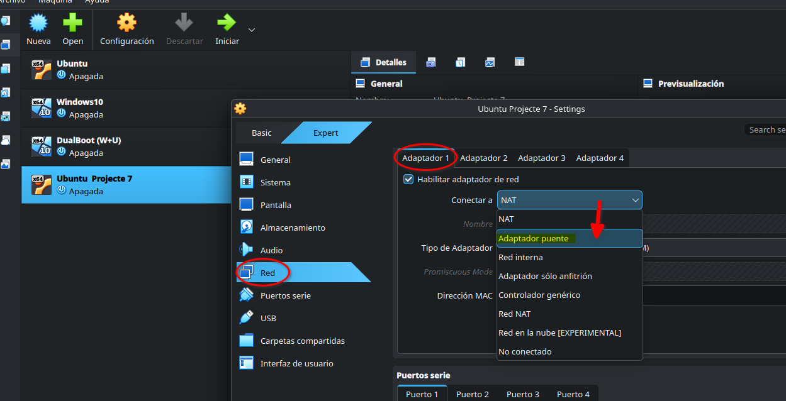

2. **Resposta**

Per comprovar l'adreça IP es fa servir la comanda "ip a".

3. **Resposta**

Entenc que al canviar la configuració de la xarxa a "Adaptador pont" el que fa la màquina virtual en qüestió és subministrar internet a la màquina a través de la connexió física del host principal directament. Aquesta assignació ve donada, normalment, pel router més proper.

4. **Resposta**

Per saber a quina classe pertany l'adreça IP s'agafa el primer nombre decimal. Com que en aquest cas no hem de transformar d'hexadecimal a decimal per saber-ne el número, perquè ja ens ve donada, només ens hem de quedar amb el primer decimal. Sabent que les classes (tal com hem estudiat a l'assignatura de _Planificació i administració de la xarxa_) es troben agrupades en:
    - Classe A: de la 0 a la 127.
    - Classe B: de la 128 a la 191.
    - Classe C: de la 192 a la 223.
    - Classe D: de la 224 a la 255.

5. **Resposta**

La màscara assignada és determinada pel "/24" que hi ha després del número IP (podria ser /8, /16 o 24/). El "/24" correspon als tres primers decimals, això vol dir que la màscara d'aquesta adreça IP és "255.255.255.0". 

6. **Resposta**

Per fer aquesta activitat, s'ha fet servir de referència aquest [vídeo](https://www.youtube.com/watch?v=MUCoY4Xfn2Q) de YouTube. En determinar una adreça IP fixa assegura un enllaç fiable en la xarxa (essencials per servidors, accés remot...). Per fer-ho serà necessari el programari netplan. Per a identificar quin arxiu necessitem hem de fer servir la comanda "ls -la /etc/netplan/". Aquesta comanda serveix per llistar tots els fitxers de configuració de xarxa d'Ubuntu.
- "ls" -> llista arxius
- "-la" -> mostra el llistat detallat i els ocults
- /etc/netplan/ -> és la ubicació estàndard

Per veure com està configurat l'arxiu es fa servir la comanda "cat" i aquest diu:
network:
  version: 2
  renderer: NetworkManager

  Es pot distingir doncs que no hi ha cap IP fixa prèvia i tota la xarxa és administrada pel "NetworkingManager", el servei de configuració que ve donada per defecte en UBuntu.

Per a modificar l'arxiu que necessitem s'ha de fer servir la comanda "nano". Aquesta serveix per modificar fitxers amb privilegis d'administrador. Per tant fem la comanda "sudo nano /etc/netplan/01-network-manager-all.yaml". Per poder entendre millor la configuració a seguir s'ha mirat la [pàgina oficial](https://netplan.readthedocs.io/en/stable/netplan-tutorial/) amb exemples. És absolutament imprescindible que Yaml no fa servir tabulador, sinó espais de dos en dos per les classificacions.

Una vegada fet els canvis canvien (per seguretat) que aquests arxius només els pugui modificar l'administrador root amb la següent comanda "sudo chmod 600 /etc/netplan/*.yaml".
És un pas que s'hauria d'haver comprovat abans, però que no havia caigut. Llavors s'apliquen els canvis amb "sudo netplan apply". I m'ha donat error. Havia donat per fet que l'arxiu que comença per 00 dintre del directori netplan, a l'anomenar-se "installer" no influiria en els canvis que faria en l'arxiu 01. En fer servir la comanda "cat" en els dos arxius he vist que estava equivocat per suposar sense saber. 

S'ha modificat llavors l'arxiu 00 (no s'ha esborrat per si de cas) perquè no influeixi col·locant com si tot allò fos un comentari amb # perquè no hi hagi conflicte intern entre els arxius. Aquesta vegada m'ha deixat fer "sudo netplan apply" per guardar els canvis i s'ha fet un ping a google.com per comprovar que tots els paquets funcionen correctament.

**EXTRA:** Necessitava invertir molt de temps per entendre com fer la IP fixa. És per això que s'ha fet a casa. S'havia que al tornar a classe tindria problemes però també m'ha servit per aprendre a solucionar-ho a través de les configuracions (tornar a canviar a NAT temporalment). Així, un cop a classe, he descobert que en una futura ocasió el què haig de fer és obrir dos ports directament per prevenir futurs incidents. Un d'IP fixa i l'altre de NAT.

7. **Resposta**

Per comprovar quina comanda s'havia de fer servir amb ARP s'ha extret d'aquest [pàgina web](https://manpages.ubuntu.com/manpages/focal/es/man8/arp.8.html). La comanda per enrutament ja es coneixia i és "ip route". S'ha instal·lat el paquet ARP i s'ha pogut comprovar les entrades actuals de xarxa. S'entén que un fa referència al cable directa i l'altre la connexió de wifi del mòbil.

## Apartat C. Instal·lació de programari i actualitzacions
1. **Resposta**

S'han fet servir les comandes "sudo apt update" i "sudo apt upgrade". Com que m'he oblidat de col·locar dins la comanda el "-y" per acceptar automàticament les actualitzacions, s'ha hagut de fer de manera manual.

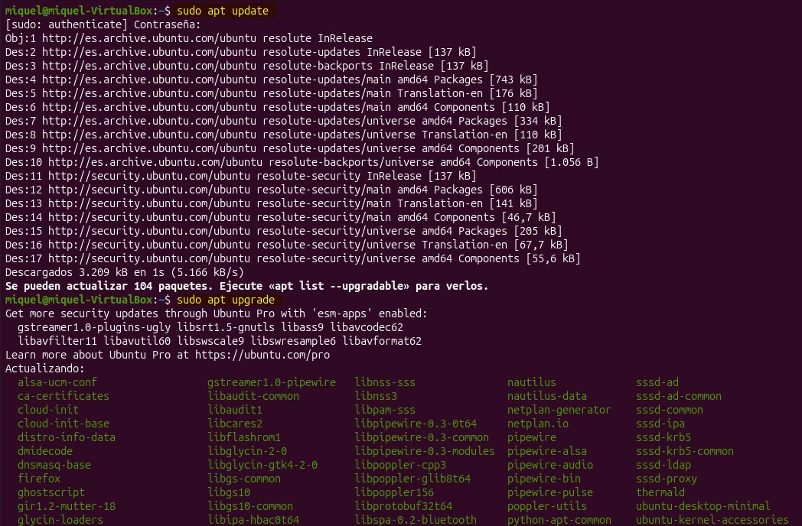


2. **Resposta**

Investigant quins són tots els [possibles mètodes](https://serverspace.io/es/support/help/installing-ubuntu-debian-programs-using-the-batch-manager/) per instal·lar del que disposa un administrador, s'han triat aquests tres programaris per fer-ho: Visual Studio Code, l'Asciidoctor i el Python.

Amb el primer mètode es buscarà el programa Asciidoctor a través de l'administrador de paquets amb la comanda "sudo apt install -y asciidoctor". 

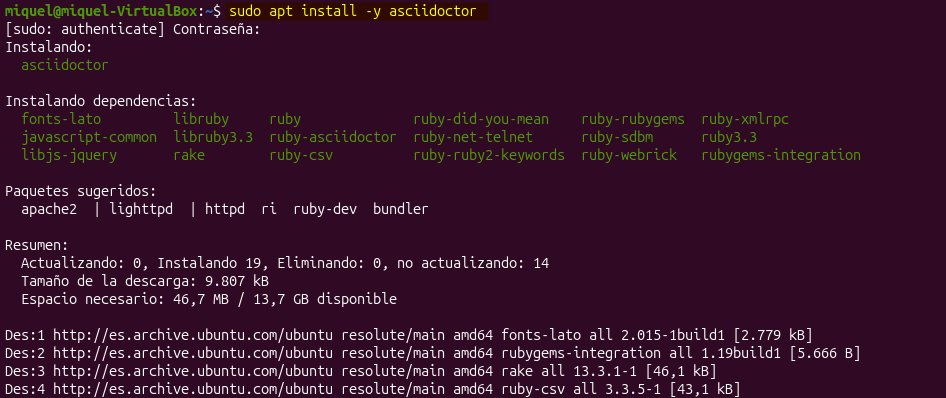

Amb el segon mètode es buscarà el programa VSCode a través d'un arxiu .deb i aquest l'obtenim de la [pàgina oficial](https://code.visualstudio.com/docs/setup/linux) de Code. La mateixa web t'indica que hi ha dues maneres de fer-ho, el mètode actual i l'antic. Provarem el més actual. Per fer-ho s'ha de descarregar l'arxiu .deb i fer servir la comanda "sudo apt install ./code.deb". Ens desplacem al directori on tenim l'arxiu i, sobretot, li hem de dir el nom exacte del code.

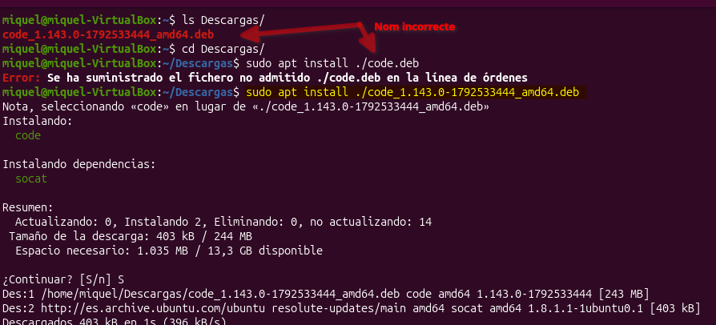

Amb el tercer mètode s'ha hagut d'investigar més per entendre bé com s'ha de fer. Tot i això la part més "complicada" és trobar una font confiable. Per això ha sigut preferible anar directament al [Github oficial](https://github.com/pyenv/pyenv) de pyenv. Aquest el vaig conèixer quan vaig fer _Code in place_ d'Stanford. A partir d'aquí seguim les instruccions per instal·lar Python (script) a través de la terminal.

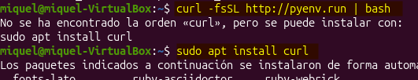

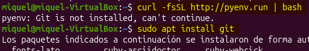

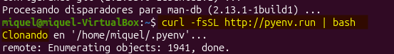

3. **Resposta**

S'han mirat els directoris i les versions dels programes a través de les comandes "--version" i "which". I llavors s'han eliminat amb la comanda "remove". Tal com es veu en les imatges el propi sistema em recomana fer servir la comanda "sudo apt autoremove" per eliminar paquets que ja no són necessaris després de la desinstal·lació.

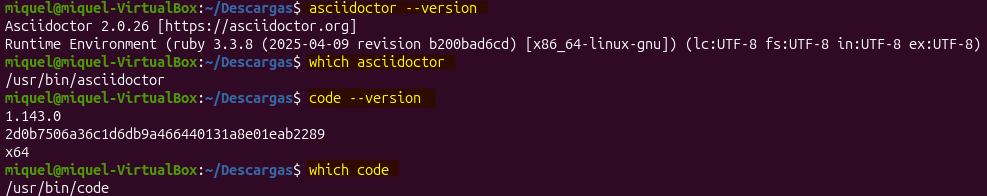

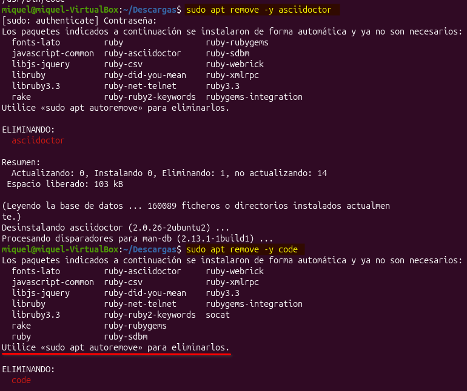

En aquest cas s'han esborrat, tot i que no es vegi en la imatge, tant Python3, com Git i Curl (necessàries per intal·lar Python3)

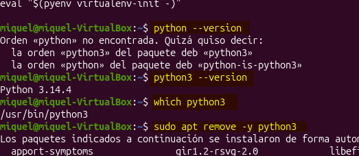

## Apartat D. Logs de sistema i registre

**PROBLEMES ESTRUCTURALS AMB LA MV**

En aquest punt de l'activitat ha aparegut un problema inesperat. S'ha sortit de la màquina virtual per llegir la web que es fa servir en aquesta activitat. A l'estar una estona llegint s'ha bloquejat l'usuari de la màquina virtual. I quan s'ha intentat entrar han començat els "problemes". A la mínima que tocava una tecla o amb el ratolí em sortia "contrasenya equivocada" com si tota l'estona hagués estat tocant la tecla "enter". A partir d'aquí, s'ha reiniciat la màquina virtual i la interfície gràfica havia desaparegut i t'enviava directament a la pantalla anomenada **TTY** (teletypewriter). S'ha demanat ajuda al professor, i dos companys que en saben molt també han intervingut.

El problema en aquest punt era que hi havia comandes que no funcionaven i sobretot no es podia accedir a internet per mirar de restaurar o instal·lar altre cop la gràfica, encara que no fos la mateixa. Quan s'han acabat els coneixements que tenien els companys, s'ha recorregut inclús a l'assistència de la IA. I ni així ha funcionat. És per això que en aquest punt s'ha donat definitivament per perduda aquesta màquina virtual i els exercicis que havíem fet fins ara. Se n'ha clonat una de nova i s'ha continuat llavors amb l'apartat actual. Com que s'han perdut els logs registrats el que es farà serà instal·lar i desinstal·lar l'Asciidoctor. 

**APARTAT D**

En aquesta [pàgina web](https://oneuptime.com/blog/post/2026-03-02-how-to-debug-apt-package-installation-failures-on-ubuntu/view), en l'apartat de "Checking dpkg logs" t'ensenya a fer la comanda per veure els últims logs. Com he tingut el problema anterior, s'ha instal·lat i desinstal·lat l'Asciidoctor i prou. 

Per una banda, tenim de la següent manera: "cat /var/log/apt/history.log | [tail](https://www.geeksforgeeks.org/linux-unix/tail-command-linux-examples/) -20". Faig dos errors que en aquell moment no distingeixo i vaig a buscar directament l'arxiu.

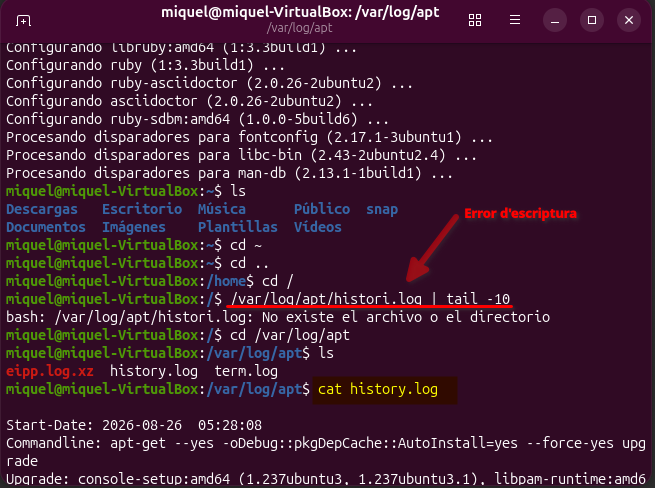

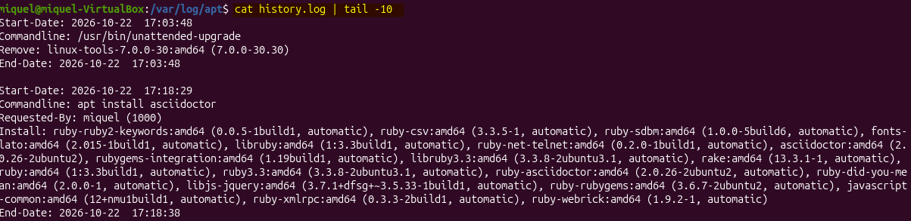

Per l'altre tenim la manera que m'ha ensenyat un company "més visual". Pugem un directori (/var/log/) i busquem l'anomenat dpkg. I se li fa la següent comanda "grep "install" dpkg.log | tail -10". Aquesta comanda el que fa és buscar en tot l'arxiu els últims logs que tinguin la paraula "install" integrada. D'aquesta manera es pot buscar el programa en concret que es necessiti. Són dues maneres diferents de trobar la mateixa informació.

## Apartat E. Usuaris i grups
1. **Resposta**

Per fer aquesta activitat s'ha fet servir la informació extreta d'aquesta [pàgina web](https://ubuntu.com/server/docs/how-to/security/user-management/). Per tal de crear els usuaris es fa servir la comanda "sudo adduser nom_user". Per tant, s'ha fet servir tres vegades per crear els tres usuaris. 

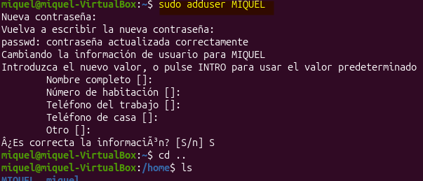

2. **Resposta**

Es crean els tres usuaris amb la comanda "sudo adduser _nom_".

  - L’usuari 1 és el propietari de la carpeta 1.

Com que el propietari de la carpeta 1 ja és precisament l'usuari 1, la comanda que s'ha de fer servir és la de "chown" per donar-li els permisos. S'ha de fer "sudo chown USER:USER /home/directori1".

Apunt: "Some people use the recursive option (-R) indiscriminately, which modifies all child folders and files. However, this is not necessary and may have undesirable/unintended consequences."

  - L’usuari 3 és el propietari de la carpeta 2.

S'han canviat els permisos perquè l'usuari USER3 sigui el propietari del directori3.

  - L’usuari 1 i 2 podran accedir a la carpeta 1 i crear, modificar i eliminar fitxers.

Per canviar els permisos dels usuaris amb els respectius directoris s'ha de fer servir la comanda "[setfacl](https://manpages.ubuntu.com/manpages/trusty/man5/acl.5.html)" (serveix per configurar les "llistes de control d'accés") i per poder-ho fer s'ha d'instal·lar el programari acl per poder-ho fer. La "-m" serveix per modificar les ACL existents del fitxer o directori. Per comprovar si ha servit es fa servir la comanda "setfacl /home/nom_carpeta"

  - L’usuari 3 pot accedir a la carpeta 1, però tan sols pot llistar i visualitzar els fitxers.

Com que el tercer usuari només pot fer lectura del directori1, en la comanda s'ha d'especificar només la "r--".

  - L’usuari 2 i 3 podran accedir a la carpeta 2, però l’usuari 1 no pot accedir-hi. 

Se li han concedit permisos al ususari 2 i 3 però se li han denegat al primer usuari.

3. **Resposta**

Si mirem el directori arrel/etc podrem trobar els directoris correponents "passwd" i "group". Cada un està duplicat amb un "-" al final del nom. S'entén que serà un backup o alguna cosa semblant, perquè quan fas un "tail" et mostra exactament la mateixa informació.

## Apartat F. Memòria, processos i serveis

1. **Resposta**

Per mirar els processos que s'estan executant en aquests instants s'ha de fer servir la comanda "ps aux".

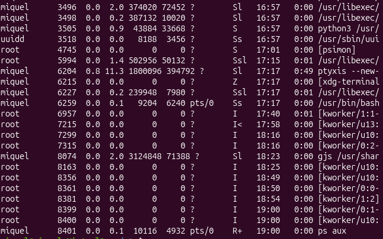

2. **Resposta**

Mirem, en primer lloc, si tenim alguna versió d'OpenOffice. Ens ha indicat que s'ha de descarregar perquè no el tenim.

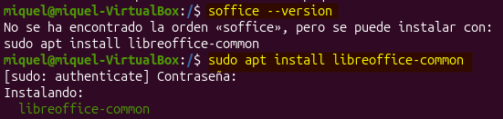

A continuació, obrim office en segon pla perquè ens deixi continuar treballant amb la terminal. Busquem exactament el procés que s'ha creat i fem servir la comanda "kill" per tancar-lo forçosament. 

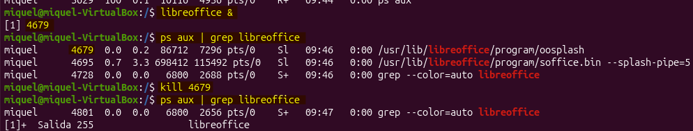

3. **Resposta**

S'obre firefox en segon pla i s'elimina afegint a la comanda la "p" al davant de kill per advertir que vols eliminar el procés amb aquest nom i així evitar buscar el número en concret del procés. 

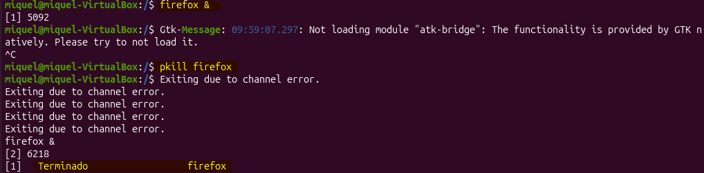


4. **Resposta**

Per respondre a aquest exercici s'ha buscat la informació pertinent en aquesta [pàgina web](https://blogubuntu.com/combinaciones-de-teclas-utiles-en-ubuntu) i [aquesta altre](https://www.luisllamas.es/comandos-linux-procesos/). 

Quan obres un programa en primer pla des de la terminal, aquesta queda bloquejada i no pots continuar escrivint noves comandes fins que aquesta es torna a alliberar. Per fer-ho has d'escriure la comanda "Ctrl + C" per interrompre el que estava fent. 

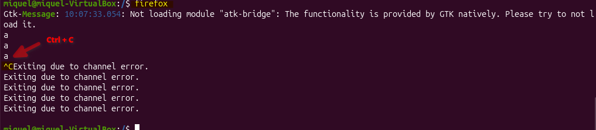

Al tornar a obrir el programa Firefox i aturar el procés amb "Ctrl + Z". Queda detingut (congelat) i no podem navegar a través d'ell fins que no el recuperem. Per fer-ho s'ha de fer servir la comanda "bg" si el vols recuperar en segon pla o "fg" si el vols recuperar en primer pla.


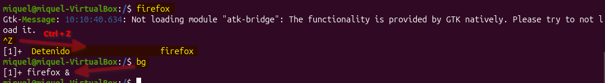

5. **Resposta**

Per mostrar l'activitat en temps real s'ha de fer servir la comanda "top". Si es vol consultar només la memòria s'ha de fer servir la comanda "free -m".

- Memòria total: 3398'8 MB
- Memòria utilitzada: 1806'7 MB
- Memòria Swap: 3909 MB (només s'estan fent servir 20MB)

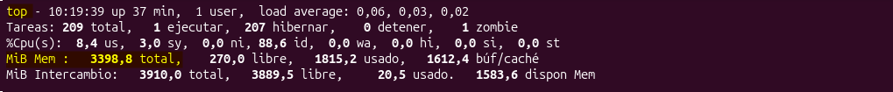

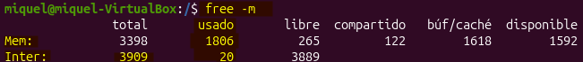