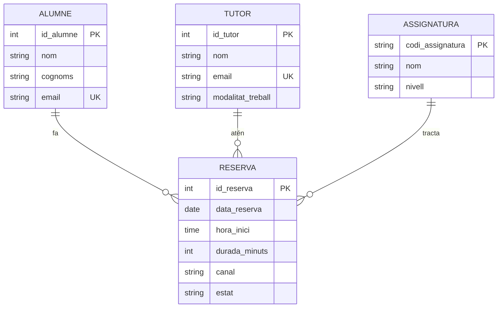
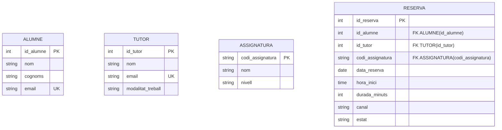

# Activitat 001: Reserva de tutories

### Crow's foot

`RESERVA` s’ha de modelar com una *entitat associativa*, ja que representa un fet amb identitat pròpia i té diversos atributs: data, hora, durada, canal i estat.



Lectura d’una de les relacions:

* un `ALUMNE` pot fer zero o moltes `RESERVA`;
* cada `RESERVA` és feta per exactament un `ALUMNE`.

El mateix patró s’aplica a `TUTOR` i `ASSIGNATURA`.

### Transformació

#### Transformació de les entitats

En aquest primer pas només es transformen les entitats amb els seus atributs propis. Les claus foranes s'incorporen posteriorment en transformar les relacions.

**ALUMNE**
> `ALUMNE(id_alumne, nom, cognoms, email)`  
> PK: `id_alumne`  
> AK: `email`

**TUTOR**
> `TUTOR(id_tutor, nom, email, modalitat_treball)`  
> PK: `id_tutor`  
> AK: `email`

**ASSIGNATURA**
> `ASSIGNATURA(codi_assignatura, nom, nivell)`  
> PK: `codi_assignatura`

**RESERVA**
> `RESERVA(id_reserva, data_reserva, hora_inici, durada_minuts, canal, estat)`  
> PK: `id_reserva`

Les claus foranes d'`ALUMNE`, `TUTOR` i `ASSIGNATURA` s'incorporen en el pas següent.

#### Transformació de les relacions

**ALUMNE - RESERVA (1:N)**

Un alumne pot fer zero o moltes reserves, i cada reserva correspon a un únic alumne.

La clau primària `id_alumne` s'incorpora a `RESERVA` com a clau forana.

Després de transformar aquesta relació, l'entitat modificada queda així:

> `RESERVA(id_reserva, data_reserva, hora_inici, durada_minuts, canal, estat, id_alumne)`  
> PK: `id_reserva`  
> FK: `id_alumne` $\rightarrow$ `ALUMNE(id_alumne)` NOT NULL

**TUTOR - RESERVA (1:N)**

Un tutor pot atendre zero o moltes reserves, i cada reserva és atesa per un únic tutor.

La clau primària `id_tutor` s'incorpora a `RESERVA` com a clau forana.

Després de transformar aquesta relació, l'entitat modificada queda així:

> `RESERVA(id_reserva, data_reserva, hora_inici, durada_minuts, canal, estat, id_alumne)`  
> PK: `id_reserva`  
> FK: `id_alumne` $\rightarrow$ `ALUMNE(id_alumne)` NOT NULL  
> FK: `id_tutor` $\rightarrow$ `TUTOR(id_tutor)` NOT NULL

**ASSIGNATURA - RESERVA (1:N)**

La clau primària `codi_assignatura` s'incorpora a `RESERVA` com a clau forana.

Després de transformar aquesta relació, l'entitat modificada queda així:

> `RESERVA(id_reserva, data_reserva, hora_inici, durada_minuts, canal, estat, id_alumne)`  
> PK: `id_reserva`  
> FK: `id_alumne` $\rightarrow$ `ALUMNE(id_alumne)` NOT NULL  
> FK: `id_tutor` $\rightarrow$ `TUTOR(id_tutor)` NOT NULL  
> FK: `codi_assignatura` $\rightarrow$ `ASSIGNATURA(codi_assignatura)` NOT NULL

#### Model relacional

> `ALUMNE(id_alumne, nom, cognoms, email)`  
> PK: `id_alumne`  
> AK: `email`
>
> `TUTOR(id_tutor, nom, email, modalitat_treball)`  
> PK: `id_tutor`  
> AK: `email`
>
> `ASSIGNATURA(codi_assignatura, nom, nivell)`  
> PK: `codi_assignatura`
>
> `RESERVA(id_reserva, data_reserva, hora_inici, durada_minuts, canal, estat, id_alumne)`  
> PK: `id_reserva`  
> FK: `id_alumne` $\rightarrow$ `ALUMNE(id_alumne)` NOT NULL  
> FK: `id_tutor` $\rightarrow$ `TUTOR(id_tutor)` NOT NULL  
> FK: `codi_assignatura` $\rightarrow$ `ASSIGNATURA(codi_assignatura)` NOT NULL

| Relació | Clau primària | Claus foranes o úniques |
| :--- | :--- | :--- |
| `ALUMNE` | `id_alumne` | `email UK` |
| `TUTOR` | `id_tutor` | `email UK` |
| `ASSIGNATURA` | `codi_assignatura` | No en té |
| `RESERVA` | `id_reserva` | `id_alumne` $\rightarrow$ `ALUMNE(id_alumne)`<br>`id_tutor` $\rightarrow$ `TUTOR(id_tutor)`<br>`codi_assignatura` $\rightarrow$ `ASSIGNATURA(codi_assignatura)` |

### Normalització

#### ALUMNE

> `ALUMNE(id_alumne, nom, cognoms, email)`  
> PK: `id_alumne`  
> AK: `email`

```text
id_alumne -> nom, cognoms, email
email -> id_alumne, nom, cognoms
```

| Tipus de clau | Atribut o conjunt d'atributs |
| :--- | :--- |
| Clau primària | `id_alumne` |
| Clau candidata alternativa | `email`, marcat com a `UK`. |
| Claus foranes | No en té. |

`id_alumne`, `nom`, `cognoms` i `email` contenen un únic valor per alumne.

*Resultat:* `ALUMNE` està en 1FN.

Les claus candidates són simples: `id_alumne` i `email`.

No hi pot haver dependències parcials respecte d'una clau composta.

*Resultat:* `ALUMNE` està en 2FN.

No hi ha dependències funcionals entre atributs no clau.

*Resultat:* `ALUMNE` està en 3FN.

`id_alumne` i `email` són superclaus.

*Conclusió:* `ALUMNE` està formalitzada fins a BCNF.

#### TUTOR

> `TUTOR(id_tutor, nom, email, modalitat_treball)`  
> PK: `id_tutor`  
> AK: `email`

```text
id_tutor -> nom, email, modalitat_treball
email -> id_tutor, nom, modalitat_treball
```

| Tipus de clau | Atribut o conjunt d'atributs |
| :--- | :--- |
| Clau primària | `id_tutor` |
| Clau candidata alternativa | `email`, marcat com a `UK`. |
| Claus foranes | No en té. |

`id_tutor`, `nom`, `email` i `modalitat_treball` contenen un únic valor per tutor.

*Resultat:* `TUTOR` està en 1FN.

Les claus candidates són simples: `id_tutor` i `email`.

No hi pot haver dependències parcials respecte d'una clau composta.

*Resultat:* `TUTOR` està en 2FN.

No hi ha dependències funcionals entre atributs no clau.

*Resultat:* `TUTOR` està en 3FN.

`id_tutor` i `email` són superclaus.

*Conclusió:* `TUTOR` està formalitzada fins a BCNF.

#### ASSIGNATURA

> `ASSIGNATURA(codi_assignatura, nom, nivell)`  
> PK: `codi_assignatura`

```text
codi_assignatura -> nom, nivell
```

| Tipus de clau | Atribut o conjunt d'atributs |
| :--- | :--- |
| Clau primària | `codi_assignatura` |
| Claus candidates alternatives | No se'n dedueix cap altra del diagrama. |
| Claus foranes | No en té. |

`codi_assignatura`, `nom` i `nivell` contenen un únic valor per assignatura.

*Resultat:* `ASSIGNATURA` està en 1FN.

La clau primària és simple: `codi_assignatura`.

No hi pot haver dependències parcials.

*Resultat:* `ASSIGNATURA` està en 2FN.

No hi ha dependències funcionals entre els atributs no clau `nom` i `nivell`.

*Resultat:* `ASSIGNATURA` està en 3FN.

`codi_assignatura` és una superclau.

*Conclusió:* `ASSIGNATURA` està formalitzada fins a BCNF.

#### RESERVA

> `RESERVA(id_reserva, data_reserva, hora_inici, durada_minuts, canal, estat, id_alumne)`  
> PK: `id_reserva`  
> FK: `id_alumne` $\rightarrow$ `ALUMNE(id_alumne)` NOT NULL  
> FK: `id_tutor` $\rightarrow$ `TUTOR(id_tutor)` NOT NULL  
> FK: `codi_assignatura` $\rightarrow$ `ASSIGNATURA(codi_assignatura)` NOT NULL

```text
id_reserva -> id_alumne,id_tutor,codi_assignatura,data_reserva,hora_inici,durada_minuts,canal,estat
```

| Tipus de clau | Atribut o conjunt d'atributs |
| :--- | :--- |
| Clau primària | `id_reserva` |
| Claus candidates alternatives | No se'n dedueix cap altra del diagrama. |
| Clau forana | `id_alumne`, que referencia `ALUMNE(id_alumne)`. |
| Clau forana | `id_tutor`, que referencia `TUTOR(id_tutor)`. |
| Clau forana | `codi_assignatura`, que referencia `ASSIGNATURA(codi_assignatura)`. |

Cada reserva conté un únic valor per als atributs `id_alumne`, `id_tutor`, `codi_assignatura`, `data_reserva`, `hora_inici`, `durada_minuts`, `canal` i `estat`.

*Resultat:* `RESERVA` està en 1FN.

La clau primària és simple: `id_reserva`.

No hi pot haver dependències parcials.

*Resultat:* `RESERVA` està en 2FN.

Les dades descriptives de l'alumne, el tutor i l'assignatura no es desen a `RESERVA`; només s'hi desen les seves claus foranes.

No hi ha dependències transitives entre atributs no clau dins de `RESERVA`.

*Resultat:* `RESERVA` està en 3FN.

`id_reserva` és una superclau.

*Conclusió:* `RESERVA` està formalitzada fins a BCNF.

### Conclusió

Totes les relacions estan formalitzades fins a BCNF i no requereixen cap descomposició addicional.



| Relació | Determinants de les dependències funcionals | Forma normal final |
| :--- | :--- | :--- |
| `ALUMNE` | `id_alumne`; `email` si és `UNIQUE NOT NULL` | BCNF |
| `TUTOR` | `id_tutor`; `email` si és `UNIQUE NOT NULL` | BCNF |
| `ASSIGNATURA` | `codi_assignatura` | BCNF |
| `RESERVA` | `id_reserva` | BCNF |