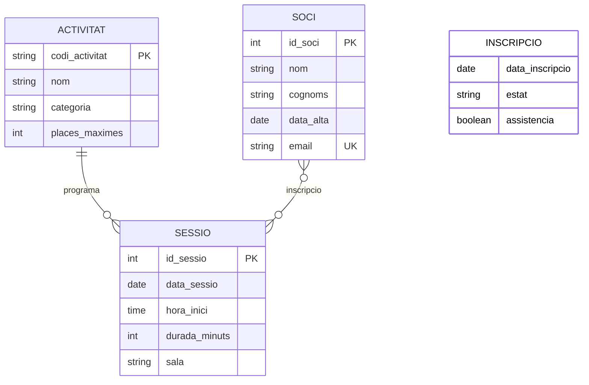
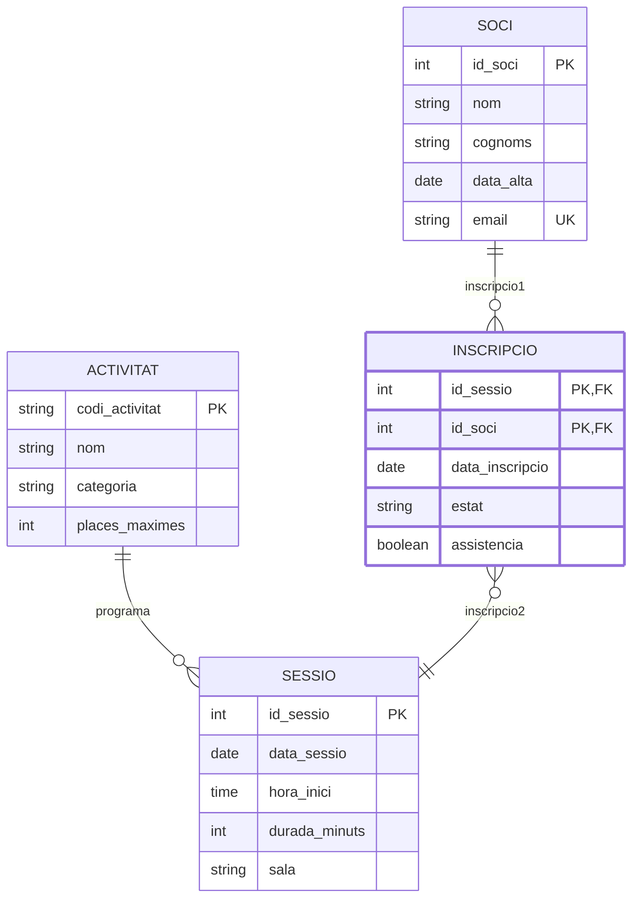
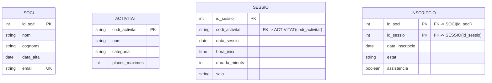

# Activitat 002: Activitats d’un centre esportiu

### Crow's foot





#### Interpretació del diagrama

El diagrama conté les entitats següents:

* `SOCI`
* `ACTIVITAT`
* `SESSIO`

La relació `INSCRIPCIO` no és una entitat inicial del model. És el nom de la relació N:M entre `SOCI` i `SESSIO`.

Els atributs que apareixen dins del bloc `INSCRIPCIO`:

```text
data_inscripcio
estat
assistencia
```

són atributs propis de la relació N:M. Per tant, no es transformen amb les entitats. S'incorporen quan es transforma la relació `SOCI -- SESSIO`.

### Transformació

#### Transformació de les entitats

En aquest primer pas només es transformen les entitats `SOCI`, `ACTIVITAT` i `SESSIO`.

No s'incorporen encara les claus foranes provinents de les relacions.

**SOCI**

`SOCI` es transforma directament en una relació.

* `id_soci` és la clau primària.
* `email` és una clau única, perquè està marcat com a `UK`.
* `nom`, `cognoms` i `data_alta` són atributs descriptius.

> `SOCI (id_soci, nom, cognoms, data_alta, email)`  
> PK: `id_soci`  
> AK: `email`

**ACTIVITAT**

`ACTIVITAT` es transforma directament en una relació.

* `codi_activitat` és la clau primària.
* `nom`, `categoria` i `places_maximes` són atributs descriptius.

> `ACTIVITAT(codi_activitat, nom, categoria, places_maximes)`  
> PK: `codi_activitat`

**SESSIO**

`SESSIO` es transforma directament en una relació.

* `id_sessio` és la clau primària.
* `data_sessio`, `hora_inici`, `durada_minuts` i `sala` són atributs propis de la sessió.
* La clau forana de l'activitat s'incorporarà després, en transformar la relació `ACTIVITAT -- SESSIO`.

> `SESSIO(id_sessio, data_sessio, hora_inici, durada_minuts, sala)`  
> PK: `id_sessio`

#### Transformació de les relacions

**ACTIVITAT - SESSIO 1:N**

* Una activitat pot programar zero o moltes sessions.
* Cada sessió correspon a una única activitat.

És una relació 1:N, amb `ACTIVITAT` al costat 1 i `SESSIO` al costat N.

La clau primària d'`ACTIVITAT`, `codi_activitat`, s'incorpora a `SESSIO` com a clau forana.

Després de transformar la relació, la relació modificada queda així:

> `SESSIO(id_sessio, data_sessio, hora_inici, durada_minuts, sala,codi_activitat)`  
> PK: `id_sessio`  
> FK: `codi_activitat` $\rightarrow$ `ACTIVITAT(codi_activitat)` NOT NULL

**SOCI - SESSIO N:M**

* Un soci pot inscriure's en zero o moltes sessions.
* Una sessió pot tenir zero o molts socis inscrits.

És una relació N:M.

La relació s'anomena `INSCRIPCIO` i té els atributs propis:

```text
data_inscripcio
estat
assistencia
```

Una relació N:M no es pot implementar només incorporant una clau forana en una de les dues relacions.

Per tant, es crea una relació nova anomenada `INSCRIPCIO`.

Aquesta relació incorpora:

* `id_soci`, clau forana cap a `SOCI`;
* `id_sessio`, clau forana cap a `SESSIO`;
* `data_inscripcio`, `estat` i `assistencia`, que són atributs propis de la relació.

La combinació `(id_soci, id_sessio)` és la clau primària composta.

> `INSCRIPCIO(id_soci, id_sessio, data_inscripcio, estat, assistencia)`  
> PK: `id_soci,id_sessio`  
> FK: `id_soci` $\rightarrow$ `SOCI(id_soci)` NOT NULL  
> FK: `id_sessio` $\rightarrow$ `SESSIO(id_sessio)` NOT NULL

#### Model relacional

> `SOCI (id_soci, nom, cognoms, data_alta, email)`  
> PK: `id_soci`  
> AK: `email`
>
> `ACTIVITAT(codi_activitat, nom, categoria, places_maximes)`  
> PK: `codi_activitat`
>
> `SESSIO(id_sessio, data_sessio, hora_inici, durada_minuts, sala,codi_activitat)`  
> PK: `id_sessio`  
> FK: `codi_activitat` $\rightarrow$ `ACTIVITAT(codi_activitat)` NOT NULL
>
> `INSCRIPCIO(id_soci, id_sessio, data_inscripcio, estat, assistencia)`  
> PK: `id_soci,id_sessio`  
> FK: `id_soci` $\rightarrow$ `SOCI(id_soci)` NOT NULL  
> FK: `id_sessio` $\rightarrow$ `SESSIO(id_sessio)` NOT NULL

| Relació | Clau primària | Claus foranes o úniques |
| :--- | :--- | :--- |
| `SOCI` | `id_soci` | `email UK` |
| `ACTIVITAT` | `codi_activitat` | No en té |
| `SESSIO` | `id_sessio` | `codi_activitat` $\rightarrow$ `ACTIVITAT(codi_activitat)` |
| `INSCRIPCIO` | `(id_soci, id_sessio)` | `id_soci` $\rightarrow$ `SOCI(id_soci)`<br>`id_sessio` $\rightarrow$ `SESSIO(id_sessio)` |

### Normalització

#### SOCI

> `SOCI (id_soci, nom, cognoms, data_alta, email)`  
> PK: `id_soci`  
> AK: `email`

| Tipus de clau | Atribut o conjunt d'atributs |
| :--- | :--- |
| Clau primària | `id_soci` |
| Clau candidata alternativa | `email`, perquè està marcat com a `UK`. |
| Claus foranes | No en té. |

Els atributs `id_soci`, `nom`, `cognoms`, `data_alta` i `email` tenen un únic valor per soci.

No hi ha atributs multivaluats ni grups repetitius.

*Resultat:* `SOCI` està en 1FN.

Les claus candidates són simples: `id_soci` i `email`.

No hi pot haver dependències parcials respecte d'una clau composta.

*Resultat:* `SOCI` està en 2FN.

No es dedueixen dependències funcionals entre els atributs no clau `nom`, `cognoms`, `data_alta` i `email`.

*Resultat:* `SOCI` està en 3FN.

Els determinants `id_soci` i `email` són superclaus.

*Conclusió:* `SOCI` està formalitzada fins a BCNF. No cal descompondre-la.

#### ACTIVITAT

> `ACTIVITAT(codi_activitat, nom, categoria, places_maximes)`  
> PK: `codi_activitat`

| Tipus de clau | Atribut o conjunt d'atributs |
| :--- | :--- |
| Clau primària | `codi_activitat` |
| Claus candidates alternatives | No se'n dedueix cap altra a partir del diagrama. |
| Claus foranes | No en té. |

Els atributs `codi_activitat`, `nom`, `categoria` i `places_maximes` tenen un únic valor per activitat.

No hi ha atributs multivaluats ni grups repetitius.

*Resultat:* `ACTIVITAT` està en 1FN.

La clau primària `codi_activitat` és simple.

No hi pot haver dependències parcials.

*Resultat:* `ACTIVITAT` està en 2FN.

No es dedueixen dependències funcionals entre els atributs no clau `nom`, `categoria` i `places_maximes`.

*Resultat:* `ACTIVITAT` està en 3FN.

La dependència funcional coneguda és:

```text
codi_activitat ->
    nom,
    categoria,
    places_maximes
```

`codi_activitat` és una superclau.

*Conclusió:* `ACTIVITAT` està formalitzada fins a BCNF. No cal descompondre-la.

#### SESSIO

> `SESSIO(id_sessio, data_sessio, hora_inici, durada_minuts, sala,codi_activitat)`  
> PK: `id_sessio`  
> FK: `codi_activitat` $\rightarrow$ `ACTIVITAT(codi_activitat)` NOT NULL

| Tipus de clau | Atribut o conjunt d'atributs |
| :--- | :--- |
| Clau primària | `id_sessio` |
| Claus candidates alternatives | No se'n dedueix cap altra a partir del diagrama. |
| Clau forana | `codi_activitat`, que referencia `ACTIVITAT(codi_activitat)`. |

Els atributs `id_sessio`, `codi_activitat`, `data_sessio`, `hora_inici`, `durada_minuts` i `sala` tenen un únic valor per sessió.

No hi ha atributs multivaluats ni grups repetitius.

*Resultat:* `SESSIO` està en 1FN.

La clau primària `id_sessio` és simple.

No hi pot haver dependències parcials.

*Resultat:* `SESSIO` està en 2FN.

Els atributs descriptius de l'activitat, com `nom`, `categoria` i `places_maximes`, no s'emmagatzemen a `SESSIO`; només s'hi desa `codi_activitat`.

No es dedueixen dependències transitives dins de `SESSIO`.

*Resultat:* `SESSIO` està en 3FN.

La dependència funcional coneguda és:

```text
id_sessio ->
    codi_activitat,
    data_sessio,
    hora_inici,
    durada_minuts,
    sala
```

`id_sessio` és una superclau.

*Conclusió:* `SESSIO` està formalitzada fins a BCNF. No cal descompondre-la.

#### INSCRIPCIO

> `INSCRIPCIO(id_soci, id_sessio, data_inscripcio, estat, assistencia)`  
> PK: `id_soci,id_sessio`  
> FK: `id_soci` $\rightarrow$ `SOCI(id_soci)` NOT NULL  
> FK: `id_sessio` $\rightarrow$ `SESSIO(id_sessio)` NOT NULL

| Tipus de clau | Atribut o conjunt d'atributs |
| :--- | :--- |
| Clau primària composta | `(id_soci, id_sessio)` |
| Claus candidates alternatives | No se'n dedueix cap altra a partir del diagrama. |
| Clau forana | `id_soci`, que referencia `SOCI(id_soci)`. |
| Clau forana | `id_sessio`, que referencia `SESSIO(id_sessio)`. |

Els atributs `id_soci`, `id_sessio`, `data_inscripcio`, `estat` i `assistencia` tenen un únic valor per inscripció.

No hi ha atributs multivaluats ni grups repetitius.

*Resultat:* `INSCRIPCIO` està en 1FN.

La clau primària és composta: `(id_soci, id_sessio)`.

Els atributs no clau `data_inscripcio`, `estat` i `assistencia` depenen de la combinació completa de soci i sessió:

```text
id_soci, id_sessio ->
    data_inscripcio,
    estat,
    assistencia
```

No es dedueix que algun d'aquests atributs depengui només de `id_soci` o només de `id_sessio`.

*Resultat:* `INSCRIPCIO` està en 2FN.

No es dedueixen dependències funcionals entre els atributs no clau `data_inscripcio`, `estat` i `assistencia`.

*Resultat:* `INSCRIPCIO` està en 3FN.

La dependència funcional coneguda és:

```text
id_soci, id_sessio ->
    data_inscripcio,
    estat,
    assistencia
```

El determinant `(id_soci, id_sessio)` és la clau primària composta i, per tant, una superclau.

*Conclusió:* `INSCRIPCIO` està formalitzada fins a BCNF. No cal descompondre-la.

### Conclusió

Totes les relacions estan formalitzades fins a BCNF. No cal fer cap descomposició addicional.



| Relació | Determinant de les dependències funcionals conegudes | Forma normal final |
| :--- | :--- | :--- |
| `SOCI` | `id_soci`; `email` si és `UNIQUE NOT NULL` | BCNF |
| `ACTIVITAT` | `codi_activitat` | BCNF |
| `SESSIO` | `id_sessio` | BCNF |
| `INSCRIPCIO` | `(id_soci, id_sessio)` | BCNF |