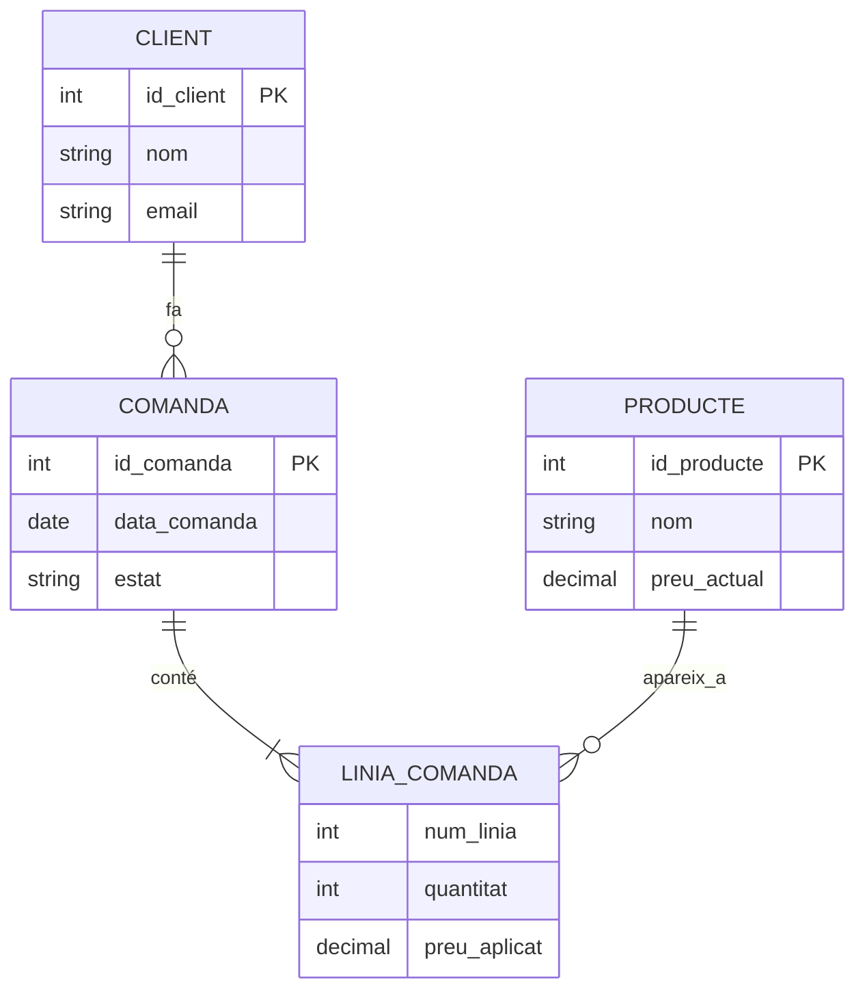
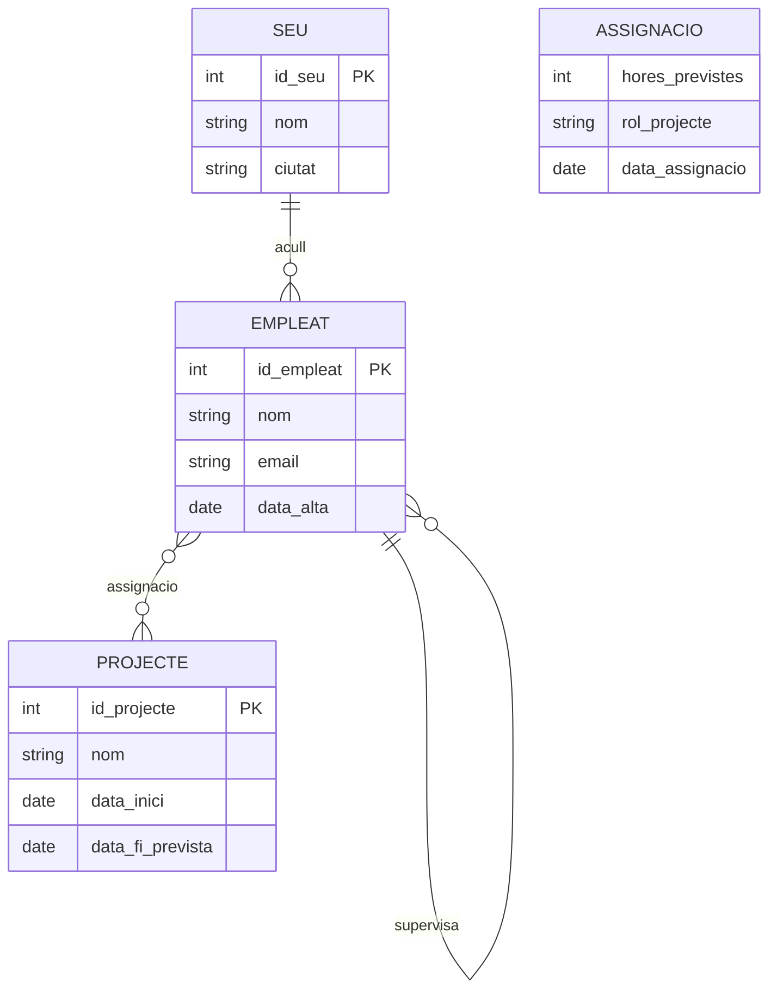

# Exercicis de classe

## Activitat 001: Reserva de tutories
Un institut ofereix tutories de reforç acadèmic. Cal registrar alumnes, tutors, assignatures i reserves de tutoria.

* De cada *alumne* es vol guardar l’identificador, el nom, els cognoms i el correu electrònic.
* De cada *tutor* es vol guardar l’identificador, el nom, el correu electrònic i la modalitat de treball (`presencial` o `remot`).
* De cada *assignatura* es guarda el codi, el nom i el nivell.
* Un alumne pot fer zero, una o moltes reserves al llarg del curs.
* Cada reserva correspon a un únic alumne, un únic tutor i una única assignatura.
* Un tutor pot atendre zero, una o moltes reserves.
* Una assignatura pot aparèixer en zero, una o moltes reserves.
* De cada reserva cal desar la data, l’hora d’inici, la durada prevista, el canal (`aula` o `videoconferència`) i l’estat (`pendent`, `confirmada`, `cancel·lada` o `realitzada`).

**Tasques:**
1. Identifica les entitats, els atributs i les claus identificadores.
2. Decideix si `RESERVA` és una relació simple o una entitat associativa i justifica-ho.
3. Genera un diagrama ER en notació Crow’s Foot mitjançant un bloc Mermaid `erDiagram`.
4. Reflecteix les cardinalitats indicades per l’enunciat.

**Resolucions:** Veure les resolucions de cada un després de practicar-lo per tu mateix

- **Disseny conceptual i lògic (Asciidoctor -> MD):** [Act001_asciidoctor.md](./Act001/Act001_asciidoctor.md)
- **Disseny físic (DDL manual):** [Act001_manual.sql](./Act001/Act001_manual.sql)
- **Exportació / DBeaver:** [Act001_dbeaver.sql](./Act001/Act001_dbeaver.sql)
- **Diagrama:** [Act001_reserva_tutories.png](./Act001/Act001_reserva_tutories.png)
- **Sortida terminal (`SHOW`):** [Act001_show.txt](./Act001/Act001_show.txt)


## Activitat 002: Activitats d’un centre esportiu
Un centre esportiu municipal gestiona socis, activitats dirigides, sessions i inscripcions.

* De cada *soci* cal guardar el número de soci, el nom, els cognoms, la data d’alta i el correu electrònic.
* De cada *activitat* es guarda el codi, el nom, la categoria i el nombre màxim de places.
* Una activitat pot programar-se en diverses sessions; cada sessió correspon a una única activitat.
* De cada *sessió* cal registrar un identificador, la data, l’hora d’inici, la durada i la sala.
* Un soci es pot inscriure a moltes sessions i una sessió pot tenir molts socis inscrits.
* De cada *inscripció* cal guardar la data d’inscripció, l’estat (`confirmada`, `llista_espera` o `cancel·lada`) i l’assistència final.
* Una sessió pot existir encara que no tingui cap inscripció. Un soci pot existir encara que no s’hagi inscrit a cap sessió.

**Tasques:**
1. Identifica les relacions 1:N i M:N.
2. Resol la relació M:N amb una entitat associativa.
3. Dibuixa el diagrama ER Crow’s Foot en Mermaid, incloent-hi atributs, PK i FK.
4. Indica una regla de negoci que *no quedi completament garantida* només amb el diagrama.

**Resolucions:** Veure les resolucions de cada un després de practicar-lo per tu mateix

- **Disseny conceptual i lògic (Asciidoctor -> MD):** [Act002_asciidoctor.md](./Act002/Act002_asciidoctor.md)
- **Disseny físic (DDL manual):** [Act002_manual.sql](./Act002/Act002_manual.sql)
- **Exportació / DBeaver:** [Act002_dbeaver.sql](./Act002/Act002_dbeaver.sql)
- **Diagrama:** [Act002_activitats_centre_esportiu.png](./Act002/Act002_activitats_centre_esportiu.png)
- **Sortida terminal (`SHOW`):** [Act002_show.txt](./Act002/Act002_show.txt)

## Activitat 003: Comandes
Considera el diagrama següent:



**Tasques:**
1. Transforma el diagrama en un esquema relacional.
2. Indica la PK de cada relació.
3. Indica totes les FK i la relació que referencien.
4. Decideix la PK de `LINIA_COMANDA` i justifica-la.
5. Indica quins camps haurien de ser `NOT NULL`.
6. Proposa accions referencials raonables per a les FK.

**Resolucions:** Veure les resolucions de cada un després de practicar-lo per tu mateix

- **Disseny conceptual i lògic (Asciidoctor -> MD):** [Act003_asciidoctor.md](./Act003/Act003_asciidoctor.md)
- **Disseny físic (DDL manual):** [Act003_manual.sql](./Act003/Act003_manual.sql)
- **Exportació / DBeaver:** [Act003_dbeaver.sql](./Act003/Act003_dbeaver.sql)
- **Diagrama:** [Act003_comandes.png](./Act003/Act003_comandes.png)
- **Sortida terminal (`SHOW`):** [Act003_show.txt](./Act003/Act003_show.txt)

## Activitat 004: Projectes i supervisió
Considera el diagrama següent:



**Tasques:**
1. Transforma el diagrama a relacions.
2. Resol correctament la relació recursiva de supervisió.
3. Resol la relació M:N entre `EMPLEAT` i `PROJECTE`.
4. Indica PK, FK, nul·labilitat i dues restriccions `UNIQUE` o `CHECK` que consideris útils.
5. Explica quin valor pot tenir `id_cap` per a la persona situada al màxim nivell de l’organització.


**Resolucions:** Veure les resolucions de cada un després de practicar-lo per tu mateix

- **Disseny conceptual i lògic (Asciidoctor -> MD):** [Act004_asciidoctor.md](./Act004/Act004_asciidoctor.md)
- **Disseny físic (DDL manual):** [Act004_manual.sql](./Act004/Act004_manual.sql)
- **Exportació / DBeaver:** [Act004_dbeaver.sql](./Act004/Act004_dbeaver.sql)
- **Diagrama:** [Act004_projectes_supervisio](./Act004/Act004_projectes_supervisio)
- **Sortida terminal (`SHOW`):** [Act004_show.txt](./Act004/Act004_show.txt)


## Activitat 005: Inscripcions en edicions de cursos
Una aplicació ha començat emmagatzemant les inscripcions en aquesta relació:

```text
INSCRIPCIO_BRUTA(
    id_alumne,
    nom_alumne,
    email_alumne,
    id_edicio,
    data_inici_edicio,
    id_curs,
    nom_curs,
    preu_base,
    id_professor,
    nom_professor,
    data_inscripcio,
    import_aplicat
)
```

Suposa les dependències funcionals següents:

```text
id_alumne -> nom_alumne, email_alumne
id_edicio -> data_inici_edicio, id_curs, id_professor
id_curs -> nom_curs, preu_base
id_professor -> nom_professor
(id_alumne, id_edicio) -> data_inscripcio, import_aplicat
```

**Tasques:**
1. Indica una clau candidata de `INSCRIPCIO_BRUTA`.
2. Determina si la relació compleix 1FN i justifica-ho.
3. Detecta les dependències parcials i transitives.
4. Explica una anomalia d’inserció, una de modificació i una d’esborrat.
5. Descompon la relació fins a BCNF.
6. Per a cada relació resultant, indica la PK i les FK necessàries.
7. Justifica que les relacions resultants compleixen BCNF.

**Resolucions:** Veure les resolucions de cada un després de practicar-lo per tu mateix

- **Disseny conceptual i lògic (Asciidoctor -> MD):** [Act005_asciidoctor.md](./Act005/Act005_asciidoctor.md)
- **Disseny físic (DDL manual):** [Act005_manual.sql](./Act005/Act005_manual.sql)
- **Exportació / DBeaver:** [Act005_dbeaver.sql](./Act005/Act005_dbeaver.sql)
- **Diagrama:** [act005_inscripcions_edicions_cursos.png](./Act005/act005_inscripcions_edicions_cursos.png)
- **Sortida terminal (`SHOW`):** [Act005_show.txt](./Act005/Act005_show.txt)

## Activitat 006: Docència i grups
Una escola registra l’assignació de professorat a grups amb la relació següent:

```text
DOCENCIA_BRUTA(
    id_professor,
    nom_professor,
    id_assignatura,
    nom_assignatura,
    id_grup,
    aula
)
```

Es coneixen aquestes regles de negoci:

* Cada professor imparteix una única assignatura durant el curs acadèmic considerat.
* Un grup rep una única docència per a cada assignatura.
* Un professor pot impartir la seva assignatura a diversos grups.
* L’aula queda determinada per la combinació d’assignatura i grup.
* El nom d’un professor depèn del seu identificador i el nom d’una assignatura depèn del seu identificador.

Les dependències funcionals són:

```text
id_professor -> nom_professor, id_assignatura
id_assignatura -> nom_assignatura
(id_assignatura, id_grup) -> id_professor, aula
```

**Tasques:**
1. Troba totes les claus candidates de `DOCENCIA_BRUTA`.
2. Indica si la relació és en 1FN i justifica-ho.
3. Normalitza fins a 3FN.
4. Demostra que la relació de docència obtinguda en 3FN no està en BCNF.
5. Descompon el model fins a BCNF.
6. Indica si la descomposició a BCNF preserva totes les dependències funcionals de manera directa. Explica la conseqüència pràctica.

**Resolucions:** Veure les resolucions de cada un després de practicar-lo per tu mateix

- **Disseny conceptual i lògic (Asciidoctor -> MD):** [Act006_asciidoctor.md](./Act006/Act006_asciidoctor.md)
- **Disseny físic (DDL manual):** [Act006_manual.sql](./Act006/Act006_manual.sql)
- **Exportació / DBeaver:** [Act006_dbeaver.sql](./Act006/Act006_dbeaver.sql)
- **Diagrama:** [act006_docencia_grups.png](./Act006/act006_docencia_grups.png)
- **Sortida terminal (`SHOW`):** [Act006_show.txt](./Act006/Act006_show.txt)

## Activitat 007: Centre de formació
Un centre de formació ofereix cursos en diferents edicions.

1. Una edició concreta té dates, una aula i un professor responsable.
2. Els alumnes es poden matricular en diverses edicions.
3. Cada matrícula pot tenir una qualificació final, però encara no en tindrà si l'edició no ha acabat.

**Resolucions:** Veure les resolucions de cada un després de practicar-lo per tu mateix

- **Disseny conceptual i lògic (Asciidoctor -> MD):** [Act007_asciidoctor.md](./Act007/Act007_asciidoctor.md)
- **Disseny físic (DDL manual):** [Act007_manual.sql](./Act007/Act007_manual.sql)
- **Exportació / DBeaver:** [Act007_dbeaver.sql](./Act007/Act007_dbeaver.sql)
- **Diagrama:** [act007_centre_formacio.png](./Act007/act007_centre_formacio.png)
- **Sortida terminal (`SHOW`):** [Act007_show.txt](./Act007/Act007_show.txt)

## Activitat 008: Botiga en línia
Una botiga en línia ven productes classificats en categories.

1. Cada comanda pertany a un client i conté una o més línies.
2. Cada línia identifica el producte venut, la quantitat i el preu unitari aplicat en el moment de la compra.
3. El preu unitari de la línia es conserva perquè el preu actual del producte pot canviar posteriorment.

**Resolucions:** Veure les resolucions de cada un després de practicar-lo per tu mateix

- **Disseny conceptual i lògic (Asciidoctor -> MD):** [Act008_asciidoctor.md](./Act008/Act008_asciidoctor.md)
- **Disseny físic (DDL manual):** [Act008_manual.sql](./Act008/Act008_manual.sql)
- **Exportació / DBeaver:** [Act008_dbeaver.sql](./Act008/Act008_dbeaver.sql)
- **Diagrama:** [act008_botiga_en_linia.png](./Act008/act008_botiga_en_linia.png)
- **Sortida terminal (`SHOW`):** [Act008_show.txt](./Act008/Act008_show.txt)

## Activitat 009: Centre mèdic
Un centre mèdic organitza visites de pacients amb metges.

1. Cada metge pertany a una especialitat.
2. Un pacient pot tenir diverses visites i un metge pot atendre moltes visites.
3. Cada visita pot rebre un diagnòstic clínic codificat; aquest diagnòstic és opcional mentre la visita encara no s'ha tancat.

**Resolucions:** Veure les resolucions de cada un després de practicar-lo per tu mateix

- **Disseny conceptual i lògic (Asciidoctor -> MD):** [Act009_asciidoctor.md](./Act009/Act009_asciidoctor.md)
- **Disseny físic (DDL manual):** [Act009_manual.sql](./Act009/Act009_manual.sql)
- **Exportació / DBeaver:** [Act009_dbeaver.sql](./Act009/Act009_dbeaver.sql)
- **Diagrama:** [act009_centre_medic.png](./Act009/act009_centre_medic.png)
- **Sortida terminal (`SHOW`):** [Act009_show.txt](./Act009/Act009_show.txt)

## Activitat 010: Activitats extraescolars
Una associació gestiona activitats extraescolars.

1. Cada activitat pot tenir diversos grups en dies i franges diferents.
2. Cada grup té un monitor responsable i pot rebre moltes inscripcions.
3. Cada infant pot inscriure's en diferents grups, però només una vegada a cada grup.
4. El contacte principal és una persona adulta responsable de l'infant.

**Resolucions:** Veure les resolucions de cada un després de practicar-lo per tu mateix

- **Disseny conceptual i lògic (Asciidoctor -> MD):** [Act010_asciidoctor.md](./Act010/Act010_asciidoctor.md)
- **Disseny físic (DDL manual):** [Act010_manual.sql](./Act010/Act010_manual.sql)
- **Exportació / DBeaver:** [Act010_dbeaver.sql](./Act010/Act010_dbeaver.sql)
- **Diagrama:** [act010_activitats_extraescolars.png](./Act010/act010_activitats_extraescolars.png)
- **Sortida terminal (`SHOW`):** [Act010_show.txt](./Act010/Act010_show.txt)

## Activitat 011: Reserves hoteleres multi-seu
Sistema de reserves hoteleres multi-seu:

* Una cadena hotelera gestiona diversos hotels.
* Cada hotel té habitacions numerades internament.
* Les habitacions pertanyen a un tipus d’habitació, com ara individual, doble o suite.
* Cada client pot fer diverses reserves; una reserva s’efectua en un únic hotel, però pot incloure una o més habitacions del mateix hotel.
* Una reserva pot tenir diversos pagaments.
* El codi de reserva només és únic *dins de cada hotel*. Per això, la reserva s’identifica mitjançant la combinació `id_hotel` i `codi_reserva`.
* Igualment, el número d’habitació només és únic dins de cada hotel.

**Tasques:**
1. Crea el diagrama ER amb notació Crow’s Foot, transforma’l al model relacional i normalitza’l, explicant cada pas que es fa.
2. Normalitza la relació següent:

```text
RESERVA_GLOBAL(
    id_hotel, nom_hotel, ciutat_hotel, email_hotel,
    codi_reserva,
    id_client, document_identitat, nom_client, cognoms_client, email_client,
    data_entrada, data_sortida, estat_reserva,
    habitacions,
    pagaments
)
```

**Resolucions:** Veure les resolucions de cada un després de practicar-lo per tu mateix

- **Disseny conceptual i lògic (Asciidoctor -> MD):** [Act011_asciidoctor.md](./Act011/Act011_asciidoctor.md)
- **Disseny físic (DDL manual):** [Act011_manual.sql](./Act011/Act011_manual.sql)
- **Exportació / DBeaver:** [Act011_dbeaver.sql](./Act011/Act011_dbeaver.sql)
- **Diagrama:** [act011_cadena_hotelera.png](./Act011/act011_cadena_hotelera.png)
- **Sortida terminal (`SHOW`):** [Act011_show.txt](./Act011/Act011_show.txt)

## Activitat 012: Gestió de projectes i hores
Plataforma de gestió de projectes i hores:

* Una empresa de desenvolupament de programari necessita gestionar clients, empleats, projectes, sprints, tasques, etiquetes, assignacions i registres d’hores.
* Un projecte pertany a un client i té una persona responsable.
* Cada projecte pot tenir diversos sprints; el número d’un sprint només és únic dins del projecte.
* Una tasca pertany a un projecte i pot quedar sense sprint inicialment.
* Una tasca pot estar assignada a diversos empleats, i cada empleat pot registrar hores únicament en tasques que té assignades.

**Tasques:**
1. Crea el diagrama ER amb notació Crow’s Foot, transforma’l al model relacional i normalitza’l, explicant cada pas que es fa.
2. Normalitza la relació següent:

```text
PROJECTE_OPERACIO(
    id_projecte, codi_projecte, nom_projecte,
    id_client, rao_social_client, nif_client,
    id_responsable, nom_responsable, email_responsable,
    sprints,
    tasques,
    empleats_assignats,
    etiquetes,
    registres_hores
)
```

**Resolucions:** Veure les resolucions de cada un després de practicar-lo per tu mateix

- **Disseny conceptual i lògic (Asciidoctor -> MD):** [Act012_asciidoctor.md](./Act012/Act012_asciidoctor.md)
- **Disseny físic (DDL manual):** *Encara no fet*
- **Exportació / DBeaver:** *Encara no fet*
- **Diagrama:** *Encara no fet*
- **Sortida terminal (`SHOW`):** *Encara no fet*

## Activitat 013a: Ordinadors A
Una empresa vol informatitzar la seva nòmina. Del resultat de l’anàlisi realitzada s’obtenen les següents informacions:

* A cada empleat se li entreguen múltiples justificants de nòmina durant la seva vida laboral en l’empresa. Com a mínim en rep un mensualment.
* A cada empleat se li assigna un número de matrícula en el moment de la seva incorporació a l’empresa i aquest és el número utilitzat a efectes interns d’identificació.
* A més, es registren el NIF de l’empleat, nom, nombre de fills, percentatge de retenció a Hisenda, dades del compte corrent per ingressar la nòmina (banc, sucursal i número de compte) així com departaments on treballa.
* Un empleat pot treballar en diversos departaments i en cadascun d’ells treballarà amb una funció diferent.
* D’un departament es guarda el nom i cadascuna de les possibles seus (nom, adreça, població, telèfon, fax i Email).
* Les dades d’un justificant de nòmina són l’ingrés total percebut per l’empleat i el descompte aplicat. La distinció entre dos justificants de nòmina es farà mitjançant el número de matrícula de l’empleat, l’exercici fiscal i el número de mes a què pertany. Per distingir varis justificants de nòmina d’un mateix mes s’assignarà un número d’ordre.
* Cada justificant de nòmina consta de vàries línies (com a mínim una d’ingrés). Cada línia s’identifica per un número de línia del corresponent justificant. Una línia pot correspondre a un ingrés o a un descompte. En ambdós casos es guarda la quantitat que correspon a la línia (positiu si es tracta d’un ingrés o negatiu si es tracta d’un descompte); en el cas dels descomptes, es recull la base sobre la qual s’aplica i el percentatge que s’aplica.

**Resolucions:** Veure les resolucions de cada un després de practicar-lo per tu mateix

- **Disseny conceptual i lògic (Asciidoctor -> MD):** [Act013a_asciidoctor.md](./Act013a/Act013a_asciidoctor.md)
- **Disseny físic (DDL manual):** [Act013a_manual.sql](./Act013a/Act013a_manual.sql)
- **Exportació / DBeaver:** [Act013a_dbeaver.sql](./Act013a/Act013a_dbeaver.sql)
- **Diagrama:** [act013a_ordinadors.png](./Act013a/act013a_ordinadors.png)
- **Sortida terminal (`SHOW`):** [Act013a_show.txt](./Act013a/Act013a_show.txt)

## Activitat 013b: Ordinadors B
Es vol dissenyar una base de dades relacional per emmagatzemar la informació relativa als zoos del món, així com les espècies animals que tenen. De cada zoo es coneix el nom, ciutat i país, grandària (en $m^2$) i pressupost anual.

* De cada espècie animal s’emmagatzema el nom comú i el científic i si es troba o no en perill d’extinció.
* A més, de cada animal (no espècie) que té el zoo, s’emmagatzema el seu número d’identificació, espècie, sexe, any de naixement i país d’origen.
* També es vol portar el control de visitants del zoo. Per cada visitant s’emmagatzema el seu DNI, nom sencer i adreça. S’ha de tenir clar que un visitant pot anar a diferents zoos.
* A més d’emmagatzemar tota la informació dels treballadors, es vol conèixer quin és el cuidador de cada animal i quins treballadors s’encarreguen del manteniment del zoo (un cuidador no s’encarrega del manteniment).
* Per últim, per indicar de forma correcta la taxonomia d’un animal, en les informacions que dona el zoo, a més de l'espècie, cal dir la família i classe a la que pertany. Tant una família com una classe, a més del seu nom comú, tenen un nom en llatí.

**Resolucions:** Veure les resolucions de cada un després de practicar-lo per tu mateix

- **Disseny conceptual i lògic (Asciidoctor -> MD):** [Act013b_asciidoctor.md](./Act013b/Act013b_asciidoctor.md)
- **Disseny físic (DDL manual):** [Act013b_manual.sql](./Act013b/Act013b_manual.sql)
- **Exportació / DBeaver:** [Act013b_dbeaver.sql](./Act013b/Act013b_dbeaver.sql)
- **Diagrama:** [act013b_ordinadors.png](./Act013b/act013b_ordinadors.png)
- **Sortida terminal (`SHOW`):** [Act013b_show.txt](./Act013b/Act013b_show.txt)

## Activitat 013c: Ordinadors C
Una empresa dedicada al món de la confecció vol tenir informatitzada tota la seva producció; per fer això vol crear una base de dades amb les dades següents:

* Models que fabrica, amb un codi, amb la gamma de talles en que es fabrica.
* Articles, que està composat pel model i el color d’aquest model. El preu de l’article depèn del model i el color.
* També vol tenir les gammes de talles, és a dir, per exemple el codi A correspon a les talles P M G, el B a les XLLL XLL XL X M S SL SLL, o el C a la talla 42 44 46 48 50 52 54...
* Clients, amb el seu codi i totes les seves dades.
* Proveïdors, amb el seu codi i totes les seves dades.
* Comandes, on consta el codi del client, i un llistat de tots els articles demanats, així com la quantitat que vol de cada talla.
* Stock: es vol saber en cada moment el que hi ha al magatzem per saber si es pot servir o no la comanda. Albarans, que són les comandes que s’han servit, tenint en compte que una comanda es pot servir en diferents albarans, segons es tinguin en el magatzem o no.
* Factures: al final del mes es fa un resum de tots els albarans servits i es fa la seva corresponent factura.
* S’ha de tenir en compte que a la comanda no només s’ha de posar la quantitat demanada, sinó també la quantitat servida.

**Resolucions:** Veure les resolucions de cada un després de practicar-lo per tu mateix

- **Disseny conceptual i lògic (Asciidoctor -> MD):** [Act013c_asciidoctor.md](./Act013c/Act013c_asciidoctor.md)
- **Disseny físic (DDL manual):** *Encara no fet*
- **Exportació / DBeaver:** *Encara no fet*
- **Diagrama:** *Encara no fet*
- **Sortida terminal (`SHOW`):** *Encara no fet*

## Activitat 013d: Ordinadors D
Una empresa vol tenir emmagatzemada la informació del hardware i software del que disposa:

* Hardware: Pot ser ordinador, switch/hub, router.
* Software: Pot ser una aplicació o SO.
* Tant el Hardware com el Software s’identificaran per una referència i tindran una breu descripció.
* Del Software es vol conèixer en quin ordinador està instal·lat i el número de llicència que en té.
* Depenent del tipus de Hardware, hi ha una sèrie de característiques particulars, com que del switch s’ha de conèixer el nombre de ports i la velocitat d’ells.
* Sobre els ordinadors, es vol saber en quin switch i en quina boca està connectat.
* Sobre els switch cal conèixer si està connectat a un altre switch o a un router; també s’ha de connèixer la boca on està connectat.

**Resolucions:** Veure les resolucions de cada un després de practicar-lo per tu mateix

- **Disseny conceptual i lògic (Asciidoctor -> MD):** [Act013d_asciidoctor.md](./Act013d/Act013d_asciidoctor.md)
- **Disseny físic (DDL manual):** [Act013d_manual.sql](./Act013d/Act013d_manual.sql)
- **Exportació / DBeaver:** [Act013d_dbeaver.sql](./Act013d/Act013d_dbeaver.sql)
- **Diagrama:** *Encara no fet*
- **Sortida terminal (`SHOW`):** [Act013d_show.txt](./Act013d/Act013d_show.txt)

## Activitat 014: Biblioteca
Una biblioteca municipal gestiona llibres, autors, exemplars físics, persones usuàries i préstecs. Un llibre pot tenir més d’un autor i un autor pot haver escrit més d’un llibre. Cada exemplar correspon a un únic llibre. Un préstec correspon a un exemplar i a una persona usuària.

Una biblioteca necessita gestionar:
* llibres identificats per ISBN;
* autors;
* exemplars físics de cada llibre;
* socis que poden fer préstecs;
* préstecs d’un exemplar a un soci;
* la data de préstec, la data prevista de retorn i la data real de retorn.

**Regles de negoci:**
1. Un llibre pot tenir diversos autors i un autor pot haver escrit diversos llibres.
2. Cada exemplar pertany a un únic llibre.
3. Un préstec correspon a un únic exemplar i a un únic soci.
4. Un exemplar no pot tenir dos préstecs oberts simultàniament.
5. La data prevista de retorn no pot ser anterior a la data de préstec.
6. Un ISBN no s’ha d’esborrar si existeixen exemplars associats.

**Resolucions:** Veure les resolucions de cada un després de practicar-lo per tu mateix

- **Disseny conceptual i lògic (Asciidoctor -> MD):** *Encara no fet*
- **Disseny físic (DDL manual):** [Act014_manual.sql](./Act014/Act014_manual.sql)
- **Exportació / DBeaver:** [Act014_dbeaver.sql](./Act014/Act014_dbeaver.sql)
- **Diagrama:** [act014_biblioteca.png](./Act014/act014_biblioteca.png)
- **Sortida terminal (`SHOW`):** [Act014_show.txt](./Act014/Act014_show.txt)

## Activitat 015: Data
Com crear l'estructura per la data.

**Resolucions:** Veure les resolucions de cada un després de practicar-lo per tu mateix

- **Disseny conceptual i lògic (Asciidoctor -> MD):** *Encara no fet*
- **Disseny físic (DDL manual):** [Act015_manual.sql](./Act015/Act015_manual.sql)
- **Exportació / DBeaver:** [Act015_dbeaver.sql](./Act015/Act015_dbeaver.sql)
- **Diagrama:** *Encara no fet*
- **Sortida terminal (`SHOW`):** [Act015_show.txt](./Act015/Act015_show.txt)

## Activitat 016: DNI
Com crear l'estructura pel DNI.

**Resolucions:** Veure les resolucions de cada un després de practicar-lo per tu mateix

- **Disseny conceptual i lògic (Asciidoctor -> MD):** *Encara no fet*
- **Disseny físic (DDL manual):** [Act016_manual.sql](./Act016/Act016_manual.sql)
- **Exportació / DBeaver:** [Act016_dbeaver.sql](./Act016/Act016_dbeaver.sql)
- **Diagrama:** *Encara no fet*
- **Sortida terminal (`SHOW`):** [Act016_show.txt](./Act016/Act016_show.txt)

## Activitat 017a: Gimnas
Un gimnàs necessita una base de dades per gestionar els seus entrenadors, les activitats esportives i els socis.
* Cada entrenador pot impartir diverses activitats, però cada activitat té assignat un únic entrenador.
* Un soci pot estar inscrit en una activitat o no estar inscrit en cap.

**Resolucions:** Veure les resolucions de cada un després de practicar-lo per tu mateix

- **Disseny conceptual i lògic (Asciidoctor -> MD):** *Encara no fet*
- **Disseny físic (DDL manual):** [Act017a_manual.sql](./Act017a/Act017a_manual.sql)
- **Exportació / DBeaver:** [Act017a_dbeaver.sql](./Act017a/Act017a_dbeaver.sql)
- **Diagrama:** [act017a_gimnas.png](./Act017a/act017a_gimnas.png)
- **Sortida terminal (`SHOW`):** [Act017a_show.txt](./Act017a/Act017a_show.txt)

## Activitat 017b: Festival musical
L'organització d'un festival de música necessita una base de dades per gestionar els artistes participants, els escenaris disponibles i les actuacions programades.
* Un artista pot tenir diverses actuacions i un escenari pot acollir diverses actuacions.
* Cada actuació correspon obligatòriament a un únic artista i a un únic escenari.

**Resolucions:** Veure les resolucions de cada un després de practicar-lo per tu mateix

- **Disseny conceptual i lògic (Asciidoctor -> MD):** *Encara no fet*
- **Disseny físic (DDL manual):** [Act017b_manual.sql](./Act017b/Act017b_manual.sql)
- **Exportació / DBeaver:** [Act017b_dbeaver.sql](./Act017b/Act017b_dbeaver.sql)
- **Diagrama:** [act017b_festival_musica.png](./Act017b/act017b_festival_musica.png)
- **Sortida terminal (`SHOW`):** [Act017b_show.txt](./Act017b/Act017b_show.txt)


## Activitat 018a: Patinatge musiques
Crear una base de dades on emmagatzemar les músiques d'un campionat de patinatge artístic sobre rodes.
* Cada patinador, que per tant a un sol club, té una música específica quan competeix.
* Un club només per tany a una territorial.

**Resolucions:** Veure les resolucions de cada un després de practicar-lo per tu mateix

- **Disseny conceptual i lògic (Asciidoctor -> MD):** *Encara no fet*
- **Disseny físic (DDL manual):** [Act018a_manual.sql](./Act018a/Act018a_manual.sql)
- **Exportació / DBeaver:** [Act018a_dbeaver.sql](./Act018a/Act018a_dbeaver.sql)
- **Diagrama:** [act018a_patinatge_musiques.png](./Act018a/act018a_patinatge_musiques.png)
- **Sortida terminal (`SHOW`):** [Act018a_show.txt](./Act018a/Act018a_show.txt)

## Activitat 018b: Fitxer PDF
Crear una base de dades on es puguin emmagatzemar els fitxers pdf's i tenir-los classificats.
* Es disposen de fitxers en format pdf, que poden ser llibres, apunts o revistes.
* Es vol ordenar aquests fitxers per la seva temàtica, tenint en compte que un fitxer pot ser de diferents temes.

**Resolucions:** Veure les resolucions de cada un després de practicar-lo per tu mateix

- **Disseny conceptual i lògic (Asciidoctor -> MD):** *Encara no fet*
- **Disseny físic (DDL manual):** [Act018b_manual.sql](./Act018b/Act018b_manual.sql)
- **Exportació / DBeaver:** [Act018b_dbeaver.sql](./Act018b/Act018b_dbeaver.sql)
- **Diagrama:** [act018b_fitxers_pdf.png](./Act018b/act018b_fitxers_pdf.png)
- **Sortida terminal (`SHOW`):** [Act018b_show.txt](./Act018b/Act018b_show.txt)

## Activitat 019a: Hotel reserves


1. Crea la base de dades `hotel_reserves`.
2. Implementa totes les taules del diagrama en MariaDB.
3. Garanteix que una habitació no es pugui referenciar des d'una reserva d'un hotel diferent.
4. Defineix restriccions per validar dates, imports, capacitats, estats i mètodes de pagament.
5. Indica quines regles de negoci no es poden garantir només amb el DDL mostrat.
6. Amb ALTER es crearan tots els CONSTRAINTS excepte la PK que és farà amb el CREATE.
7. Ordre del SQL:
    - CREATE TABLE
    - ALTER TABLE per afegir els indexs.
    - ALTER TABLE per afegir les UK.
    - ALTER TABLE per afegir els checks.
    - ALTER TABLE per afegir les FK.

**Resolucions:** Veure les resolucions de cada un després de practicar-lo per tu mateix

- **Disseny conceptual i lògic (Asciidoctor -> MD):** *Encara no fet*
- **Disseny físic (DDL manual):** [Act019a_manual.sql](./Act019a/Act019a_manual.sql)
- **Exportació / DBeaver:** [Act019a_dbeaver.sql](./Act019a/Act019a_dbeaver.sql)
- **Diagrama:** [act019a_hotel_reserves.png](./Act019a/act019a_hotel_reserves.png)
- **Sortida terminal (`SHOW`):** [Act019a_show.txt](./Act019a/Act019a_show.txt)


## Activitat 019b: Projecte treball


1. Crea la base de dades `projectes_treball`.
2. Implementa totes les taules del diagrama en MariaDB.
3. Garanteix que, quan una tasca tingui sprint, aquest sprint pertanyi al mateix projecte que la tasca.
4. Garanteix que un registre d'hores només es pugui crear per a una parella empleat--tasca existent a `assignacio_tasca`.
5. Defineix restriccions per validar dates, hores, estats i prioritats.
Explica quines regles de negoci encara requeririen.
6. Ordre del SQL:
7. CREATE TABLE
    - ALTER TABLE per afegir els indexs.
    - ALTER TABLE per afegir les UK.
    - ALTER TABLE per afegir els checks.
    - ALTER TABLE per afegir les FK.

**Resolucions:** Veure les resolucions de cada un després de practicar-lo per tu mateix

- **Disseny conceptual i lògic (Asciidoctor -> MD):** *Encara no fet*
- **Disseny físic (DDL manual):** [Act019b_manual.sql](./Act019b/Act019b_manual.sql)
- **Exportació / DBeaver:** [Act019b_dbeaver.sql](./Act019b/Act019b_dbeaver.sql)
- **Diagrama:** [act019b_projectes_treball.png](./Act019b/act019b_projectes_treball.png)
- **Sortida terminal (`SHOW`):** [Act019b_show.txt](./Act019b/Act019b_show.txt)


## Activitat 020: Competició patinatge

#### Enunciat
???


**Resolucions:** Veure les resolucions de cada un després de practicar-lo per tu mateix

- **Disseny conceptual i lògic (Asciidoctor -> MD):** *Encara no fet*
- **Disseny físic (DDL manual):** [Act020_manual.sql](./Act020/Act020_manual.sql)
- **Exportació / DBeaver:** *Encara no fet*
- **Diagrama:** *Encara no fet*
- **Sortida terminal (`SHOW`):** *Encara no fet*


## Activitat 021: Congrés articles

#### Enunciat
???

**Resolucions:** Veure les resolucions de cada un després de practicar-lo per tu mateix

- **Disseny conceptual i lògic (Asciidoctor -> MD):** *Encara no fet*
- **Disseny físic (DDL manual):** [Act021_manual.sql](./Act021/Act021_manual.sql)
- **Exportació / DBeaver:** *Encara no fet*
- **Diagrama:** *Encara no fet*
- **Sortida terminal (`SHOW`):** *Encara no fet*